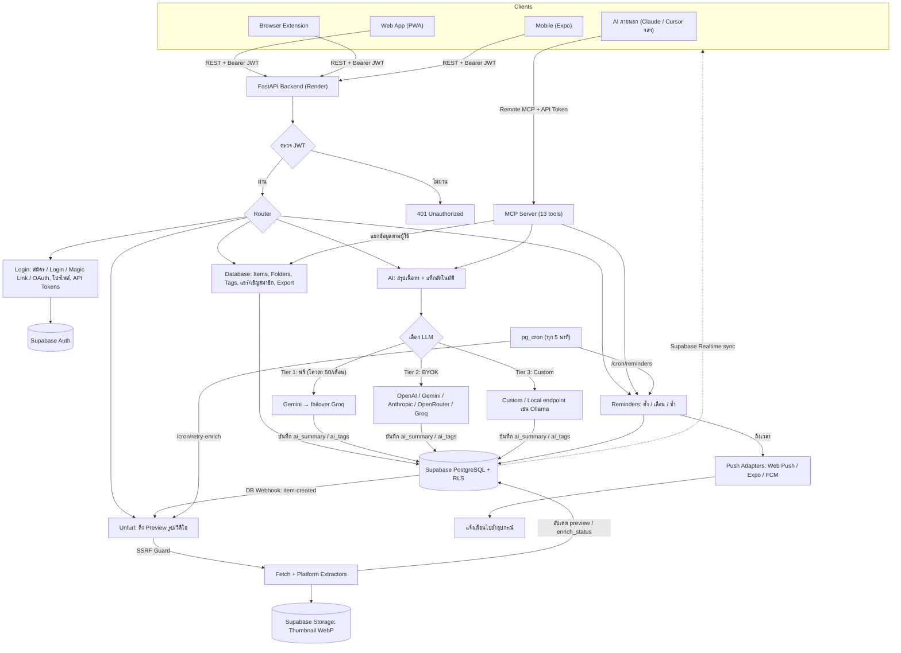

# Flowchart โครงสร้างระบบ Backend (ภาพรวม)

## หลักการทำงานโดยสรุป
1. **Client** (Web, Extension, Mobile) เรียก REST API พร้อม JWT จาก Supabase Auth ส่วน **AI ภายนอก** เชื่อมผ่าน Remote MCP ด้วย API Token
2. **FastAPI** ตรวจตัวตน แล้วส่งไปยังโมดูล Login, Database, Unfurl, AI, Reminders
3. ข้อมูลทั้งหมดเก็บใน **Supabase PostgreSQL** (มี RLS) รูป thumbnail เก็บใน Supabase Storage
4. บันทึกลิงก์ใหม่ → DB Webhook เรียก **Unfurl** ดึง preview (ผ่าน SSRF Guard) → เก็บ WebP → อัปเดต item หากล้มเหลว `/cron/retry-enrich` จะลองใหม่
5. **AI** สรุปเนื้อหาและสร้างแท็ก โดยเลือก 3 ระดับ: ฟรีในตัว (Gemini → Groq), BYOK, Custom endpoint
6. **Reminders** ใช้ pg_cron ตรวจทุก 5 นาที แล้วส่ง Push (Web Push / Expo / FCM) ร่วมกับ local notification
7. **Supabase Realtime** sync ข้อมูลข้ามอุปกรณ์
