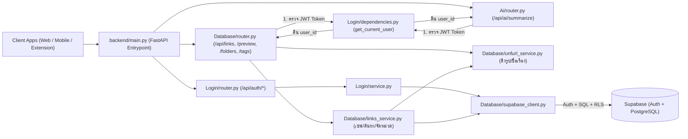
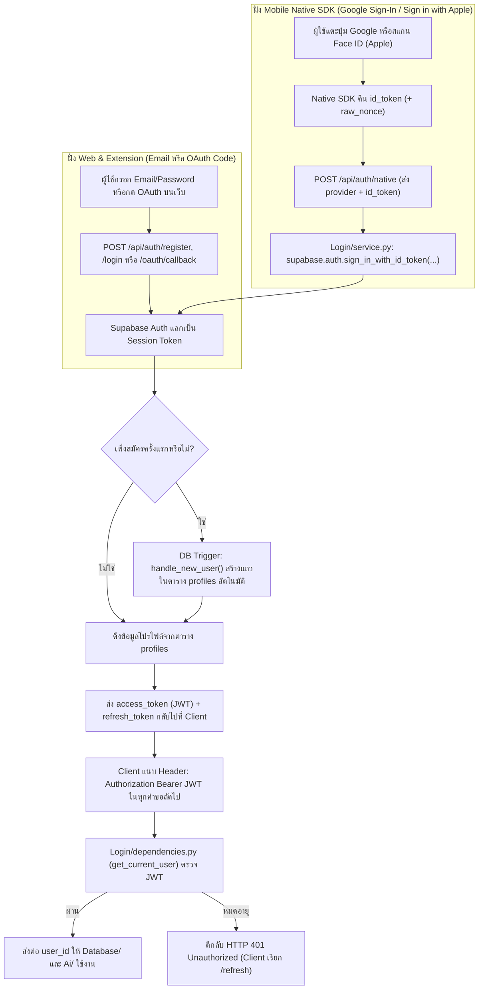
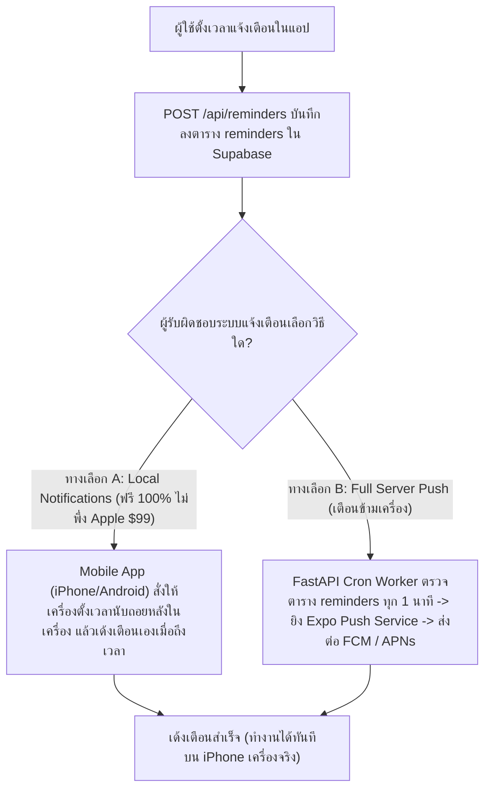

<!-- NOUS-SPEC: domain=auth-db-links-module | purpose=implementation-plan | stack=fastapi-supabase-postgres-httpx-selectolax | target=backend/Login+backend/Database -->
# แผนงานละเอียดพาร์ท Login, Database และการเซฟลิงก์/แสดงรายการ (`backend/Login/` & `backend/Database/`)

> **เจ้าของพาร์ท:** ทีม Backend (Login & Database) — โฟลเดอร์ `backend/Login/` และ `backend/Database/`
> **อ้างอิงสเปกหลัก:** [PRODUCT_SPEC.md](./PRODUCT_SPEC.md) และ [TECH_STACK.md](./TECH_STACK.md)
> **การทำงานร่วมกับทีม AI:** ใช้ Supabase Schema เดียวกัน และแชร์ `get_current_user` JWT Dependency ให้ `backend/Ai/router.py` เรียกใช้ได้ทันที (ดู [AI_IMPLEMENTATION_PLAN.md](./AI_IMPLEMENTATION_PLAN.md))

---

## 1. ภาพรวมหน้าที่และความรับผิดชอบ (Scope of Work)

พาร์ทนี้รับผิดชอบโครงสร้างพื้นฐานหลังบ้านทั้งหมดของแอป **Just-Save-It** โดยอัปเดตสอดคล้องกับข้อสรุปสถาปัตยกรรมล่าสุด:
1. **Database & Schema (`backend/Database/schema.sql`):**
   - ออกแบบและสร้างตารางบน Supabase PostgreSQL พร้อม Trigger สร้าง Profile อัตโนมัติ
   - รองรับ Full-Text Search + Trigram (`pg_trgm`) สำหรับค้นหาภาษาไทย
   - Row Level Security (RLS) แยกสิทธิ์ข้อมูลส่วนตัวและ Shared Folder
   - มีตาราง `reminders` และ `devices` พร้อมรองรับระบบแจ้งเตือนทุกรูปแบบ
2. **Authentication & API Tokens (`backend/Login/` — สเปก 2B ครบวงจร):**
   - **Email/Password:** สมัครสมาชิก, ล็อกอิน, ต่ออายุ JWT Token, รีเซ็ตรหัสผ่าน
   - **Web OAuth:** Google & Apple Redirect Flow สำหรับ Web และ Browser Extension
   - **Mobile Native Auth (`POST /api/auth/native`):** รองรับ Google Sign-In และ **Sign in with Apple (Face ID / Touch ID)** ผ่าน Native SDK โดยรับ `id_token` มาแลกรับ Session กับ Supabase
   - **Security Middleware:** `get_current_user` สำหรับตรวจ Supabase JWT ใช้ร่วมกันทั้ง `Database/` และ `Ai/`
   - **MCP API Tokens:** ระบบสร้าง/เพิกถอน Personal Access Token (`jsi_live_xxx` เก็บแบบ SHA-256)
3. **Link Saving (1B: In-App Share Sheet), Unfurling & Listing (`backend/Database/`):**
   - **In-App Mobile Share Sheet Ingestion (1B):** ระบบรับลิงก์ที่ถูกแชร์มาจาก TikTok, YouTube, IG, Safari หรือเบราว์เซอร์ โดยมีตัวแกะ URL อัตโนมัติ (Extract URL from shared text)
   - **เซฟลิงก์ (`POST /api/links`):** บันทึกลิงก์แบบรวดเร็ว (Optimistic Save) เช็กลิงก์ซ้ำด้วย `url_hash`, ดึงรูปปก/ชื่อเรื่อง/คำโปรยอัตโนมัติ (Unfurl ด้วย oEmbed + OpenGraph ไม่เสียโควต้า AI), จัดลงโฟลเดอร์ และผูกแท็ก
   - **แสดงรายการ (`GET /api/links`):** กรองตามโฟลเดอร์, สถานะ (`inbox`, `todo`, `done`, `archived`), แท็ก และค้นหา Substring ภาษาไทย/อังกฤษ พร้อมแบ่งหน้า (Pagination)
   - **จัดการข้อมูลประกอบ:** แก้ไข/ลบ/เปลี่ยนสถานะลิงก์, จัดการ Folders (พร้อมสร้างลิงก์เชิญเพื่อน Shared Folder) และ Tags
4. **Reminders & Notifications (ระบบแจ้งเตือน — รอผู้รับผิดชอบเลือกช่องทางส่ง):**
   - Backend เตรียมตาราง `reminders`, `devices` และ API จัดการเวลาเตือน (`/api/reminders`) ไว้ให้พร้อมใช้งาน
   - ช่องทางการส่งแจ้งเตือนจริง (Local Notification ในเครื่อง หรือ Server Push ผ่าน APNs/Expo Push) เปิดเป็น Open Decision ให้ผู้รับผิดชอบเลือกตามความพร้อมของบัญชี Apple Developer

---

## 2. ลำดับขั้นตอนการทำงานและความเกี่ยวข้องกัน (System Flowcharts)

เพื่อให้เห็นภาพรวมว่าแต่ละไฟล์และแต่ละโมดูลเชื่อมโยงกันอย่างไร สามารถดูตามแผนภาพ 3 ส่วนด้านล่างนี้ครับ

### 2.1 ภาพรวมความเกี่ยวข้องของทุกโมดูลใน Backend
ทุกคำขอจากหน้าบ้าน (Web / Mobile / Extension) จะวิ่งผ่าน `main.py` แล้วแยกไปตาม Router โดยใช้ `get_current_user` จาก `Login/` เป็นประตูตรวจสิทธิ์ก่อนเข้าถึง `Database/` และ `Ai/`



### 2.2 ลำดับขั้นตอนระบบสมาชิกและยืนยันตัวตน (สเปก 2B: Web + Native SDK)


### 2.3 ลำดับขั้นตอนการเซฟลิงก์ (1B: Mobile Share Sheet & Web) และแสดงรายการ

```mermaid
flowchart TD
    subgraph SaveFlow["ขาเซฟลิงก์ (POST /api/links) — รองรับ 1B In-App Share Sheet"]
        S1["แชร์จาก TikTok / IG / YouTube / Safari หรือวางบน Web"] --> S2["extract_and_normalize_url: ดึง URL ออกจากข้อความแชร์ + ตัด Tracking (utm, fbclid)"]
        S2 --> S3{"เช็กใน DB: มี (owner_id, url_hash) แล้วหรือยัง?"}
        S3 -->|"มีแล้ว (เซฟซ้ำ)"| S4["อัปเดต saved_at = now() ดึงลิงก์เดิมขึ้นมาบนสุด (ไม่สร้างซ้ำ)"]
        S3 -->|"ยังไม่มี"| S5["unfurl_service: ตรวจ SSRF Guard (บล็อก Private IP)"]
        S5 --> S6["ดึงพรีวิว: oEmbed (YouTube/TikTok/X) -> OpenGraph -> Fallback ชื่อเว็บ"]
        S6 --> S7["บันทึกลงตาราง items + สร้าง/ผูกแท็กใน tags & item_tags"]
        S4 --> S8["ส่ง LinkItemResponse กลับหน้าจอทันที (< 1 วินาที)"]
        S7 --> S8
    end

    subgraph ListFlow["ขาแสดงรายการ (GET /api/links)"]
        L1["รับ Query: folder_id, status, tag, q (คำค้น), limit, offset"] --> L2["ตรวจสิทธิ์: owner_id = user_id หรืออยู่ใน Shared Folder"]
        L2 --> L3["กรองตาม Folder / Status (inbox, todo, done, archived) / Tag"]
        L3 --> L4["ถ้ามีคำค้น q: ค้นหาแบบ Substring ไทย/อังกฤษ ด้วย pg_trgm + ILIKE"]
        L4 --> L5["เรียงตาม saved_at ล่าสุด + แบ่งหน้า (Pagination)"]
        L5 --> L6["ส่ง LinkListResponse (items + total + has_more) กลับหน้าบ้าน"]
    end
```


### 2.4 ทางเลือกสถาปัตยกรรมระบบแจ้งเตือน (Reminders Architecture — รอผู้รับผิดชอบเลือก)


---

## 3. โครงสร้างไฟล์ทั้งหมดใน `backend/`

```text
backend/
├── main.py                          # FastAPI Entrypoint (CORS, Healthcheck, รวม Router จาก Login/, Database/, Ai/)
├── requirements.txt                 # ไลบรารีทั้งหมดของระบบ
├── .env.example                     # ตัวแปรแวดล้อม (SUPABASE_URL, SUPABASE_ANON_KEY, SUPABASE_SERVICE_ROLE_KEY, ...)
│
├── Login/                           # [ส่วนระบบสมาชิก & JWT]
│   ├── __init__.py
│   ├── schemas.py                   # [Step 1] Pydantic v2 Models (Register, Login, Token, UserProfile, PAT)
│   ├── dependencies.py              # [Step 2] FastAPI Dependency ตรวจ Supabase JWT (get_current_user)
│   ├── service.py                   # [Step 3] Logic คุยกับ Supabase Auth + สร้าง/เพิกถอน API Token (SHA-256)
│   └── router.py                    # [Step 4] Endpoints: /api/auth/*
│
├── Database/                        # [ส่วนฐานข้อมูล, Unfurl, เซฟลิงก์ และแสดงรายการ]
│   ├── __init__.py
│   ├── schema.sql                   # [Step 0] SQL Migration ตัวเต็มสำหรับรันบน Supabase SQL Editor
│   ├── supabase_client.py           # [Step 5] ตัวเชื่อมต่อ Supabase (Service Role & User JWT Client)
│   ├── schemas.py                   # [Step 6] Pydantic v2 Models (Link, Preview, Filter, Folder, Tag)
│   ├── unfurl_service.py            # [Step 7] ระบบดึงพรีวิว oEmbed + OpenGraph + SSRF Guard + URL Normalizer
│   ├── links_service.py             # [Step 8] Business Logic เซฟลิงก์ (กันซ้ำ), แสดงรายการ/ค้นหา, Folder, Tag
│   └── router.py                    # [Step 9] Endpoints: /api/preview, /api/links/*, /api/folders/*, /api/tags/*
│
└── tests/
    └── test_login_and_links.py      # [Step 10] Unit Tests (pytest) จำลอง Supabase เพื่อทดสอบ Auth + Save + List
```

---

## 4. รายละเอียดแต่ละโมดูล (Detailed Module Specification)

### Step 0: `Database/schema.sql` (โครงสร้างฐานข้อมูล Supabase PostgreSQL)

ไฟล์ SQL สำหรับสร้างโครงสร้างฐานข้อมูลทั้งหมดใน Supabase ตาม [PRODUCT_SPEC.md §7](./PRODUCT_SPEC.md#L212-L366) และรองรับส่วน AI ใน [AI_IMPLEMENTATION_PLAN.md](./AI_IMPLEMENTATION_PLAN.md):

1. **Extensions:**
   - `pg_trgm` (สำคัญ: ใช้ทำ Index `gin_trgm_ops` เพื่อให้ค้นหาภาษาไทยแบบ substring ได้แม่นยำ)
   - `vector` (เตรียมไว้สำหรับ Semantic Search ด้วย `pgvector`)
2. **Enums:**
   - `item_status`: `'inbox' | 'todo' | 'done' | 'archived'`
   - `enrich_status`: `'pending' | 'unfurled' | 'done' | 'failed'`
   - `folder_role`: `'owner' | 'editor' | 'viewer'`
3. **Tables (11 ตารางหลัก):**
   - `public.profiles` — ผูก `id` กับ `auth.users(id)` (`display_name`, `avatar_url`, `tier`, `locale`, `timezone`)
   - `public.folders` — โฟลเดอร์จัดหมวดหมู่ (`owner_id`, `name`, `emoji`, `is_shared`)
   - `public.folder_members` — สมาชิกใน Shared Folder (`folder_id`, `user_id`, `role`)
   - `public.folder_invites` — ลิงก์เชิญเข้า Shared Folder (`token`, `folder_id`, `role`, `expires_at`)
   - `public.items` — ตารางเก็บลิงก์ทั้งหมด (`url`, `url_hash` แบบ generated `md5(lower(url))`, `title`, `description`, `image_url`, `site_name`, `favicon_url`, `content_type`, `platform`, `note`, `ai_summary`, `ai_tags`, `status`, `enrich_status`, `search_tsv` แบบ generated `tsvector`, และ `UNIQUE (owner_id, url_hash)`)
   - `public.tags` & `public.item_tags` — ระบบแท็กแบบ N:M
   - `public.reminders` — ตั้งเวลาแจ้งเตือน (`item_id`, `user_id`, `remind_at`, `sent_at`)
   - `public.devices` — เก็บ Push Token ของ Android/iOS/Web/Extension
   - `public.api_tokens` — เก็บ SHA-256 Hash ของ Personal Access Token (`jsi_live_xxx`) สำหรับ MCP
   - `public.daily_ai_usage` — นับโควต้าการกดสรุป AI รายเดือน/รายวันของผู้ใช้ (เชื่อมกับฝั่ง `Ai/`)
4. **Database Trigger & Functions (เพิ่มจาก Spec พื้นฐานเพื่อให้ระบบ Auth สมบูรณ์):**
   - `handle_new_user()` Trigger บน `auth.users` AFTER INSERT: สร้างแถวใน `public.profiles` ให้อัตโนมัติทุกครั้งที่ผู้ใช้สมัครผ่าน Email หรือ Google/Apple
   - `can_access_folder(fid uuid, min_role folder_role)` (`SECURITY DEFINER`): Helper ป้องกัน Infinite Recursion ใน RLS
   - `accept_invite(invite_token text)` (`SECURITY DEFINER`): RPC สำหรับกดรับคำเชิญเข้า Shared Folder
5. **Row Level Security (RLS):**
   - เปิด `ENABLE ROW LEVEL SECURITY` ทุกตาราง
   - กำหนด Policy ให้เข้าถึงได้เฉพาะเจ้าของ (`owner_id = auth.uid()`) หรือสมาชิกใน Shared Folder ตามสิทธิ์ `viewer`/`editor`

---

### ส่วนที่ 1: ระบบยืนยันตัวตน (`backend/Login/`)

#### Step 1: `Login/schemas.py`
กำหนด Pydantic v2 Models สำหรับ Request/Response (ครอบคลุมสเปก 2B):
- `RegisterRequest`: `email: EmailStr`, `password: str (min_length=8)`, `display_name: str | None = None`
- `LoginRequest`: `email: EmailStr`, `password: str`
- `RefreshTokenRequest`: `refresh_token: str`
- `OAuthCallbackRequest`: `code: str` (สำหรับแลก Session จาก OAuth PKCE flow บน Web)
- `NativeAuthRequest` *(สเปก 2B สำหรับ Mobile Google/Apple Native SDK)*:
  - `provider: Literal["google", "apple"]`
  - `id_token: str` (ได้จาก Google Sign-In SDK หรือ `expo-apple-authentication`)
  - `raw_nonce: str | None = None` (จำเป็นสำหรับการตรวจสอบ Apple Sign-In เพื่อความปลอดภัย)
  - `full_name: str | None = None` (ชื่อที่ Apple ส่งมาให้เฉพาะการล็อกอินครั้งแรก)
- `AuthTokenResponse`: `access_token: str`, `refresh_token: str`, `token_type: str = "bearer"`, `expires_in: int`, `user: UserProfileResponse`
- `UserProfileResponse`: `id: str`, `email: str`, `display_name: str | None`, `avatar_url: str | None`, `tier: Literal["free", "pro"]`, `locale: str`, `timezone: str`
- `UpdateProfileRequest`: `display_name: str | None = None`, `avatar_url: str | None = None`, `locale: str | None = None`, `timezone: str | None = None`
- `CreateApiTokenRequest`: `name: str (min_length=1, max_length=50)`
- `CreateApiTokenResponse`: `id: str`, `name: str`, `token: str` *(แสดง Plaintext `jsi_live_...` ครั้งเดียวตอนสร้าง)*, `token_prefix: str`, `created_at: datetime`
- `ApiTokenSummary`: `id: str`, `name: str`, `token_prefix: str`, `last_used_at: datetime | None`, `created_at: datetime`

#### Step 2: `Login/dependencies.py`
ตัวกลางตรวจสอบตัวตนที่ใช้ร่วมกันทั้ง `Login/`, `Database/` และ `Ai/`:
- **`CurrentUser`** (Dataclass / Pydantic Model): `id: str`, `email: str | None`, `access_token: str`
- **`get_current_user(credentials: HTTPAuthorizationCredentials = Depends(HTTPBearer())) -> CurrentUser`:**
  1. ดึง Bearer Token จาก Header `Authorization`
  2. ตรวจสอบความถูกต้องของ JWT Token กับ Supabase Auth (`supabase.auth.get_user(token)` หรือ Local JWT Verify ด้วย `SUPABASE_JWT_SECRET` เพื่อความเร็วและลด Network Call)
  3. หาก Token หมดอายุหรือไม่ถูกต้อง → คืน `HTTP 401 Unauthorized`
  4. หากผ่าน → คืน `CurrentUser(id=user.id, email=user.email, access_token=token)`

#### Step 3: `Login/service.py`
Business Logic เชื่อมต่อ Supabase Auth และ `profiles` / `api_tokens`:
- `register_user(req: RegisterRequest)`: เรียก `supabase.auth.sign_up(...)` พร้อมแนบ `display_name` ใน `options.data`
- `login_user(req: LoginRequest)`: เรียก `supabase.auth.sign_in_with_password(...)` แล้วดึงข้อมูลจาก `public.profiles` มาประกอบเป็น `AuthTokenResponse`
- `login_with_native_id_token(req: NativeAuthRequest)` *(สเปก 2B)*:
  - เรียก `supabase.auth.sign_in_with_id_token({"provider": req.provider, "token": req.id_token, "nonce": req.raw_nonce})`
  - หากเป็นผู้ใช้ใหม่และมี `req.full_name` แนบมา ให้บันทึกอัปเดตลงตาราง `profiles` ทันที
  - คืนค่า `AuthTokenResponse` ให้แอป Mobile นำไปใช้งานได้ทันทีโดยไม่ต้องเปิด Web View
- `get_oauth_url(provider: Literal["google", "apple"], redirect_to: str)`: สร้าง URL สำหรับ Redirect ไปล็อกอิน Google/Apple ผ่าน Supabase
- `exchange_oauth_code(code: str)`: แลก Authorization Code เป็น Session (`access_token` + `refresh_token`)
- `refresh_session(refresh_token: str)`: ต่ออายุ Token ด้วย `supabase.auth.refresh_session(...)`
- `get_profile(user_id: str)` & `update_profile(user_id: str, req: UpdateProfileRequest)`
- `create_api_token(user_id: str, name: str)`:
  - สุ่ม Secret 32 bytes สร้างเป็น `"jsi_live_" + secrets.token_urlsafe(24)`
  - เก็บ `token_prefix` (เช่น `jsi_live_abcd...`) และ `token_hash = hashlib.sha256(token.encode()).hexdigest()` ลงตาราง `api_tokens` (ไม่เก็บ Plaintext ลง DB)
- `list_api_tokens(user_id: str)` & `revoke_api_token(user_id: str, token_id: str)`

#### Step 4: `Login/router.py`
FastAPI Router (`prefix="/api/auth"`, `tags=["Authentication"]`):
| Method | Endpoint | หน้าที่ | Auth |
| :--- | :--- | :--- | :---: |
| `POST` | `/api/auth/register` | สมัครสมาชิกด้วย Email/Password | ❌ |
| `POST` | `/api/auth/login` | เข้าสู่ระบบด้วย Email/Password รับ JWT | ❌ |
| `POST` | `/api/auth/native` | **เข้าสู่ระบบ Native SDK (Google / Face ID Apple) ด้วย `id_token`** | ❌ |
| `GET` | `/api/auth/oauth/{provider}` | ขอ OAuth Login URL (Google / Apple) บน Web | ❌ |
| `POST` | `/api/auth/oauth/callback` | แลก OAuth Code เป็น Session | ❌ |
| `POST` | `/api/auth/refresh` | ต่ออายุ Access Token | ❌ |
| `POST` | `/api/auth/logout` | ออกจากระบบ (Revoke Session) | ✅ |
| `GET` | `/api/auth/me` | ดึงข้อมูลโปรไฟล์ผู้ใช้ปัจจุบัน | ✅ |
| `PATCH` | `/api/auth/me` | แก้ไขโปรไฟล์ (ชื่อ, ภาษา, Timezone) | ✅ |
| `GET` | `/api/auth/tokens` | ดูรายการ MCP Personal Access Tokens | ✅ |
| `POST` | `/api/auth/tokens` | สร้าง MCP Token ใหม่ (`jsi_live_...`) | ✅ |
| `DELETE` | `/api/auth/tokens/{token_id}` | ยกเลิก MCP Token | ✅ |

---

### ส่วนที่ 2: ระบบฐานข้อมูล การเซฟลิงก์ และแสดงรายการ (`backend/Database/`)

#### Step 5: `Database/supabase_client.py`
ตัวจัดการ Connection ไปยัง Supabase:
- `get_supabase_anon_client() -> Client`: ใช้ `SUPABASE_URL` + `SUPABASE_ANON_KEY` (สำหรับ Auth flow)
- `get_supabase_service_client() -> Client`: ใช้ `SUPABASE_URL` + `SUPABASE_SERVICE_ROLE_KEY` (สำหรับ Backend query ที่ตรวจสิทธิ์ `user_id` แล้ว หรือดึงข้อมูลข้ามตารางอย่างปลอดภัย)
- `get_user_scoped_client(access_token: str) -> Client`: สร้าง Client ที่แนบ `Authorization: Bearer <access_token>` เพื่อให้ PostgreSQL บังคับใช้ **RLS Policies** อัตโนมัติ

#### Step 6: `Database/schemas.py`
Pydantic v2 Models สำหรับ Link, Preview, Folder, Tag และ Reminder:
- **Preview:**
  - `PreviewRequest`: `url: str`
  - `PreviewResponse`: `url: str`, `normalized_url: str`, `title: str | None`, `description: str | None`, `image_url: str | None`, `site_name: str | None`, `favicon_url: str | None`, `content_type: Literal["video", "article", "post", "link"]`, `platform: str | None`
- **Links / Items (รองรับ 1B In-App Share Sheet):**
  - `CreateLinkRequest`:
    - `url_or_text: str` *(รับได้ทั้ง URL เพียวๆ หรือข้อความที่แชร์มาจาก Mobile Share Sheet เช่น `"ดูคลิปนี้ https://vt.tiktok.com/..."` โดยระบบจะดึง URL ออกมาให้อัตโนมัติ)*
    - `title: str | None = None`
    - `description: str | None = None`
    - `image_url: str | None = None`
    - `note: str | None = None`
    - `folder_id: str | None = None`
    - `tags: list[str] = []`
    - `status: Literal["inbox", "todo", "done", "archived"] = "inbox"`
    - `auto_unfurl: bool = True`
  - `UpdateLinkRequest`: `title: str | None = None`, `note: str | None = None`, `folder_id: str | None = None`, `status: Literal["inbox", "todo", "done", "archived"] | None = None`, `tags: list[str] | None = None`
  - `LinkItemResponse`: `id: str`, `url: str`, `title: str | None`, `description: str | None`, `image_url: str | None`, `site_name: str | None`, `favicon_url: str | None`, `content_type: str | None`, `platform: str | None`, `note: str | None`, `ai_summary: str | None`, `ai_tags: list[str] | None`, `tags: list[TagResponse]`, `folder_id: str | None`, `status: str`, `enrich_status: str`, `saved_at: datetime`, `done_at: datetime | None`
  - `LinkListResponse`: `items: list[LinkItemResponse]`, `total: int`, `limit: int`, `offset: int`, `has_more: bool`
- **Folders & Tags:**
  - `FolderCreateRequest` / `FolderUpdateRequest` / `FolderResponse` (รวม `item_count`, `is_shared`, `role`)
  - `FolderInviteRequest` (`role: Literal["viewer", "editor"] = "editor"`, `expires_in_days: int = 7`) / `FolderInviteResponse` (`token`, `invite_url`, `expires_at`)
  - `TagCreateRequest` / `TagResponse` (`id`, `name`, `color`, `item_count`)
- **Reminders (การแจ้งเตือน):**
  - `CreateReminderRequest`: `item_id: str`, `remind_at: datetime`
  - `ReminderResponse`: `id: str`, `item_id: str`, `user_id: str`, `remind_at: datetime`, `sent_at: datetime | None`, `item_title: str | None = None`

#### Step 7: `Database/unfurl_service.py` (ระบบดึงพรีวิวอัตโนมัติ — ไม่ใช้ AI)
1. **`extract_and_normalize_url(raw_text: str) -> tuple[str, str]` (สำหรับ 1B Share Sheet):**
   - ใช้ Regex ตรวจหาลิงก์ `https?://[^\s]+` จากข้อความแชร์ของ TikTok / IG / YouTube
   - ตัด Tracking Parameters ที่ไม่จำเป็นออก (`utm_source`, `utm_medium`, `utm_campaign`, `fbclid`, `igshid`, `si`)
   - คืนค่า `(normalized_url, url_hash)` โดยคำนวณ `md5(normalized_url.lower())` เพื่อใช้เช็กลิงก์ซ้ำ (Idempotent)
2. **`validate_safe_url(url: str)` (SSRF Guard):**
   - อนุญาตเฉพาะ `http` และ `https`
   - Resolve DNS ของ Hostname และบล็อก Private/Loopback/Link-Local IPs (`127.0.0.0/8`, `10.0.0.0/8`, `172.16.0.0/12`, `192.168.0.0/16`, `169.254.0.0/16`, `::1`)
3. **`unfurl_url(url: str) -> PreviewResponse`:**
   - **ตรวจ Platform:** ระบุ `platform` (`youtube`, `tiktok`, `instagram`, `facebook`, `x`, `reddit`, `web`)
   - **ลำดับที่ 1 — Official oEmbed API:** ยิงไปที่ oEmbed endpoint ของ YouTube, TikTok (`tiktok.com/oembed`), X (`publish.twitter.com/oembed`), Reddit, Vimeo
   - **ลำดับที่ 2 — HTML OpenGraph / Twitter Card (`httpx` + `selectolax`):**
     - Timeout 8 วินาที, จำกัดขนาด Response สูงสุด 3 MB, ใช้ User-Agent มาตรฐาน
     - ดึง `og:title` / `<title>`, `og:description` / `meta[name=description]`, `og:image` / `twitter:image`, `og:site_name`, `link[rel=icon]`
   - **ลำดับที่ 3 — Graceful Fallback:** หากเว็บปลายทางบล็อกการดึงข้อมูล (เช่น 403/Timeout) ให้คืนค่า `title = hostname`, `enrich_status = 'failed'` โดย **ไม่ทำให้การเซฟลิงก์ล้มเหลว**

#### Step 8: `Database/links_service.py` (Logic เซฟลิงก์, แสดงรายการ, Folder, Tag และ Reminder)
1. **`save_link(user_id: str, req: CreateLinkRequest) -> LinkItemResponse`:**
   - เรียก `extract_and_normalize_url(req.url_or_text)`
   - **Idempotent Check:** เช็กในตาราง `items` ว่ามี `(owner_id=user_id, url_hash)` อยู่แล้วหรือไม่:
     - *ถ้ามีแล้ว:* อัปเดต `saved_at = now()` (ดึงลิงก์เดิมขึ้นมาบนสุด) + อัปเดต `note`/`folder_id` หากผู้ใช้ส่งมาใหม่ แล้วคืนค่าเดิม (ไม่สร้างแถวซ้ำ)
     - *ถ้ายังไม่มี:* ถ้า `req.auto_unfurl` เป็น `True` และไม่ได้ส่ง `title`/`image_url` มา ให้เรียก `unfurl_url()` ดึงข้อมูลพรีวิว
   - **Insert Item:** บันทึกลงตาราง `items` (`enrich_status = 'unfurled'` หรือ `'failed'`)
   - **Sync Tags:** หากมี `req.tags` ส่งมา ให้สร้าง/ดึง Tag จากตาราง `tags` (แบบ Upsert ต่อ `owner_id`) แล้วผูกในตาราง `item_tags`
2. **`list_links(user_id: str, folder_id, status, tag, q, sort_by, limit, offset) -> LinkListResponse`:**
   - **สิทธิ์การเข้าถึง:** ดึงรายการที่ `owner_id == user_id` **หรือ** อยู่ใน `folder_id` ที่ผู้ใช้เป็นสมาชิกใน `folder_members`
   - **Filter:**
     - `folder_id="inbox"` → กรอง `folder_id IS NULL`
     - `folder_id=<uuid>` → กรองตามโฟลเดอร์นั้น
     - `status` → กรอง `'inbox' | 'todo' | 'done' | 'archived'`
     - `tag` → Join กับ `item_tags` + `tags` เพื่อกรองชื่อแท็ก
   - **Search (`q`):** ค้นหาแบบ Substring (`ILIKE '%q%'` บน `title`, `description`, `note`, `ai_summary`, `url` ซึ่งรองรับ Index `pg_trgm` สำหรับภาษาไทยที่ไม่มีเว้นวรรค)
   - **Pagination & Ordering:** `saved_at DESC` (ค่าเริ่มต้น) พร้อมคืน `total` และ `has_more`
3. **`get_link_detail` / `update_link` / `delete_link`:**
   - เช็กสิทธิ์เจ้าของหรือ Editor ใน Shared Folder ก่อนแก้ไข
   - หากเปลี่ยน `status` เป็น `'done'` ให้บันทึก `done_at = now()` อัตโนมัติ
4. **Folder & Share Management:**
   - `list_folders`, `create_folder`, `update_folder`, `delete_folder`
   - `create_folder_invite` (สร้าง Token หมดอายุ 7 วัน) และ `accept_folder_invite`
5. **Tag Management:**
   - `list_tags` (พร้อมนับจำนวนลิงก์), `create_tag`, `delete_tag`
6. **Reminders Management:**
   - `create_reminder(user_id, req: CreateReminderRequest)`: บันทึกเวลาเตือนลงตาราง `reminders`
   - `list_reminders(user_id)`: ดึงรายการเตือนทั้งหมดที่ยังไม่ถึงเวลาส่ง
   - `delete_reminder(user_id, reminder_id)`: ยกเลิกการเตือน

#### Step 9: `Database/router.py`
FastAPI Router สำหรับจัดการลิงก์, พรีวิว, โฟลเดอร์, แท็ก และแจ้งเตือน (ทุก Endpoint ต้องผ่าน `Depends(get_current_user)`):
| หมวด | Method | Endpoint | หน้าที่ |
| :--- | :--- | :--- | :--- |
| **Preview** | `POST` | `/api/preview` | พรีวิวรูปปก/ชื่อเรื่องจาก URL ก่อนกดเซฟ |
| **Links** | `GET` | `/api/links` | **แสดงรายการลิงก์** (รองรับ `?folder_id=&status=&tag=&q=&limit=20&offset=0`) |
| | `POST` | `/api/links` | **เซฟลิงก์ใหม่ (รองรับ 1B Share Sheet)** (กันซ้ำ + Unfurl อัตโนมัติ + ผูก Folder/Tags) |
| | `GET` | `/api/links/{item_id}` | ดูรายละเอียดลิงก์รายตัว (รวมโน้ต, แท็ก, บทสรุป AI) |
| | `PATCH` | `/api/links/{item_id}` | แก้ไขชื่อ, โน้ต, ย้ายโฟลเดอร์, เปลี่ยนสถานะ (`done`/`todo`/`archived`), แก้แท็ก |
| | `DELETE` | `/api/links/{item_id}` | ลบลิงก์ |
| **Folders** | `GET` | `/api/folders` | ดึงโฟลเดอร์ทั้งหมด (ส่วนตัว + ที่ถูกแชร์มา) |
| | `POST` | `/api/folders` | สร้างโฟลเดอร์ใหม่ |
| | `PATCH` | `/api/folders/{folder_id}` | แก้ชื่อ / Emoji โฟลเดอร์ |
| | `DELETE` | `/api/folders/{folder_id}` | ลบโฟลเดอร์ (ลิงก์ข้างในจะกลับไปที่ Inbox) |
| | `POST` | `/api/folders/{folder_id}/invites` | สร้างลิงก์แชร์โฟลเดอร์ให้เพื่อน |
| | `POST` | `/api/folders/invites/{token}/accept` | กดรับคำเชิญเข้า Shared Folder |
| **Tags** | `GET` | `/api/tags` | ดึงแท็กทั้งหมดของผู้ใช้ |
| | `POST` | `/api/tags` | สร้างแท็กใหม่ |
| | `DELETE` | `/api/tags/{tag_id}` | ลบแท็ก |
| **Reminders** | `GET` | `/api/reminders` | ดึงรายการแจ้งเตือนทั้งหมดของผู้ใช้ |
| | `POST` | `/api/reminders` | ตั้งเวลาแจ้งเตือนลิงก์ |
| | `DELETE` | `/api/reminders/{reminder_id}` | ยกเลิกเวลาแจ้งเตือน |

---

### 4.3 ข้อสังเกตและทางเลือกสำหรับระบบแจ้งเตือน (Reminders & Delivery Mechanism — ข้อ 3)

> 📌 **สถานะ: Open Decision (รอผู้รับผิดชอบระบบแจ้งเตือนตัดสินใจ)**
> ในระดับ Backend Schema (ตาราง `reminders`, `devices`) และ REST API (`/api/reminders`) ถูกสร้างเตรียมไว้สมบูรณ์แล้ว ส่วนช่องทางการส่งจริงไปถึงผู้ใช้ มี 2 แนวทางให้ผู้รับผิดชอบเลือก:

| มิติเปรียบเทียบ | ทางเลือก A: Mobile Local Notifications | ทางเลือก B: Full Server Push Notifications |
| :--- | :--- | :--- |
| **การทำงาน** | เมื่อผู้ใช้ตั้งเตือนผ่าน API แอปมือถือ (iPhone/Android) จะลงทะเบียนเวลาเตือนไว้ในเครื่อง (Local Notifications) แล้วเครื่องจะนับถอยหลังเด้งเตือนเอง | FastAPI มี Cron Worker รันทุก 1 นาที ตรวจสอบตาราง `reminders` แล้วยิงผ่าน Expo Push Service ไปยัง APNs (iOS) / FCM (Android) |
| **ค่าใช้จ่าย Apple Dev ($99)** | **ฟรี 100%** ไม่ต้องใช้ Certificate หรือ Key ใดๆ ของ Apple | **ต้องมีบัญชี Apple $99** เพื่อสร้าง `.p8 Key` เชื่อม APNs สำหรับ iOS Production (แต่ Android ใช้ฟรี 100%) |
| **การเตือนข้ามอุปกรณ์** | เตือนเฉพาะบนเครื่องที่ตั้งเวลา | เตือนข้ามเครื่องได้ (เซฟบนคอม แจ้งเตือนเด้งบนมือถือ) |
| **ความซับซ้อนของโค้ด** | ต่ำ (เขียนโค้ดแค่ฝั่ง Mobile ด้วย `expo-notifications`) | ปานกลาง (ต้องมี Worker ฝั่ง Backend + จัดการ Device Token) |

*(Backend รองรับได้ทั้ง 2 ทางเลือกโดยไม่กระทบโครงสร้างระบบหลัก)*

---

### Step 10: `backend/main.py` & `tests/test_login_and_links.py`
- **`main.py`:**
  - ตั้งค่า `CORSMiddleware` ให้รองรับ Web App (Next.js) และ Browser Extension (`chrome-extension://`)
  - Mount Router จาก `Login.router` (`/api/auth`) และ `Database.router` (`/api/links`, `/api/preview`, `/api/folders`, `/api/tags`, `/api/reminders`)
  - เตรียมจุดเชื่อมต่อ `Ai.router` (`/api/ai`) ให้ทีม AI นำมาเสียบได้ทันที
  - มี `GET /health` สำหรับตรวจสอบสถานะเซิร์ฟเวอร์
- **`tests/test_login_and_links.py`:**
  - ทดสอบ Register / Login / Native Auth (`id_token`) / Token Refresh / `get_current_user` (Mock Supabase Auth)
  - ทดสอบ SSRF Guard (บล็อก `http://127.0.0.1` และ `http://192.168.1.1`)
  - ทดสอบ `extract_and_normalize_url` (ดึง URL จากข้อความแชร์ TikTok/IG และตัด `utm_*`, `fbclid`)
  - ทดสอบ Save Link (เซฟใหม่ + เซฟซ้ำแบบ Idempotent)
  - ทดสอบ List Links (กรองตาม `folder_id`, `status`, `tag`, ค้นหาภาษาไทย `q`)
  - ทดสอบ Reminders CRUD (`create_reminder`, `list_reminders`, `delete_reminder`)

---

## 5. ลำดับการลงมือพัฒนา (Micro-Batch Execution Plan)

สามารถแบ่งทำทีละ Batch เพื่อความชัวร์และทดสอบได้ทันทีในแต่ละขั้น:

| Batch | ไฟล์ที่สร้าง/แก้ไข | เป้าหมาย & การตรวจสอบ |
| :---: | :--- | :--- |
| **Batch 1** | `backend/requirements.txt`, `backend/.env.example`, `backend/Database/schema.sql` | เตรียม Dependencies และรัน SQL สร้างตาราง + RLS บน Supabase ให้เรียบร้อย |
| **Batch 2** | `backend/Login/schemas.py`, `backend/Login/dependencies.py` | โครงสร้างข้อมูล Auth (รองรับ Native `id_token`) และ Middleware `get_current_user` ตรวจ JWT |
| **Batch 3** | `backend/Login/service.py`, `backend/Login/router.py` | ระบบ Register, Login, Native Google/Apple Auth (`POST /api/auth/native`), Profile, และสร้าง MCP Token |
| **Batch 4** | `backend/Database/supabase_client.py`, `backend/Database/schemas.py` | ตัวเชื่อม Supabase และ Model สำหรับ Link/Folder/Tag/Reminder |
| **Batch 5** | `backend/Database/unfurl_service.py` | ดึง URL จากข้อความแชร์ (1B Share Sheet) + ดึงรูปปก/ชื่อเรื่องอัตโนมัติ (oEmbed + OG Tags + SSRF Guard) |
| **Batch 6** | `backend/Database/links_service.py`, `backend/Database/router.py` | ระบบเซฟลิงก์ แสดงรายการ ค้นหา จัดการ Folder/Tag และ CRUD Reminder |
| **Batch 7** | `backend/main.py`, `backend/tests/test_login_and_links.py` | เชื่อมทุก Router เข้า FastAPI และรัน `pytest` ผ่าน 100% |

---

## 6. 📋 บรีฟพร้อมก๊อปปี้ไปสั่งงานต่อ (สำหรับให้ AI หรือเพื่อนร่วมทีมเขียนโค้ดตามแผน)

> 💡 **วิธีใช้:** หากต้องการให้ AI (หรือส่งต่อให้เพื่อนร่วมทีม) ลงมือเขียนโค้ดตามแผนนี้ สามารถก๊อปปี้ข้อความด้านล่างไปวางสั่งงานได้ทันที:

```markdown
ช่วยเขียนโค้ดพาร์ท Login, Database และการเซฟลิงก์/แสดงรายการ ของโปรเจกต์ Just-Save-It ในโฟลเดอร์ `backend/Login/` และ `backend/Database/` ตามแผนที่วางไว้ในไฟล์ `BACKEND_LOGIN_DB_PLAN.md` (และอ้างอิงสเปกตารางใน `PRODUCT_SPEC.md`)

### กฎการทำงาน:
1. อ่านไฟล์ `BACKEND_LOGIN_DB_PLAN.md` ให้ครบก่อนเริ่ม
2. ใช้ FastAPI + Pydantic v2 + `supabase` Python SDK + `httpx` + `selectolax`
3. ข้อกำหนดทางเทคนิคตามสถาปัตยกรรมล่าสุด:
   - **Auth (2B):** รองรับทั้ง Email/Password, Web OAuth, และ **Native Google / Apple Sign-In (`POST /api/auth/native`)** โดยรับ `id_token` แลก Session และมี `Login/dependencies.py` สำหรับ verify JWT ส่ง `CurrentUser` ออกมาให้ทั้งระบบใช้ร่วมกัน
   - **Save Link (1B Share Sheet):** มีฟังก์ชัน `extract_and_normalize_url` ใน `Database/unfurl_service.py` ที่ดึง URL ออกจากข้อความแชร์ของ TikTok / IG / YouTube ได้ พร้อม SSRF Guard บล็อก Private IP
   - **Idempotent & Search:** `Database/links_service.py` ต้องทำ Idempotent Save ด้วย `url_hash` (ถ้าเซฟซ้ำให้อัปเดตเวลาขึ้นบนสุด) และรองรับค้นหาภาษาไทยแบบ Substring (`pg_trgm`) ใน `GET /api/links`
   - **Reminders:** มี Endpoint จัดการเวลาเตือน (`/api/reminders`) รองรับทั้ง Local Notification และ Server Push
4. ลงมือทำทีละ Batch ตามตารางในหัวข้อที่ 5 ของ `BACKEND_LOGIN_DB_PLAN.md` จนครบ Batch 7 และรัน `pytest` ให้ผ่านทั้งหมด
```
