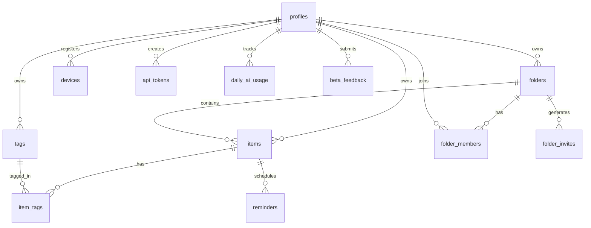

# Just-Save-It — คู่มือสำหรับนักพัฒนา (Developer Onboarding & Handoff Guide)

เอกสารนี้สรุปสถาปัตยกรรม โครงสร้างโค้ด วิธีรันในเครื่อง (ไม่ต้องรอ Frontend หรือ Supabase Cloud) วิธีเชื่อม Supabase จริง + ทดสอบ RLS วิธีใช้งาน Browser Extension และสิ่งที่ควรทำต่อสำหรับนักพัฒนาที่จะเข้ามารับช่วงต่อ

---

## 1. ภาพรวมโปรเจกต์ & สถานะล่าสุด

| ส่วนงาน | ตำแหน่งหลัก | สถานะปัจจุบัน |
| --- | --- | --- |
| **Backend API & MCP Server** | `backend/` (`Login`, `Database`, `Unfurl`, `Reminders`, `Ai`) | พร้อมรันในเครื่องและเทสต์ครบ (`pytest`: 104 passed) มีโหมด `LocalDevDatabase` ใช้แทน Supabase ได้ทันที |
| **Database Schema & Cloud RLS Verification** | `supabase/migrations/0001..0006`, `backend/Database/schema.sql`, `backend/scripts/verify_supabase_live.py` | SQL ทั้ง 12 ตาราง + RLS + Triggers + RPCs + Storage bucket `thumbnails` พร้อมใช้งาน รอแค่ใส่คีย์ใน `backend/.env` เพื่อรันขึ้น Supabase Cloud จริง |
| **Browser Extension (MV3)** | `extension/` | ใช้งานได้ทันทีแบบ Load unpacked (ไม่ต้อง build) ดึง URL/OG/ข้อความที่ไฮไลต์จากแท็บปัจจุบันยิงเข้า Backend โดยตรง |
| **Frontend Web UI / Prototype** | `frontend/` | มี Design Tokens, Screens และ Prototype API client (`frontend/src/services/apiClient.js`) รอเชื่อมต่อกับ Backend Endpoints จริง |

---

## 2. โครงสร้างโฟลเดอร์สำคัญ

```text
Just-Save-It-/
├── backend/
│   ├── main.py                      # Entrypoint ของ FastAPI, โหลด .env, ตั้ง CORS, Mount /mcp และ /local-media
│   ├── requirements.txt             # Python dependencies
│   ├── .env.example                 # ตัวอย่าง Environment variables (คัดลอกเป็น backend/.env เมื่อขึ้น Cloud)
│   ├── Login/
│   │   ├── router.py                # Auth routes (/api/auth/register, /login, /me, /tokens, ฯลฯ)
│   │   ├── service.py               # AuthService (รองรับทั้ง Supabase Auth และ LocalDevDatabase)
│   │   ├── auth_dep.py              # HTTPBearer + verify_supabase_jwt() + get_current_user_id()
│   │   ├── dependencies.py          # get_current_user() / get_optional_current_user() (delegate ไป auth_dep)
│   │   └── schemas.py               # Pydantic models สำหรับ Auth/Profile/API Token
│   ├── Database/
│   │   ├── client.py                # get_supabase_client() / get_db() สลับ Override -> LocalDevDB -> Supabase จริง
│   │   ├── local_db.py              # LocalDevDatabase (JSON-backed PostgREST & Storage emulator สำหรับรันในเครื่อง)
│   │   ├── supabase_client.py       # is_supabase_configured(), anon/service/user-scoped clients
│   │   ├── repository.py            # CRUD Items, Folders, Shared Invites, Tags, Devices, Export, Feedback
│   │   ├── router.py                # Endpoints /api/items, /api/folders, /api/tags, /api/export, ฯลฯ
│   │   ├── schemas.py               # Request/Response schemas
│   │   ├── text_hygiene.py          # Canonicalize URL, ถอดรหัส charset เว็บเก่า, ป้องกัน Mojibake
│   │   └── schema.sql               # สคีมารวมล่าสุด (ซิงก์จาก supabase/migrations/0001..0006)
│   ├── Unfurl/
│   │   ├── router.py                # /api/preview, /api/items/{id}/refresh-preview, /hooks/item-created, /cron/retry-enrich
│   │   ├── service.py               # Cache 7 วัน, oEmbed/OG scraping, enrich_item()
│   │   ├── extractors.py            # ตัวดึงข้อมูลเฉพาะแพลตฟอร์ม (YouTube, TikTok, Reddit, X, IG/FB, Generic)
│   │   ├── security.py              # SSRF guard (บล็อก Private IP / redirect อันตราย) + HTML 3MB cap
│   │   └── webp_storage.py          # ย่อ/แปลงปกเป็น WebP และอัปโหลดเข้า bucket 'thumbnails'
│   ├── Reminders/
│   │   ├── router.py                # /api/reminders*, /api/reminders/local-sync, /cron/reminders
│   │   ├── service.py               # Reminders CRUD, Snooze, ส่ง Push ผ่าน adapters
│   │   ├── unroller.py              # คำนวณรอบวันเวลา (DST/Timezone) และจำกัด slot สำหรับ iOS 64 local notifications
│   │   └── push_adapters.py         # Adapters สำหรับ Expo, FCM HTTP v1, Web Push VAPID
│   ├── Ai/
│   │   ├── router.py                # POST /api/ai/summarize
│   │   ├── summarizer_service.py    # คุม Quota รายเดือน + Cache ตามภาษา + เรียก LLM (Tier 1/2/3)
│   │   ├── llm_client.py            # Built-in Gemini/Groq, BYOK Headers, Custom Base URL
│   │   ├── content_extractor.py     # ดึงข้อความสะอาดสำหรับส่งเข้า LLM
│   │   └── mcp_server.py            # Remote MCP Server (/mcp) ใช้ PAT (jsi_live_xxx)
│   ├── scripts/
│   │   └── verify_supabase_live.py  # สคริปต์ตรวจ 12 ตาราง + Storage + RLS (User A vs User B) บน Supabase Cloud จริง
│   └── tests/                       # Pytest suite (104 tests)
├── extension/                       # Chrome / Edge / Arc Browser Extension (Manifest V3)
│   ├── manifest.json
│   ├── api.js                       # ตัวกลางเรียก API + auto-refresh JWT + storage
│   ├── content_assist.js            # DOM Assist ดึงหัวข้อ/รูป/selection จากหน้าเว็บเมื่อกดใช้งาน
│   ├── background.js                # Context menu + คีย์ลัด Cmd+Shift+S / Alt+Shift+S
│   ├── popup.html / popup.css / popup.js
│   ├── icons/
│   └── README.md
├── supabase/
│   ├── README.md
│   └── migrations/                  # 0001 ถึง 0006 สำหรับ PostgreSQL / Supabase
└── frontend/                        # UI Prototype (HTML/CSS/JS) และ design tokens
```

---

## 3. วิธีรัน Backend ในเครื่องทันที (Zero-Config Local Dev)

ไม่จำเป็นต้องมี `backend/.env` หรือบัญชี Supabase ก็รันเซิร์ฟเวอร์และทดสอบผ่าน Swagger UI ได้ทันที

### ขั้นตอนรันเซิร์ฟเวอร์

จากโฟลเดอร์ root ของโปรเจกต์:

```bash
# (ครั้งแรกถ้ายังไม่มี venv) สร้าง venv และติดตั้ง packages:
# python3 -m venv .venv && .venv/bin/pip install -r backend/requirements.txt

cd backend
../.venv/bin/uvicorn main:app --reload --port 8000
```

* **Swagger UI (Interactive Docs):** `http://localhost:8000/docs`
* **Health Check:** `http://localhost:8000/health` (เมื่อใช้ฐานข้อมูลจำลอง จะคืนค่า `"storage_mode": "local_dev"`)

### ทดสอบยิง API บน Swagger UI (`/docs`)

1. เปิด `POST /api/auth/login` → กด **Try it out** → ใช้บัญชีทดสอบที่ระบบสร้างรอไว้ให้แล้ว:
   ```json
   {
     "email": "may@example.com",
     "password": "password123"
   }
   ```
   *(หรือสมัครผู้ใช้ใหม่ได้ที่ `POST /api/auth/register`)*
2. คัดลอกค่า `access_token` ที่ได้จาก Response
3. กดปุ่ม **Authorize 🔒** มุมขวาบนของหน้า Swagger UI → วาง `access_token` ลงในช่อง `HTTPBearer` (วางเฉพาะตัว JWT ไม่ต้องพิมพ์ `Bearer`) → กด **Authorize**
4. ทดลองยิง Endpoint อื่น ๆ ได้ทันที เช่น `GET /api/folders`, `POST /api/items`, `POST /api/preview`, `GET /api/items`, `PUT /api/reminders/{item_id}`

### กลไกของโหมด Local Dev (`LocalDevDatabase`)

* หาก `is_supabase_configured()` เป็น `False` (`backend/.env` ไม่มีค่าจริงหรือยังใช้ค่า placeholder จาก `.env.example`), `get_supabase_client()` ใน [client.py](file:///Users/chanisaniyom/Desktop/Just-Save-It-/backend/Database/client.py) จะคืน `LocalDevDatabase` อัตโนมัติ
* ข้อมูลทั้งหมดถูกบันทึกลง `backend/.local_dev_db.json` และรูป Thumbnail เก็บใน `backend/.local_thumbnails/` (เสิร์ฟผ่าน `/local-media/...` เมื่อไม่อยู่ในโหมด Supabase) โดยทั้งสองพาธถูกใส่ใน [.gitignore](file:///Users/chanisaniyom/Desktop/Just-Save-It-/.gitignore) แล้ว
* หากต้องการลบข้อมูลจำลองเพื่อเริ่มใหม่: ลบไฟล์ `backend/.local_dev_db.json` แล้วรีสตาร์ต `uvicorn`
* **ข้อควรรู้สำหรับ Dev:**
  * `LocalDevDatabase` จงใจ**ไม่มีเมธอด `.rpc()`** เพื่อให้ `Database/repository.py` และ `Ai/summarizer_service.py` วิ่งเข้าสู่ Python fallback path ที่มีอยู่แล้วแทน PostgreSQL stored procedures
  * ในโหมด `pytest` (`PYTEST_CURRENT_TEST` ถูกตั้งค่า), `LocalDevDatabase` จะไม่เขียนลง `backend/.local_dev_db.json` เพื่อไม่ให้เทสต์ปะปนกับข้อมูล Dev เว้นแต่ตั้ง `LOCAL_DEV_DB_PATH` เอง
  * เมื่อบันทึกไอเทมใหม่ (`POST /api/items`) ในโหมด Local Dev, [router.py](file:///Users/chanisaniyom/Desktop/Just-Save-It-/backend/Database/router.py) จะจัดตารางรัน `Unfurl.service.enrich_item` ผ่าน FastAPI `BackgroundTasks` ให้เอง (เพราะในเครื่องไม่มี Supabase `pg_net` webhook) — ปิดชั่วคราวได้ด้วย `DISABLE_LOCAL_BG_ENRICH=true`

---

## 4. สถาปัตยกรรม Authentication & กฎความปลอดภัย

* **ทุก Route ที่ต้อง Login** ใช้ [auth_dep.py](file:///Users/chanisaniyom/Desktop/Just-Save-It-/backend/Login/auth_dep.py) (`get_current_user_id`) หรือ [dependencies.py](file:///Users/chanisaniyom/Desktop/Just-Save-It-/backend/Login/dependencies.py) (`get_current_user`) ซึ่งใช้โค้ดตรวจสิทธิ์ร่วมกันผ่าน `extract_bearer_or_dev_payload()` และ `verify_supabase_jwt()`
* **ลำดับการตรวจ Bearer JWT (`verify_supabase_jwt`):**
  1. หาก Token ใช้ `HS256` และระบบอยู่ในโหมด Local Dev (หรือตั้งค่า `SUPABASE_JWT_SECRET` จริงไว้) → ตรวจลายเซ็น, `exp`, `sub`, และ `aud="authenticated"` ด้วย PyJWT
  2. หากเชื่อม Supabase Cloud จริงและใช้คีย์แบบ asymmetric (`ES256`/`RS256`) หรือไม่ได้ใส่ `SUPABASE_JWT_SECRET` → fallback ไปตรวจผ่าน `db.auth.get_user(token)` ของ Supabase Auth โดยตรง
* **Dev Header Bypass (`X-User-Id`):** ถูกปิดเป็นค่าเริ่มต้น และจะใช้งานได้**เฉพาะเมื่อตั้งค่าพร้อมกันทั้ง 2 ตัวแปร**ใน Environment:
  ```ini
  ENV=development
  ALLOW_DEV_AUTH_BYPASS=true
  ```
* **Webhook / Cron Endpoints (`/hooks/item-created`, `/cron/retry-enrich`, `/cron/reminders`):** ป้องกันด้วย Header `X-Webhook-Secret` เทียบกับ `INTERNAL_WEBHOOK_SECRET` (เว้นแต่ตั้ง `ENV=development` และ `ALLOW_DEV_WEBHOOK_BYPASS=true`)

---

## 5. วิธีเชื่อม Supabase Cloud จริง & ทดสอบ RLS (User A vs User B)

### ขั้นตอน Setup

1. สร้างโปรเจกต์ฟรีบน Supabase แล้วคัดลอกไฟล์ตัวอย่าง:
   ```bash
   cp backend/.env.example backend/.env
   ```
2. เปิด [backend/.env.example](file:///Users/chanisaniyom/Desktop/Just-Save-It-/backend/.env.example) เพื่อดูตัวแปรทั้งหมด แล้วกรอกค่าจริงลงใน `backend/.env`:
   * **จำเป็นสำหรับการต่อ Supabase:**
     * `SUPABASE_URL`
     * `SUPABASE_ANON_KEY` (จำเป็นสำหรับ Login/SignUp และ `get_user_scoped_client`)
     * `SUPABASE_SERVICE_ROLE_KEY` (ใช้เฉพาะฝั่ง Backend และสคริปต์ admin)
     * `SUPABASE_JWT_SECRET`
   * **แนะนำสำหรับ Security & Production:**
     * `ENV=production` (`ALLOW_DEV_AUTH_BYPASS=false`, `ALLOW_DEV_WEBHOOK_BYPASS=false`)
     * `INTERNAL_WEBHOOK_SECRET` (ตั้งรหัสสุ่มยาว ๆ ให้ตรงกับฝั่ง Supabase pg_net)
   * **ตัวเลือกเพิ่มเติม (Optional):**
     * `GEMINI_API_KEY`, `GROQ_API_KEY` (สำหรับ Built-in Free AI Summarizer Tier 1 — ดู Tier 2/3 BYOK headers ได้ใน `.env.example`)
     * `META_OEMBED_ACCESS_TOKEN`, `EXPO_ACCESS_TOKEN`, `FCM_*`, `VAPID_*`
3. **สร้างตาราง & สิทธิ์ทั้งหมดใน Supabase:**
   * นำเนื้อหาทั้งหมดจาก [backend/Database/schema.sql](file:///Users/chanisaniyom/Desktop/Just-Save-It-/backend/Database/schema.sql) ไปวางใน **Supabase Dashboard → SQL Editor** แล้วกด Run
   * *(หรือรันไฟล์ใน `supabase/migrations/0001` ถึง `0006` ตามลำดับ ดูรายละเอียดเพิ่มใน [supabase/README.md](file:///Users/chanisaniyom/Desktop/Just-Save-It-/supabase/README.md))*
   * ตารางทั้ง 12 ตารางใน `public`: `profiles`, `folders`, `folder_members`, `folder_invites`, `items`, `tags`, `item_tags`, `reminders`, `devices`, `daily_ai_usage`, `api_tokens`, `beta_feedback` + Storage bucket `thumbnails`
4. **รันสคริปต์ทดสอบ Supabase & RLS จริง:**
   ```bash
   cd backend
   ../.venv/bin/python scripts/verify_supabase_live.py
   ```
   สคริปต์นี้จะตรวจครบทั้ง 12 ตาราง, bucket `thumbnails`, สร้างผู้ใช้ทดสอบ User A และ User B ชั่วคราวบน Auth จริง, ทดสอบว่า User B อ่าน/แก้/ลบข้อมูลส่วนตัวของ User A ไม่ได้ (`0 rows`), ทดสอบเชิญเข้าโฟลเดอร์แชร์ผ่าน `accept_invite` RPC (User B เห็นเฉพาะลิงก์ในโฟลเดอร์ที่แชร์ แต่ไม่เห็น `reminders` ส่วนตัวของ User A), แล้วลบผู้ใช้ทดสอบทิ้งอัตโนมัติ

---

## 6. โครงสร้างฐานข้อมูล (Database Schema, ER Diagram & RLS)

อ้างอิงจาก [backend/Database/schema.sql](file:///Users/chanisaniyom/Desktop/Just-Save-It-/backend/Database/schema.sql) และ `supabase/migrations/0001..0006`

### 6.1 ตารางสรุปภาพรวม (12 ตารางหลัก + 1 ตารางภายใน + Storage Bucket)

| ลำดับ | ชื่อตาราง / Storage | หมวดหมู่ | หน้าที่หลัก |
| :---: | :--- | :--- | :--- |
| 1 | `public.profiles` | ผู้ใช้และสิทธิ์ | ข้อมูลโปรไฟล์, แพ็กเกจ (`free`/`pro`), ภาษา และเขตเวลา |
| 2 | `public.devices` | ผู้ใช้และสิทธิ์ | ลงทะเบียนอุปกรณ์และ Push Token (FCM / Expo / Web Push) |
| 3 | `public.api_tokens` | ผู้ใช้และสิทธิ์ | เก็บ Personal Access Token (SHA-256) สำหรับเชื่อมต่อ MCP |
| 4 | `public.items` | เนื้อหาหลัก | ตารางหลักเก็บลิงก์, พรีวิว (Unfurl), รูป, AI Summary, สถานะ |
| 5 | `public.tags` | เนื้อหาหลัก | แท็กที่ผู้ใช้สร้างเอง พร้อมสี |
| 6 | `public.item_tags` | เนื้อหาหลัก | ตารางเชื่อมความสัมพันธ์ระหว่างลิงก์ (`items`) กับแท็ก (`tags`) |
| 7 | `public.folders` | โฟลเดอร์และแชร์ | โฟลเดอร์/คอลเลกชันสำหรับจัดหมวดหมู่ลิงก์ |
| 8 | `public.folder_members` | โฟลเดอร์และแชร์ | รายชื่อสมาชิกและสิทธิ์ (`owner`/`editor`/`viewer`) ในโฟลเดอร์ |
| 9 | `public.folder_invites` | โฟลเดอร์และแชร์ | ลิงก์คำเชิญเข้าร่วมโฟลเดอร์, จำนวนครั้งที่ใช้ได้ และวันหมดอายุ |
| 10 | `public.reminders` | แจ้งเตือน & AI | ตั้งเวลาแจ้งเตือน (`once` / `every_n_days`) และสถานะการส่ง |
| 11 | `public.daily_ai_usage` | แจ้งเตือน & AI | นับจำนวนการใช้ AI สรุปเนื้อหารายเดือนของแต่ละผู้ใช้ |
| 12 | `public.beta_feedback` | แจ้งเตือน & AI | ข้อเสนอแนะ, แจ้งบั๊ก และ Waitlist จากผู้ใช้ |
| 13 | `private.app_config` | ระบบภายใน | เก็บ URL และ Secret สำหรับ Webhook/Cron (ผู้ใช้เข้าถึงไม่ได้) |
| - | `thumbnails` (Storage Bucket) | ไฟล์รูปภาพ | เก็บรูปภาพปกของลิงก์ที่ย่อและแปลงเป็น `.webp` แล้ว |

### 6.2 แผนผังความสัมพันธ์ (ER Diagram)



### 6.3 ชนิดข้อมูลพิเศษ (Enum Types ทั้ง 7 ตัว)

| ชื่อ Enum | ค่าที่เป็นไปได้ | ความหมาย |
| :--- | :--- | :--- |
| `item_status` | `inbox`, `todo`, `done`, `archived` | สถานะการอ่าน/จัดการของลิงก์ |
| `enrich_status` | `pending`, `unfurled`, `done`, `failed` | สถานะการดึงข้อมูลพรีวิวและ AI |
| `folder_role` | `owner`, `editor`, `viewer` | ระดับสิทธิ์ในโฟลเดอร์ที่แชร์ |
| `reminder_schedule_type` | `once`, `every_n_days` | รูปแบบการแจ้งเตือน (ครั้งเดียว / ทุกๆ N วัน) |
| `reminder_status` | `pending`, `sent`, `cancelled` | สถานะของรายการแจ้งเตือน |
| `device_platform` | `android`, `ios`, `web`, `extension` | แพลตฟอร์มของอุปกรณ์ที่ลงทะเบียน |
| `device_delivery_mode` | `remote`, `local_sync` | โหมดส่งแจ้งเตือน (Remote Push / Local Sync บน iOS) |

### 6.4 รายละเอียดคอลัมน์ทุกตาราง

#### 1) `public.profiles` (โปรไฟล์ผู้ใช้)
| คอลัมน์ | ชนิดข้อมูล | คำอธิบาย |
| :--- | :--- | :--- |
| `id` | `uuid` (PK) | รหัสผู้ใช้ (อ้างอิงจาก `auth.users`) |
| `display_name` | `text` | ชื่อที่แสดงในแอป |
| `avatar_url` | `text` | ลิงก์รูปโปรไฟล์ |
| `tier` | `text` | แพ็กเกจ: `free` (ค่าเริ่มต้น) หรือ `pro` |
| `locale` | `text` | ภาษาของแอป (ค่าเริ่มต้น `th`) |
| `preferred_summary_language` | `text` | ภาษาที่ให้ AI สรุป (`th`, `en`, `auto`) |
| `default_timezone` | `text` | เขตเวลา (ค่าเริ่มต้น `Asia/Bangkok`) |
| `created_at`, `updated_at` | `timestamptz` | เวลาที่สร้างและอัปเดตล่าสุด |

#### 2) `public.items` (ลิงก์และเนื้อหาที่บันทึก — ตารางหลัก)
| คอลัมน์ | ชนิดข้อมูล | คำอธิบาย |
| :--- | :--- | :--- |
| `id` | `uuid` (PK) | รหัสไอเทม |
| `owner_id` | `uuid` (FK) | รหัสเจ้าของ (อ้างอิง `profiles.id`) |
| `folder_id` | `uuid` (FK) | รหัสโฟลเดอร์ที่จัดเก็บ (null ได้) |
| `url` | `text` | ลิงก์ต้นฉบับที่ผู้ใช้บันทึก |
| `canonical_url` | `text` | ลิงก์สะอาดที่ตัดพารามิเตอร์ติดตามออกแล้ว |
| `url_hash` | `text` | แฮชของลิงก์ (กันลิงก์ซ้ำต่อ 1 ผู้ใช้) |
| `title` | `text` | ชื่อหัวข้อจากเว็บต้นทาง |
| `description` | `text` | คำบรรยายย่อจากเว็บต้นทาง |
| `image_url` | `text` | ลิงก์รูปปก #1 (WebP ใน Storage) |
| `media_items` | `jsonb` | อาร์เรย์รูปภาพเพิ่มเติม (จำกัดไม่เกิน 5 รูป) |
| `embed_type` | `text` | ประเภทตัวเล่น (`none`, `youtube`, `tiktok`, `instagram`, `facebook`, `x`, `reddit`, `vimeo`, `spotify`) |
| `embed_url` | `text` | ลิงก์สำหรับฝังตัวเล่น (`iframe` / `WebView`) |
| `site_name`, `favicon_url` | `text` | ชื่อเว็บไซต์และไอคอนเว็บ |
| `content_type` | `text` | ประเภทเนื้อหา (`video`, `article`, `post`, `product`, `link`, `other`) |
| `platform` | `text` | ชื่อแพลตฟอร์มต้นทาง |
| `note` | `text` | โน้ตส่วนตัวของผู้ใช้ |
| `ai_summary` | `text` | บทสรุปเนื้อหาจาก AI |
| `ai_summary_language` | `text` | ภาษาที่สรุป (`th`, `en`, `auto`) |
| `ai_tags` | `text[]` | แท็กที่ AI แนะนำให้อัตโนมัติ |
| `status` | `item_status` | สถานะการอ่าน (`inbox`, `todo`, `done`, `archived`) |
| `enrich_status` | `enrich_status` | สถานะการดึงข้อมูลพรีวิว (`pending`, `unfurled`, `done`, `failed`) |
| `enrich_attempts`, `enrich_error` | `int`, `text` | จำนวนครั้งที่ลองดึงข้อมูล และข้อความ Error |
| `search_tsv` | `tsvector` | ดัชนีค้นหา Full-Text Search (สร้างอัตโนมัติ) |
| `unfurled_at`, `saved_at`, `done_at`, `updated_at` | `timestamptz` | เวลาดึงพรีวิว, เวลาบันทึก, เวลาอ่านจบ, เวลาแก้ไขล่าสุด |

#### 3) `public.folders` (โฟลเดอร์)
| คอลัมน์ | ชนิดข้อมูล | คำอธิบาย |
| :--- | :--- | :--- |
| `id` | `uuid` (PK) | รหัสโฟลเดอร์ |
| `owner_id` | `uuid` (FK) | รหัสเจ้าของโฟลเดอร์ |
| `name` | `text` | ชื่อโฟลเดอร์ (1–80 ตัวอักษร) |
| `emoji` | `text` | อีโมจิประจำโฟลเดอร์ |
| `is_shared` | `boolean` | สถานะการเปิดแชร์ (`true`/`false`) |
| `created_at`, `updated_at` | `timestamptz` | เวลาที่สร้างและอัปเดตล่าสุด |

#### 4) `public.folder_members` (สมาชิกในโฟลเดอร์แชร์)
| คอลัมน์ | ชนิดข้อมูล | คำอธิบาย |
| :--- | :--- | :--- |
| `folder_id` | `uuid` (PK, FK) | รหัสโฟลเดอร์ |
| `user_id` | `uuid` (PK, FK) | รหัสสมาชิก |
| `role` | `folder_role` | สิทธิ์: `owner`, `editor`, หรือ `viewer` |
| `joined_at` | `timestamptz` | เวลาที่เข้าร่วมโฟลเดอร์ |

#### 5) `public.folder_invites` (ลิงก์เชิญเข้าโฟลเดอร์)
| คอลัมน์ | ชนิดข้อมูล | คำอธิบาย |
| :--- | :--- | :--- |
| `token` | `text` (PK) | รหัสสุ่มสำหรับลิงก์คำเชิญ |
| `folder_id` | `uuid` (FK) | รหัสโฟลเดอร์ที่เชิญ |
| `role` | `folder_role` | สิทธิ์ที่จะได้เมื่อรับคำเชิญ (`editor` หรือ `viewer`) |
| `created_by` | `uuid` (FK) | ผู้สร้างลิงก์เชิญ |
| `max_uses`, `use_count` | `int` | จำนวนครั้งสูงสุดที่ใช้ได้ และจำนวนครั้งที่ใช้ไปแล้ว |
| `revoked_at`, `expires_at`, `created_at` | `timestamptz` | เวลายกเลิก, วันหมดอายุ (ค่าเริ่มต้น 7 วัน), เวลาที่สร้าง |

#### 6) `public.tags` และ `public.item_tags` (แท็กและการเชื่อมแท็ก)
| ตาราง | คอลัมน์ | ชนิดข้อมูล | คำอธิบาย |
| :--- | :--- | :--- | :--- |
| `tags` | `id`, `owner_id`, `name`, `color`, `created_at` | `uuid`, `text`, `timestamptz` | รหัสแท็ก, เจ้าของ, ชื่อแท็ก (ห้ามซ้ำต่อคน), สี, เวลาที่สร้าง |
| `item_tags` | `item_id`, `tag_id`, `created_at` | `uuid` (PK, FK), `timestamptz` | จับคู่ลิงก์ 1 อันเข้ากับหลายแท็ก (Many-to-Many) |

#### 7) `public.reminders` (การแจ้งเตือน)
| คอลัมน์ | ชนิดข้อมูล | คำอธิบาย |
| :--- | :--- | :--- |
| `id` | `uuid` (PK) | รหัสแจ้งเตือน |
| `item_id`, `user_id` | `uuid` (FK) | รหัสลิงก์ และรหัสผู้ใช้ (จำกัด 1 รายการต่อ 1 ลิงก์/คน) |
| `schedule_type` | `reminder_schedule_type` | รูปแบบ: `once` (ครั้งเดียว) หรือ `every_n_days` (เตือนซ้ำ) |
| `remind_at` | `timestamptz` | วันเวลาแจ้งเตือนรอบถัดไป (UTC) |
| `repeat_every_days` | `int` | จำนวนวันเตือนซ้ำ (1–365 วัน) |
| `remind_time` | `time` | เวลาที่ให้เตือน (สำหรับแบบเตือนซ้ำ) |
| `timezone` | `text` | เขตเวลาที่ใช้คำนวณ (ค่าเริ่มต้น `Asia/Bangkok`) |
| `status` | `reminder_status` | สถานะ: `pending`, `sent`, หรือ `cancelled` |
| `title_snapshot` | `text` | ชื่อหัวข้อที่แคปไว้ตอนตั้งเตือน |
| `last_triggered_at`, `sent_at`, `created_at`, `updated_at` | `timestamptz` | เวลายิงแจ้งเตือนล่าสุด, เวลาที่ส่ง, เวลาสร้าง/แก้ไข |

#### 8) `public.devices` (อุปกรณ์สำหรับส่ง Push)
| คอลัมน์ | ชนิดข้อมูล | คำอธิบาย |
| :--- | :--- | :--- |
| `id` | `uuid` (PK) | รหัสอุปกรณ์ |
| `user_id` | `uuid` (FK) | รหัสผู้ใช้ |
| `platform` | `device_platform` | ระบบ: `android`, `ios`, `web`, หรือ `extension` |
| `delivery_mode` | `device_delivery_mode` | โหมดส่ง: `remote` หรือ `local_sync` |
| `push_token` | `text` (Unique) | Token สำหรับยิง Push Notification |
| `web_push_sub` | `jsonb` | ข้อมูล Subscription ของ Web Push |
| `is_active` | `boolean` | สถานะยังใช้งานได้อยู่หรือไม่ |
| `last_seen`, `created_at` | `timestamptz` | เวลาใช้งานล่าสุดและเวลาที่ลงทะเบียน |

#### 9) `public.daily_ai_usage`, `public.api_tokens`, `public.beta_feedback` และ `private.app_config`
| ตาราง | คอลัมน์หลัก | คำอธิบาย |
| :--- | :--- | :--- |
| `daily_ai_usage` | `id`, `user_id`, `usage_month`, `request_count`, `last_used_at` | นับจำนวนครั้งที่ใช้ AI ฟรีในแต่ละเดือนต่อ 1 ผู้ใช้ |
| `api_tokens` | `id`, `user_id`, `token_hash`, `token_prefix`, `name`, `last_used_at`, `revoked_at`, `created_at` | เก็บ API Token (SHA-256) สำหรับเชื่อมต่อ MCP Server |
| `beta_feedback` | `id`, `user_id`, `category`, `message`, `contact_email`, `allow_contact`, `created_at` | เก็บข้อความแจ้งบั๊ก/ข้อเสนอแนะ (`bug`/`feature`/`waitlist`/`general`) |
| `private.app_config` | `key`, `value`, `updated_at` | เก็บ URL และ Secret ของระบบสำหรับ Trigger Webhook/Cron ภายใน |

### 6.5 สรุปความปลอดภัย (Row-Level Security — RLS)

* **เปิดใช้ RLS ครบทุกตารางใน `public`:** ใช้ `(select auth.uid())` เพื่อประสิทธิภาพการกรองระดับแถว
* **ข้อมูลส่วนตัว (`profiles`, `tags`, `devices`, `reminders`, `daily_ai_usage`, `api_tokens`, `beta_feedback`):** เจ้าของเท่านั้นที่อ่าน/แก้ไข/ลบได้ (`user_id = auth.uid()` หรือ `owner_id = auth.uid()`)
* **โฟลเดอร์ที่แชร์ (`folders`, `folder_members`, `items`):** ใช้ฟังก์ชัน `private.can_access_folder()` ตรวจสิทธิ์; สมาชิกที่ตอบรับคำเชิญ (`viewer`/`editor`) จะเห็นเฉพาะลิงก์ในโฟลเดอร์ที่แชร์ แต่จะ**ไม่เห็น `reminders` หรือ `note` ส่วนตัวของเจ้าของ** และเฉพาะ `owner`/`editor` เท่านั้นที่เพิ่ม/แก้ไขลิงก์ในโฟลเดอร์แชร์ได้
* **ตารางภายใน (`private.app_config`):** ถูก `REVOKE ALL` จาก `PUBLIC`, `anon`, และ `authenticated` ไม่เปิดให้เข้าถึงผ่าน Data API ภายนอก

---

## 7. Browser Extension (`extension/`)

ดูขั้นตอนติดตั้งสั้น ๆ ได้ใน [extension/README.md](file:///Users/chanisaniyom/Desktop/Just-Save-It-/extension/README.md)

* **ติดตั้งใน Chrome / Arc / Brave / Edge:** เปิด `chrome://extensions` → เปิด **Developer mode** → **Load unpacked** → เลือกโฟลเดอร์ `extension/`
* **หลักการทำงาน:**
  * `popup.js` เช็ก `/health` ของ Backend จาก URL ที่ตั้งค่าไว้ (ค่าเริ่มต้น `http://localhost:8000` แก้ได้ที่ไอคอน `⚙️`)
  * เมื่อเปิด Popup บนแท็บเว็บทั่วไป ระบบจะสั่ง `chrome.scripting.executeScript` รัน `content_assist.js` แบบ on-demand เพื่อดึง `title`, `description`, `canonical_url`, `og:image` / รูปใหญ่ (สูงสุด 5 รูป) และข้อความที่ผู้ใช้ไฮไลต์ไว้ (`selected_text`) ไปเติมในช่อง Note
  * พร้อมกันนั้นยิง `POST /api/preview` เพื่อดึง Platform/Content-Type/Thumbnail จากฝั่งเซิร์ฟเวอร์
  * กดบันทึก (`POST /api/items`), สร้างโฟลเดอร์ใหม่ inline (`POST /api/folders`), สั่งสรุป AI (`POST /api/ai/summarize`) หรือใช้คลิกขวา / คีย์ลัด `Cmd+Shift+S` (`background.js`) เพื่อเซฟทันใจ
  * `api.js` จะต่ออายุ `access_token` อัตโนมัติผ่าน `POST /api/auth/refresh` เมื่อเจอ HTTP `401`

---

## 8. สรุป API Endpoints ทั้งหมดที่มีอยู่แล้ว

| หมวด | Method & Path | หน้าที่ |
| --- | --- | --- |
| **Health / Docs** | `GET /health`, `GET /docs`, `GET /openapi.json` | ตรวจสถานะเซิร์ฟเวอร์ & Swagger UI |
| **Auth & Profile** | `POST /api/auth/register`, `POST /api/auth/login`, `POST /api/auth/magic-link`, `POST /api/auth/native`, `GET /api/auth/oauth/{provider}`, `POST /api/auth/oauth/callback`, `POST /api/auth/refresh`, `POST /api/auth/logout` | สมัคร, เข้าสู่ระบบ, OAuth/Native token, Refresh, ออกจากระบบ |
| **User & MCP Tokens** | `GET/PATCH/DELETE /api/auth/me`, `PATCH /api/auth/profile`, `GET/POST /api/auth/tokens`, `DELETE /api/auth/tokens/{token_id}` | ข้อมูลผู้ใช้ + AI Quota, แก้ไขโปรไฟล์, จัดการ Personal Access Token สำหรับ MCP |
| **Items (Links)** | `GET/POST /api/items`, `GET/PATCH/DELETE /api/items/{item_id}` | บันทึก/กันลิงก์ซ้ำ, ค้นหา 4 ฟิลด์ (title/desc/note/ai_summary), แก้ไข, ลบ |
| **Folders & Sharing** | `GET/POST /api/folders`, `PATCH/DELETE /api/folders/{folder_id}`, `POST /api/folders/{folder_id}/invites`, `DELETE /api/folders/{folder_id}/invites/{token}`, `POST /api/invites/{token}/accept`, `GET /api/folders/{folder_id}/members`, `PATCH/DELETE /api/folders/{folder_id}/members/{member_user_id}` | จัดการโฟลเดอร์, สร้าง/ยกเลิกลิงก์เชิญ, ตอบรับคำเชิญ, จัดการสิทธิ์สมาชิก (`viewer`/`editor`) |
| **Tags & Export & Other** | `GET/POST /api/tags`, `PATCH/DELETE /api/tags/{tag_id}`, `POST /api/devices`, `GET /api/export`, `GET/POST /api/feedback` | แท็ก, ลงทะเบียนอุปกรณ์รับ Push, Export JSON, Beta Feedback |
| **Unfurl & Preview** | `POST /api/preview`, `POST /api/items/{item_id}/refresh-preview`, `POST /hooks/item-created`, `POST /cron/retry-enrich` | ดึงตัวอย่างลิงก์ก่อนบันทึก, รีเฟรชพรีวิว, Webhook/Cron สำหรับ Enrich |
| **Reminders** | `GET /api/reminders`, `GET /api/reminders/local-sync`, `PUT/DELETE /api/reminders/{item_id}`, `POST /api/reminders/{item_id}/snooze`, `POST /cron/reminders` | ตั้ง/แก้/ลบ/Snooze เตือนอ่าน, Sync สำหรับ iOS 64 slots, Cron ยิง Push |
| **AI & MCP** | `POST /api/ai/summarize`, `/mcp` (SSE & Streamable HTTP) | สรุปลิงก์ด้วย AI (3 Tiers), MCP server สำหรับ Claude Desktop / Cursor |

---

## 9. การรันเทสต์ & Checklist สิ่งที่ควรทำต่อ

### คำสั่งตรวจคุณภาพโค้ดก่อน Commit / Merge

```bash
# 1. รัน Backend test suite ทั้งหมด (ไม่แตะ .local_dev_db.json ของ Dev)
cd backend && ../.venv/bin/pytest -v

# 2. ตรวจ syntax ของ Browser Extension (ต้องมี Node.js)
node --check extension/api.js
node --check extension/content_assist.js
node --check extension/background.js
node --check extension/popup.js
```

### งานถัดไปที่แนะนำให้ Dev ทำต่อ

1. **ขึ้น Supabase Cloud จริง & ยืนยัน RLS:**
   * เตรียมโปรเจกต์ Supabase จริง → ใส่คีย์ใน `backend/.env` → รัน `backend/Database/schema.sql` → รัน `../.venv/bin/python scripts/verify_supabase_live.py` ให้ผ่านครบ
2. **เชื่อมต่อ Frontend Web App (`frontend/`) เข้า Backend จริง:**
   * ตรวจสอบ/อัปเดต `frontend/src/services/apiClient.js` ให้ยิงมาที่ FastAPI (`http://localhost:8000` หรือโดเมนจริง) พร้อมแนบ `Authorization: Bearer <access_token>` (CORS ใน `backend/main.py` เปิดรับแล้วผ่าน `CORS_ALLOW_ORIGINS`)
3. **เปิดใช้งาน Production Automations (เมื่อ Deploy Backend ขึ้น Cloud):**
   * ตั้งค่า `INTERNAL_WEBHOOK_SECRET`, `GEMINI_API_KEY` / `GROQ_API_KEY` และ Push credentials ตาม `.env.example`
   * ตั้งค่า `private.app_config` ใน Supabase (ดู `supabase/migrations/0006_storage_realtime_and_cron.sql`) ให้ Webhook/pg_cron ยิงไปที่ URL ของ Backend จริง (`/hooks/item-created`, `/cron/retry-enrich`, `/cron/reminders`)
