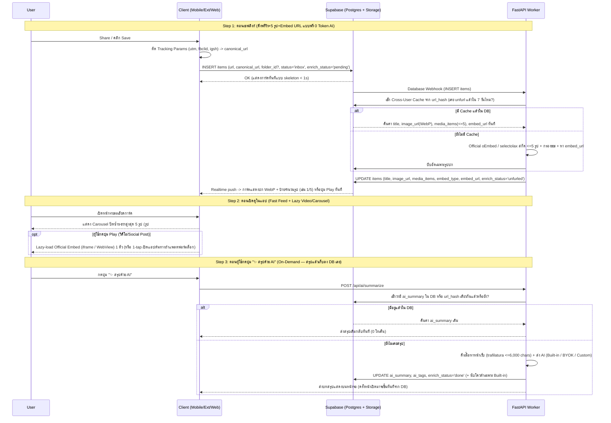
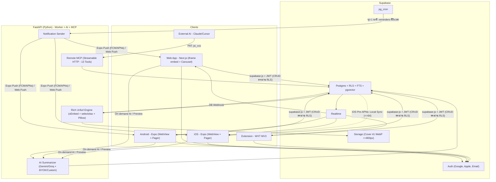

<!-- NOUS-SPEC: domain=save-for-later | purpose=product+engineering-spec | stack=nextjs-expo-wxt-supabase-fastapi | version=1.2 | team=4 | timeline=4-weeks -->
# Just-Save-It — Product & Engineering Spec (v1.2)

> **One-liner:** เซฟอะไรก็ได้จากทุกแอปใน 2 แตะ → ระบบดึงพรีวิว+วิดีโอ/5 รูปแรกให้อัตโนมัติ (ฟรี ไม่ใช้ AI) → AI ช่วยสรุปเมื่อกดสั่ง → เตือนให้กลับมาดูข้ามเครื่อง → แชร์โฟลเดอร์ให้เพื่อนได้ → AI ภายนอกเข้ามาใช้คลังได้ผ่าน MCP
>
> **ทีม:** 4 คน | **กรอบเวลา MVP:** 4 สัปดาห์ | **แพลตฟอร์ม:** Web App · Android · iOS · Browser Extension
>
> **อัปเดต v1.2:** เพิ่มสถาปัตยกรรม **Hybrid Reminder & iOS Pre-APNs Local Notification Sync** (ตั้งเวลาบนคอม/เว็บผูกกับ DB แล้วซิงค์ลงเครื่อง iOS ก่อนจ่าย Apple Developer $99/ปี พร้อมระบุข้อจำกัดจริงและเส้นทางอัปเกรดเป็น APNs) ต่อยอดจาก **v1.1** (Rich Preview: Cover WebP + สูงสุด 5 รูป + Lazy Video Embed)

---

## 1. ปัญหา (Pain Points)

| # | ปัญหา | สาเหตุย่อย | ฟีเจอร์ที่แก้ |
|---|---|---|---|
| P1 | เก็บของที่สนใจไว้ แต่ไม่กลับมาดู | **ลืม** | Reminder ตั้งเอง + Daily/Weekly Digest |
| | | **ขี้เกียจ / ไม่อยากสลับไปเปิดหลายแอป** | AI สรุป 3 บรรทัด + **ดูพรีวิวในแอปได้เลย** (เล่นวิดีโอผ่าน Official Embed + ปัดดูรูปสูงสุด 5 รูปเหมือน IG) + Focus Mode |
| | | **ลำบาก — เก็บกระจายหลายแอป** | ที่เดียวรับจากทุกแอปผ่าน Share Sheet / Extension + ตัด Tracking URL กันเซฟซ้ำ |
| | | **ลำบาก — เก็บในแชท (LINE Keep / ส่งหาตัวเอง) เสิร์ชไม่ได้ จัดไม่ได้** | Folder + Tag + Note + Full-text search (ไทย) + กรองตาม Platform/ประเภทสื่อ |
| | | **ลำบาก — เปิดดูช้า / รูปปกแตก** | รูปปกบีบอัดเป็น WebP เก็บใน Storage ถาวร (โหลดฟีด < 1.5s), เปิดลิงก์ต้นทางใน 1 แตะ |
| P2 | หาข้อมูลกับเพื่อน (ทริป, ร้าน, งานกลุ่ม) แล้วเปิดดูกันลำบาก | ลิงก์จมในกลุ่มแชท | Shared Folder (เพิ่ม/ดู/ติ๊กได้ทุกคน, sync realtime) |

**ขอบเขตเนื้อหา & ความถูกต้องตามกฎ (Compliance):**
- รองรับเฉพาะลิงก์ **โพสต์สาธารณะ** บนโซเชียลมีเดีย (YouTube, TikTok, IG, FB, X, Reddit, Vimeo, Spotify, Pantip) + เว็บทั่วไป
- **ไม่ดึงเนื้อหาที่ต้องล็อกอิน, ไม่ดูดไฟล์วิดีโอเก็บไว้, และไม่เจาะข้ามระบบป้องกันบอต/โฆษณาของแพลตฟอร์ม** เพื่อป้องกันความเสี่ยงด้านลิขสิทธิ์, ToS และการโดน App Store / Play Store ปฏิเสธ (รายละเอียดใน §3 WON'T และ §8.1)

**กลุ่มเป้าหมาย:** คนใช้อินเทอร์เน็ตทั่วไป — เริ่มเจาะ 3 persona:
1. **สายเซฟ (นักศึกษา/วัยทำงาน)** — เซฟคลิปสูตรอาหาร คาเฟ่ ทิปส์ แล้วไม่เคยกลับไปดู
2. **สายเที่ยวกับแก๊ง** — วางแผนทริปร่วมกัน ต้องรวมลิงก์ไว้ที่เดียว
3. **สาย AI/Power user** — อยากให้ Claude/Cursor/ChatGPT ค้นคลังของตัวเองได้

---

## 2. คู่แข่ง & จุดต่าง

| | **Sprink** | **Tuckii** | **Pocket** | **Just-Save-It** |
|---|---|---|---|---|
| แพลตฟอร์ม | iOS + Web (ไม่มี Android) | Android + iOS | ปิดบริการแล้ว (ก.ค. 2025) | **Web + Android + iOS + Extension** |
| Share Sheet | ✅ | ✅ | – | ✅ |
| AI จัดหมวด/แท็ก | ✅ | ❌ | – | ✅ + สรุปลง Note |
| Reminder | ✅ | ❌ (มี Focus Mode) | – | ✅ + Focus Mode |
| แชร์กับเพื่อน | แชร์รายชิ้น/กลุ่ม | ❌ | – | **Shared Folder แก้ไขร่วม realtime** |
| Sync หลายเครื่อง | ✅ | Pro (iCloud/Drive) | – | ✅ ฟรี |
| MCP / AI ภายนอก | ❌ | ❌ | – | **✅ (จุดขายเฉพาะ)** |
| ภาษาไทย | ❌ | ❌ | – | **✅ (UI + AI สรุปไทย)** |
| ราคา | $2.99/ด. หรือ $19.99/ปี | Free + Pro | – | Free + Pro (§9) |

**Positioning:** *"Sprink ที่ใช้ได้ทุกเครื่อง + แชร์กับแก๊งได้ + ให้ AI ใช้ได้ — ภาษาไทยตั้งแต่วันแรก"*

**ยืมไอเดียที่ดีจากคู่แข่ง:** Focus Mode (Tuckii), Import screenshot + "Turn saves into action" (Sprink), Export JSON (Tuckii — ข้อมูลเป็นของผู้ใช้)

---

## 3. Feature List (MoSCoW สำหรับ MVP 4 สัปดาห์)

### ✅ MUST (MVP — ต้องจบใน 4 สัปดาห์)
| ID | ฟีเจอร์ | รายละเอียด |
|---|---|---|
| F1 | **Quick Save + Smart Dedup** | วางลิงก์ / Share Sheet / Extension → ตัด Tracking Params (`utm_*`, `fbclid`, `igsh`, `si`) สร้าง `canonical_url` → บันทึกทันที (optimistic < 1s) แล้ว enrich เบื้องหลัง; เซฟลิงก์ซ้ำ = ดึงใบเดิมขึ้นมาบนสุดไม่สร้างขยะซ้ำ |
| F2 | **Rich Link Preview (Hybrid Unfurl — 0 Token AI)** | ดึงชื่อ คำโปรย เว็บ favicon ประเภทสื่อ (`video`/`post`/`article`/`product`/`link`) และ platform ด้วย `oEmbed` + `selectolax` + `trafilatura` (ฟรี 100%) พร้อมนโยบาย **ประหยัด Storage & เร็ว:**<br>1. **รูปปก #1 (`image_url`):** ดาวน์โหลดมาย่อ-บีบอัดเป็น WebP ($\le 800\text{px}$, < 120KB) เก็บถาวรใน Supabase Storage (ผูกตาม `url_hash` ไม่เก็บซ้ำข้าม user)<br>2. **รูปที่ 2–5 (`media_items`):** ดึงรูปเพิ่มจากบทความ/Gallery ด้วยตัวกรองขยะ เก็บเป็น **External URL ล้วน** (ไม่เปลือง Storage) — **บังคับไม่เกิน 5 รูปเสมอในทุกช่องทาง** แม้ต้นทางมี 20+ รูปก็ตาม!<br>3. **ปุ่มรีเฟรชพรีวิว:** กดดึงพรีวิวใหม่ได้ (rate-limit) กรณีหน้าเว็บอัปเดตหรือครั้งแรกดึงไม่ครบ |
| F2.1 | **In-App Quick Video & Swipe Carousel** | 1. **Swipe Carousel:** การ์ดที่มีหลายรูป ($\le 5$ รูป) ปัดซ้าย-ขวาดูในแอปแบบ IG ได้เลย (รูป 2–5 โหลดตรงจาก URL; ถ้ารูปไหนเสีย/403 ให้ข้ามเนียนๆ แต่รูปปก #1 จาก Storage ไม่แตก)<br>2. **Lazy Official Video/Social Embed:** หน้า Feed แสดงแค่รูปปก WebP + ป้าย Play เพื่อความเบา; เมื่อกด Play ในหน้า Detail ค่อยโหลด Official Embed (`<iframe>` / `WebView` สำหรับ YouTube, TikTok, Vimeo, Spotify, X, Reddit, IG/FB public embed) **1 ตัวต่อครั้ง** + มีปุ่มเปิดแอปต้นทางใน 1 แตะเป็น Fallback เมื่อแพลตฟอร์มจำกัดการเล่นนอกแอป |
| F3 | **Folder** | สร้าง/ย้าย/ลบ, 1 item อยู่ 1 folder (หรือ Inbox) |
| F4 | **Tag** | หลายแท็กต่อ item, กรองตามแท็ก |
| F5 | **Note** | โน้ตส่วนตัวต่อ item (markdown ธรรมดา) |
| F6 | **Status** | `inbox` → `todo` → `done` / `archived` — ติ๊กได้จากทุกหน้าจอ |
| F7 | **Search & Quick Media Filters** | Full-text (ชื่อ คำอธิบาย โน้ต สรุป URL แท็ก) ด้วย Postgres FTS + `pg_trgm` (ไทย) + **Filter chips ตาม Platform (`tiktok`, `instagram`, `youtube`, ...) และประเภท (`video`, `post`, `article`)** |
| F8 | **Reminder (1-Time & Recurring)** | ตั้งเตือนต่อ item ได้ 2 แบบ:<br>1. **กำหนดวันและเวลา (ครั้งเดียว):** เลือกวันที่ + เวลาใดก็ได้ (หรือปุ่มลัด "คืนนี้ 20:00", "พรุ่งนี้ 09:00")<br>2. **ตั้งซ้ำทุกๆ $N$ วัน ในเวลาที่กำหนด:** เช่น ทุกวัน (1 วัน) เวลา 09:00 หรือ ทุกๆ 3 วัน เวลา 20:00 — แจ้งเตือนข้ามเครื่องผ่าน Push (Android/Web) และ Local Sync (iOS Pre-APNs) และหยุดเตือนอัตโนมัติเมื่อติ๊ก `done` |
| F9 | **Shared Folder** | เชิญด้วยลิงก์/อีเมล, role `owner/editor/viewer`, ทุกคนเห็นของใหม่แบบ realtime |
| F10 | **On-Demand AI Summary (3-Tier + Persist Forever)** | ปุ่ม **"✨ สรุปด้วย AI"** บนการ์ด/หน้ารายละเอียด: เช็ก `ai_summary` ใน DB หรือ `url_hash` ข้าม user ก่อน ถ้ามีแล้วคืนทันที (0 โทเค็น); ถ้ายังไม่มีจึงสกัดเนื้อหา ($\le 6,000$ ตัวอักษร) สรุป 3 ข้อไทย + แนะนำ $\le 5$ แท็ก (จับคู่แท็กเดิมก่อน) บันทึกลง DB ถาวร รองรับ **3 Tiers:** Built-in (Gemini Flash + Groq 429 failover, 50 ครั้ง/ด.), BYOK (Stateless Header), และ Custom/Local (Ollama/vLLM Keyless ไม่จำกัดโควต้า) |
| F11 | **Multi-device Sync** | บัญชีเดียว ข้อมูลเดียว ทุกแพลตฟอร์ม (Supabase Realtime + Keyset Pagination) |
| F12 | **MCP Server (Full-Featured)** | Remote MCP (`/mcp`, Streamable HTTP + SHA-256 PAT `jsi_live_xxx`) ครบ **13 Tools** (จัดการ items, tags, folders, share invite link, summarize-to-note, reminders) |

### 🟡 SHOULD (ถ้าเหลือเวลา / สัปดาห์ 5–6)
- F13 Focus Mode — ไล่ inbox ทีละใบแบบเต็มตา (ปัดซ้าย=archive, ขวา=todo พร้อมดู 5 รูป/กดเล่นวิดีโอพรีวิวได้ทันที)
- F14 Daily Digest — "วันนี้มี 5 อันที่คุณเซฟไว้แต่ยังไม่ดู" (push/email)
- F15 Semantic Search (`pgvector`) — "ร้านกาแฟเปิดเช้าแถวอารีย์"
- F16 Export JSON / Import bookmarks HTML (รองรับ Bookmarks Browser ทั่วไป)
- F16.1 Extension DOM Assist — เมื่อเซฟจาก Chrome Extension บนหน้าเว็บเปิดอยู่ ให้แนบ public meta + รูปเนื้อหา $\le 5$ รูปที่ผ่านตัวกรองมาช่วยลดงาน Server (สำหรับเว็บ SPA/CSR)

### 🔵 COULD (Phase 2 — ต่อยอด)
- F17 **Pro tier / Payment** (จำกัดจำนวน Folder, AI credits)
- F18 **บันทึกรูปภาพ / Screenshot** (+ AI อ่านรูป OCR)
- F19 AI "Turn saves into action" — รวมโฟลเดอร์สูตรอาหาร → meal plan, ทริป → itinerary
- F20 Comment/Reaction ใน Shared Folder

### ❌ WON'T (ไม่ทำ — ด้วยเหตุผลด้านกฎหมาย ToS และความคุ้มค่า Server)
- ดึงเนื้อหาโพสต์ส่วนตัว/ต้องล็อกอิน หรือใช้บอต/บัญชีปลอมล็อกอินเข้าไป Scrape IG/FB
- ดาวน์โหลดไฟล์วิดีโอเก็บไว้บน Server หรือดูด Direct MP4 Stream ข้าม Official Player (`yt-dlp` stream proxy) — เสี่ยงลิขสิทธิ์, ผิด ToS แพลตฟอร์ม, เปลือง Bandwidth มหาศาล และเสี่ยงโดน App Store/Play Store รีเจกต์
- รัน Headless Browser Farm (Playwright/Puppeteer) บน Server สำหรับทุกการเซฟ — กิน RAM/CPU สูงเกินความคุ้มค่าของ MVP
- Offline-first เต็มรูปแบบ (มีแค่ Offline Save Queue)

---

## 4. Platform Matrix — แต่ละแพลตฟอร์มทำอะไร

| ความสามารถ | Web App | Android | iOS | Extension |
|---|:-:|:-:|:-:|:-:|
| ช่องทางเซฟหลัก | วางลิงก์ / Bookmarklet / PWA Share Target | **Share Sheet** | **Share Sheet** | **1-click popup / คลิกขวา / Shortcut `Alt+S`** |
| ดู/ค้นหา/จัดการ Folder, Tag, Note | ✅ เต็ม | ✅ เต็ม | ✅ เต็ม | ดูรายการล่าสุด + ค้นหา |
| เปลี่ยน Status | ✅ | ✅ | ✅ | ✅ |
| ตั้ง Reminder | ✅ | ✅ | ✅ | ✅ (ตอนเซฟ) |
| รับแจ้งเตือน | Web Push (VAPID) | FCM (Expo Push — ฟรีตอนเทส) | **Dev/Pre-APNs:** Local Notification Sync (≤ 64)<br>**Prod ($99):** APNs (Expo Push) | `chrome.alarms` + `chrome.notifications` |
| Shared Folder | ✅ จัดการสมาชิก | ✅ | ✅ | เลือกเป็นปลายทางตอนเซฟ |
| ตั้งค่า MCP Token | ✅ (หน้าเดียว) | – | – | – |
| บทบาทหลัก | **ศูนย์บัญชาการ** (จัดระเบียบ, ตั้งค่า, แชร์) | **เซฟไว + เตือน** | **เซฟไว + เตือน** | **เซฟไวตอนท่องเว็บบนคอม** |

**กฎ UX ร่วม:** เซฟต้องจบใน **≤ 2 แตะ** ทุกแพลตฟอร์ม — เลือก folder/tag เป็น *optional* (ค่า default = Inbox) ไม่บล็อกการเซฟ

---

## 5. User Flows หลัก

### 5.1 Save Flow (Hybrid Rich Unfurl — ไม่ใช้ AI) & In-App Quick Preview Flow

- **Idempotent + Canonical Dedup:** ตัด query tracking (`utm_*`, `fbclid`, `igsh`, `si`, `ref`) ก่อนสร้าง `url_hash` (`UNIQUE (owner_id, url_hash)`) → เซฟซ้ำ = ดึงอันเดิมขึ้นมาบน (update `saved_at`) ไม่สร้างซ้ำ
- **Hard Cap 5 รูป & Cover-Only WebP Storage:** ไม่ว่าต้นทางจะมีกี่สิบรูป ระบบจะคัดเก็บ **ไม่เกิน 5 รูปเสมอ** โดยดาวน์โหลดและบีบอัดเป็น WebP เฉพาะ **รูปปก #1 (`image_url`)** ลง Supabase Storage ส่วน **รูป #2–#5** เก็บเป็น URL ตรงใน `media_items` (ถ้าโหลดไม่ขึ้นจากเว็บต้นทางในอนาคต Client แค่ซ่อนสไลด์นั้นโดยปก #1 ยังอยู่ครบ)
- **Cross-User Unfurl & AI Cache:** ลิงก์สาธารณะเดียวกัน (`url_hash` ตรงกัน) ใช้ผล Unfurl ล่าสุด (ภายใน 7 วัน) และ `ai_summary` ร่วมกันได้ → ประหยัด CPU Server, เลี่ยงการโดนเว็บปลายทางบล็อก IP, และประหยัดโควต้า AI 70–80%
- **Retry:** worker ดึงพรีวิวล้มเหลว → `enrich_status='failed'` + `enrich_attempts`, cron retry สูงสุด 3 ครั้ง; การ์ดยังใช้งานได้ด้วย URL ล้วน + มีปุ่มกด Refresh Preview เองได้

### 5.2 กลับมาดู (Cross-Device Reminder Flow: One-Time & Recurring + iOS Local Sync)
- **ตั้งเตือนได้ 2 โหมด (บนคอม/เว็บ/มือถือ):**
  1. **ระบุวัน + เวลา (ครั้งเดียว):** เลือกวันที่และเวลา (`schedule_type = 'once'`, `repeat_every_days = NULL`) → เก็บ `remind_at` (UTC) ลงตาราง `reminders`
  2. **เตือนซ้ำทุกๆ $N$ วัน + เวลา (`schedule_type = 'every_n_days'`):** เช่น *"ทุกๆ 3 วัน เวลา 20:00 น."* → เก็บ `repeat_every_days = 3`, `remind_time = '20:00'`, `timezone = 'Asia/Bangkok'` และคำนวณรอบถัดไปลง `remind_at`
- **ส่งแจ้งเตือนข้ามเครื่อง:**
  - **Android (FCM) & Web Push:** `pg_cron` → FastAPI `claim_due_reminders()` ยิง Push ทันทีแม้ปิดแอป (ถ้าเป็น `once` → `status='sent'`; ถ้าเป็น `every_n_days` → ส่งเสร็จแล้ว **ขยับ `remind_at` ไปอีก $N$ วันข้างหน้าในเวลา `remind_time` เดิม** อัตโนมัติ)
  - **iOS (ช่วงทดสอบก่อนจ่าย $99/ปี ไม่มี APNs):** แอป iOS ซิงค์รายการ `reminders` ลงเครื่อง (`expo-notifications` Local Sync ≤ 64 slots; สำหรับแบบทุกๆ $N$ วัน ระบบจะ unroll รอบถัดๆ ไปออกมาเป็นวัน/เวลาจริงทีละรอบ) → ถึงเวลาแล้วเด้งบน iPhone แม้ออฟไลน์ *(มีข้อจำกัดถ้าไม่เปิดแอป iOS — ดู §8.4)*
- **เมื่อกดแจ้งเตือน:** เปิดเข้าหน้ารายละเอียดการ์ดทันที → ปัดดู 5 รูป / กดดูวิดีโอ / อ่านสรุป AI → ติ๊ก `done` (DB Trigger ยกเลิกทั้งเตือนครั้งเดียวและเตือนซ้ำให้อัตโนมัติ) หรือกดเลื่อนเวลา (Snooze) / กดหยุดเตือนซ้ำ

### 5.3 Shared Folder
`เจ้าของสร้าง folder → Share → ได้ invite link (token หมดอายุ 7 วัน) → เพื่อนเปิด → ล็อกอิน → เข้าเป็น editor → ใครเซฟลงก็เห็นทันที`

### 5.4 MCP
`Web → Settings → "Connect AI" → สร้าง token (โชว์ครั้งเดียว) → copy config ไปใส่ Claude Desktop/Cursor → AI ค้น/เซฟ/อ่านสรุป/สร้างลิงก์แชร์ได้`

---

## 6. สถาปัตยกรรม



**หลักการ:**
1. **CRUD ทั้งหมดผ่าน `supabase-js` ตรง + RLS** — ไม่เขียน REST endpoint ซ้ำซ้อน (ลดงานทีม ~40%)
2. **FastAPI ทำเฉพาะงานที่ client ทำไม่ได้/ไม่ควรทำ:** Rich Unfurl (CORS + 5-image filter + WebP compress), AI (ซ่อน API key + BYOK relay), push, MCP
3. **FastAPI ใช้ `service_role` เสมอ ต้อง filter `owner_id`/สิทธิ์เองทุก query** — ห้ามรับ `user_id` จาก AI/MCP parameter (ดู §8)
4. **ประหยัด Storage & Bandwidth สูงสุด:** เก็บไฟล์จริงบน Storage **เฉพาะรูปปก #1 (WebP)** เท่านั้น; รูปที่ 2–5 ใช้ External URL; วิดีโอใช้ Official Embed โหลดตอนกด Play

### 6.1 Tech Stack (ล็อกแล้ว)
| ชั้น | เลือก | เหตุผล |
|---|---|---|
| Monorepo | **pnpm workspaces + Turborepo** | แชร์ types/zod/supabase client ทั้ง 3 client TS |
| Web | **Next.js 15 (App Router) + Tailwind + shadcn/ui + TanStack Query** | SSR หน้า invite/share preview, Carousel + Lazy `<iframe>`, Vercel deploy ง่าย |
| Mobile | **Expo (SDK ล่าสุด) + Expo Router + NativeWind + `react-native-webview`** | โค้ดเดียว Android+iOS; ใช้ `WebView` แบบ Lazy เฉพาะตอนกด Play; ต้องใช้ **Dev Build/EAS** |
| Share Sheet | **`expo-share-intent`** (MVP: เปิดแอปแล้วเซฟอัตโนมัติ) → อัปเกรดเป็น `expo-share-extension` ทีหลัง | ลดความเสี่ยง iOS share-extension memory limit / App Group |
| Extension | **WXT + React** (MV3, build Chrome/Edge/Firefox จากโค้ดเดียว) | HMR, typed messaging |
| DB/Auth | **Supabase** (Postgres 15, RLS, Realtime, Storage, pg_cron, pgvector) | |
| Worker/AI/MCP | **FastAPI + Python 3.12 + `httpx` + `trafilatura` + `selectolax` + `Pillow` + `mcp` SDK** | `selectolax` แกะ HTML/5 รูปไวมาก; `Pillow` ย่อ+แปลงปกเป็น WebP; deploy: Railway / Fly.io / Cloud Run |
| AI | **Gemini Flash (`gemini-2.5-flash` via env) + Groq (`llama-3.3-70b-versatile`) failover + BYOK + Custom (Ollama/vLLM)** | รันจริงแล้วใน `backend/Ai/`; ประหยัดและรองรับผู้ใช้ที่เอา Key/Local LLM มาเอง |
| Embedding (SHOULD) | `gemini-embedding-001` (env `EMBED_MODEL`), `vector(768)` | |
| Push | **Expo Push Service** (FCM ฟรีบน Android + APNs เมื่อเปิด Apple Dev) + **`expo-notifications` Local Sync (iOS Pre-APNs)** + Web Push (VAPID) | |
| Monitoring | Sentry (ทุก client + FastAPI) | |

### 6.2 Auth ข้ามแพลตฟอร์ม
- **Providers:** Google + **Sign in with Apple (บังคับบน iOS ถ้ามี Google login — App Store Guideline 4.8)** + Email OTP
- **Web/Mobile:** Supabase session ปกติ (mobile เก็บใน `expo-secure-store`)
- **Extension:** ปุ่ม "Login" → เปิดแท็บ `web/extension/connect` → web ส่ง session ให้ extension ผ่าน `externally_connectable` + `chrome.runtime.sendMessage(EXT_ID, session)` → เก็บใน `chrome.storage.local`, refresh token เอง
- **MCP:** Personal Access Token (`jsi_live_xxx`) เก็บเป็น SHA-256 hash (pattern เดียวกับ `Nous/docs/plans/2026-11-12-unified-ai-platform-architecture.md` §4)

---

## 7. Database Schema (Supabase — Aligned & Optimized)

```sql
-- ===== Schemas & Extensions =====
create schema if not exists private;     -- ไม่ expose บน Supabase Data API (/rpc/)
create extension if not exists pg_trgm;
create extension if not exists vector;   -- SHOULD: semantic search

-- ===== Enums =====
create type item_status   as enum ('inbox','todo','done','archived');
create type enrich_status as enum ('pending','unfurled','done','failed');
create type folder_role   as enum ('owner','editor','viewer');

-- ===== Profiles =====
create table public.profiles (
  id           uuid primary key references auth.users(id) on delete cascade,
  display_name text,
  avatar_url   text,
  tier         text not null default 'free' check (tier in ('free','pro')),
  locale       text not null default 'th',
  timezone     text not null default 'Asia/Bangkok',
  created_at   timestamptz not null default now()
);

-- ===== Folders & Members (Shared) =====
create table public.folders (
  id         uuid primary key default gen_random_uuid(),
  owner_id   uuid not null references public.profiles(id) on delete cascade,
  name       text not null check (char_length(name) between 1 and 80),
  emoji      text,
  is_shared  boolean not null default false,
  created_at timestamptz not null default now()
);
create index folders_owner_idx on public.folders (owner_id);

create table public.folder_members (
  folder_id  uuid references public.folders(id) on delete cascade,
  user_id    uuid references public.profiles(id) on delete cascade,
  role       folder_role not null default 'editor',
  joined_at  timestamptz not null default now(),
  primary key (folder_id, user_id)
);
create index folder_members_user_idx on public.folder_members (user_id);

create table public.folder_invites (
  token      text primary key default encode(gen_random_bytes(16),'hex'),
  folder_id  uuid not null references public.folders(id) on delete cascade,
  role       folder_role not null default 'editor' check (role <> 'owner'),
  created_by uuid not null references public.profiles(id),
  expires_at timestamptz not null default now() + interval '7 days'
);
create index folder_invites_folder_idx on public.folder_invites (folder_id);

-- ===== Items (ลิงก์ที่เซฟ + Rich Preview) =====
create table public.items (
  id              uuid primary key default gen_random_uuid(),
  owner_id        uuid not null references public.profiles(id) on delete cascade,  -- คนเซฟ
  folder_id       uuid references public.folders(id) on delete set null,           -- null = Inbox
  url             text not null,
  canonical_url   text,                                                            -- URL หลังตัด utm_*/fbclid/igsh
  url_hash        text not null,                                                   -- Trigger auto-fill: md5(lower(coalesce(canonical_url, url)))
  title           text,
  description     text,
  image_url       text,                                                            -- รูปปก #1 (WebP <=800px แคชใน Supabase Storage)
  media_items     jsonb not null default '[]'::jsonb
                    check (jsonb_typeof(media_items) = 'array' and jsonb_array_length(media_items) <= 5),
                    -- สูงสุด 5 รูปเสมอ: index 0 = cover(cached WebP), index 1..4 = external URLs
  embed_type      text not null default 'none'
                    check (embed_type in ('none','youtube','tiktok','instagram','facebook','x','reddit','vimeo','spotify')),
  embed_url       text,                                                            -- Official Embed URL (Allowlisted hostname เท่านั้น)
  site_name       text,
  favicon_url     text,
  content_type    text check (content_type is null or content_type in ('video','article','post','product','link','other')),
  platform        text,                                                            -- 'tiktok' | 'instagram' | 'youtube' | 'web' | ...
  note            text,
  ai_summary      text,
  ai_tags         text[],                                                          -- แท็กที่ AI แนะนำ (ยังไม่ยืนยัน)
  status          item_status   not null default 'inbox',
  enrich_status   enrich_status not null default 'pending',
  enrich_attempts int not null default 0,
  unfurled_at     timestamptz,                                                     -- เวลา unfurl ล่าสุด (ใช้เช็ก Cross-User Cache)
  saved_at        timestamptz not null default now(),
  done_at         timestamptz,
  search_tsv      tsvector generated always as (
                    to_tsvector('simple',
                      coalesce(title,'')||' '||coalesce(description,'')||' '||
                      coalesce(note,'')||' '||coalesce(ai_summary,'')||' '||url)) stored,
  constraint uniq_owner_url unique (owner_id, url_hash)
);

-- Trigger เติม url_hash อัตโนมัติ (รองรับทั้ง client ที่ไม่ส่ง url_hash และ backend ที่ส่งมา)
create or replace function private.set_item_url_hash()
returns trigger language plpgsql as $$
begin
  if new.canonical_url is null or btrim(new.canonical_url) = '' then
    new.canonical_url := btrim(new.url);
  end if;
  new.url_hash := md5(lower(new.canonical_url));
  return new;
end;
$$;

create trigger trg_items_set_url_hash
  before insert or update of url, canonical_url on public.items
  for each row execute function private.set_item_url_hash();

-- Indexes (Query + FK + Filter + Cross-User Cache + Cron Partial Index)
create index items_owner_status_idx     on public.items (owner_id, status, saved_at desc, id desc);
create index items_folder_idx           on public.items (folder_id, saved_at desc, id desc);
create index items_owner_platform_idx   on public.items (owner_id, platform, content_type, saved_at desc);
create index items_tsv_idx              on public.items using gin (search_tsv);
create index items_title_trgm_idx       on public.items using gin (title gin_trgm_ops);  -- ไทยไม่มีเว้นวรรค → ใช้ trigram
create index items_url_hash_cache_idx   on public.items (url_hash, unfurled_at desc)
  where enrich_status in ('unfurled', 'done');
create index items_enrich_retry_idx     on public.items (enrich_status, enrich_attempts)
  where enrich_status in ('pending', 'failed');

-- ===== Tags =====
create table public.tags (
  id       uuid primary key default gen_random_uuid(),
  owner_id uuid not null references public.profiles(id) on delete cascade,
  name     text not null,
  color    text,
  unique (owner_id, name)
);
create table public.item_tags (
  item_id uuid references public.items(id) on delete cascade,
  tag_id  uuid references public.tags(id)  on delete cascade,
  primary key (item_id, tag_id)
);
create index item_tags_tag_idx on public.item_tags (tag_id);

-- ===== Reminders (1 active reminder per item/user: รองรับทั้งครั้งเดียว & ทุกๆ N วัน) =====
create table public.reminders (
  id                uuid primary key default gen_random_uuid(),
  item_id           uuid not null references public.items(id) on delete cascade,
  user_id           uuid not null references public.profiles(id) on delete cascade,
  schedule_type     text not null default 'once' check (schedule_type in ('once','every_n_days')),
  remind_at         timestamptz not null,                                           -- เวลาที่จะเตือน "รอบถัดไป" (UTC เสมอ)
  repeat_every_days int check (repeat_every_days is null or repeat_every_days between 1 and 365),
  remind_time       time,                                                           -- เวลาประจำวัน (เช่น '20:00:00') ใช้เมื่อ schedule_type = 'every_n_days'
  timezone          text not null default 'Asia/Bangkok',                           -- ป้องกันเวลาเพี้ยนเวลาคำนวณรอบถัดไป
  status            text not null default 'pending' check (status in ('pending','sent','cancelled')),
  title_snapshot    text,                                                           -- ชื่อลิงก์ ณ ตอนตั้งเตือน (โชว์บนแจ้งเตือนได้ทันที)
  last_triggered_at timestamptz,                                                    -- เวลาที่ยิงเตือนรอบล่าสุด (ใช้กับ recurring)
  sent_at           timestamptz,
  updated_at        timestamptz not null default now(),
  created_at        timestamptz not null default now(),
  unique (item_id, user_id),                                                        -- 1 ลิงก์มี 1 กฎเตือนล่าสุดต่อคน (upsert ได้ตรงจาก client)
  constraint chk_reminder_schedule_fields check (
    (schedule_type = 'once' and repeat_every_days is null) or
    (schedule_type = 'every_n_days' and repeat_every_days between 1 and 365 and remind_time is not null)
  )
);
create index reminders_due_idx     on public.reminders (remind_at) where status = 'pending';
create index reminders_sync_idx    on public.reminders (user_id, remind_at asc) where status = 'pending';
create index reminders_item_idx    on public.reminders (item_id);

-- Auto-cancel pending reminders เมื่อผู้ใช้ติ๊ก item เป็น done หรือ archived (หยุดทั้งครั้งเดียวและเตือนซ้ำ)
create or replace function private.cancel_reminders_on_item_done()
returns trigger language plpgsql as $$
begin
  if new.status in ('done', 'archived') and old.status is distinct from new.status then
    update public.reminders
       set status = 'cancelled', updated_at = now()
     where item_id = new.id and status = 'pending';
  end if;
  return new;
end;
$$;

create trigger trg_items_cancel_reminders
  after update of status on public.items
  for each row execute function private.cancel_reminders_on_item_done();

-- Atomic Claim & Advance Function สำหรับ FastAPI Cron (ป้องกันยิงซ้ำ + คำนวณรอบถัดไปแบบ DST-safe)
create or replace function public.claim_due_reminders(batch_limit int default 100)
returns table (
  reminder_id uuid,
  item_id uuid,
  user_id uuid,
  title_snapshot text,
  schedule_type text,
  repeat_every_days int,
  fired_at timestamptz
) language plpgsql security definer set search_path = '' as $$
declare
  rec record;
  next_local_date date;
  next_ts timestamptz;
begin
  for rec in
    select r.*
      from public.reminders r
     where r.status = 'pending' and r.remind_at <= now()
     order by r.remind_at asc
     limit batch_limit
     for update skip locked
  loop
    if rec.schedule_type = 'every_n_days' and rec.repeat_every_days is not null and rec.remind_time is not null then
      next_local_date := (rec.remind_at at time zone rec.timezone)::date + rec.repeat_every_days;
      next_ts := (next_local_date::timestamp + rec.remind_time) at time zone rec.timezone;
      while next_ts <= now() loop
        next_local_date := next_local_date + rec.repeat_every_days;
        next_ts := (next_local_date::timestamp + rec.remind_time) at time zone rec.timezone;
      end loop;

      update public.reminders
         set remind_at = next_ts,
             last_triggered_at = now(),
             sent_at = now(),
             updated_at = now()
       where id = rec.id;
    else
      update public.reminders
         set status = 'sent',
             last_triggered_at = now(),
             sent_at = now(),
             updated_at = now()
       where id = rec.id;
    end if;

    reminder_id := rec.id;
    item_id := rec.item_id;
    user_id := rec.user_id;
    title_snapshot := rec.title_snapshot;
    schedule_type := rec.schedule_type;
    repeat_every_days := rec.repeat_every_days;
    fired_at := now();
    return next;
  end loop;
end;
$$;
revoke all on function public.claim_due_reminders(int) from PUBLIC, anon, authenticated;
grant execute on function public.claim_due_reminders(int) to service_role;

-- ===== AI Quota Tracking (ตรงกับ backend/Ai/summarizer_service.py) =====
create table public.daily_ai_usage (
  id            uuid primary key default gen_random_uuid(),
  user_id       uuid not null references public.profiles(id) on delete cascade,
  usage_month   text not null,  -- รูปแบบ 'YYYY-MM' เช่น '2026-11'
  request_count int  not null default 0 check (request_count >= 0),
  last_used_at  timestamptz not null default now(),
  unique (user_id, usage_month)
);

-- ===== Devices (push tokens & local-sync registration) & API tokens =====
create table public.devices (
  id            uuid primary key default gen_random_uuid(),
  user_id       uuid not null references public.profiles(id) on delete cascade,
  platform      text not null check (platform in ('android','ios','web','extension')),
  delivery_mode text not null default 'remote' check (delivery_mode in ('remote','local_sync')),
  push_token    text unique,                                                        -- ExpoPushToken / FCM (NULL ได้เมื่อเป็น iOS local_sync)
  web_push_sub  jsonb,                                                              -- Web Push VAPID object {endpoint, keys}
  is_active     boolean not null default true,
  last_seen     timestamptz not null default now()
);
create index devices_user_active_idx on public.devices (user_id, platform) where is_active = true;

create table public.api_tokens (
  id           uuid primary key default gen_random_uuid(),
  user_id      uuid not null references public.profiles(id) on delete cascade,
  token_hash   text not null unique,
  token_prefix text not null,
  name         text not null,
  last_used_at timestamptz,
  revoked_at   timestamptz,
  created_at   timestamptz not null default now()
);
create index api_tokens_user_idx on public.api_tokens (user_id);
```

### 7.1 RLS (Optimized: `(select auth.uid())` + `private.can_access_folder`)
```sql
create or replace function private.can_access_folder(fid uuid, min_role folder_role default 'viewer')
returns boolean language sql security definer stable set search_path = '' as $$
  select exists (
    select 1 from public.folders f
    where f.id = fid and f.owner_id = (select auth.uid())
  ) or exists (
    select 1 from public.folder_members m
    where m.folder_id = fid and m.user_id = (select auth.uid())
      and (min_role = 'viewer' or m.role in ('owner','editor'))
  );
$$;
grant usage on schema private to authenticated;
grant execute on function private.can_access_folder(uuid, folder_role) to authenticated;

alter table public.items enable row level security;
create policy items_select on public.items for select using (
  owner_id = (select auth.uid()) or (folder_id is not null and (select private.can_access_folder(folder_id)))
);
create policy items_insert on public.items for insert with check (
  owner_id = (select auth.uid()) and (folder_id is null or (select private.can_access_folder(folder_id,'editor')))
);
create policy items_update on public.items for update using (
  owner_id = (select auth.uid()) or (folder_id is not null and (select private.can_access_folder(folder_id,'editor')))
);
create policy items_delete on public.items for delete using (owner_id = (select auth.uid()));

-- profiles / folders / folder_members / tags / item_tags / reminders / daily_ai_usage / devices / api_tokens:
-- เปิด RLS ทุกตารางและใช้ `(select auth.uid())` เช่นเดียวกัน (daily_ai_usage อนุญาตเฉพาะ user อ่านของตัวเอง, เขียนผ่าน FastAPI service_role)
-- การรับ invite ทำผ่าน RPC `accept_invite(token)` (security definer) เท่านั้น
```
> ⚠️ **ข้อตัดสินใจ:** `status` เป็นของ item ร่วม (ใน shared folder ใครติ๊ก done ทุกคนเห็น done) — เหมาะกับใช้วางแผนทริป ถ้าต้องการสถานะแยกรายคนค่อยเพิ่มตาราง `item_user_state` ใน Phase 2

---

## 8. Backend Services (FastAPI)

| Endpoint | เรียกโดย | หน้าที่ | สถานะ |
|---|---|---|---|
| `POST /hooks/item-created` | Supabase DB Webhook (shared secret header) | Rich Unfurl: ชื่อ, คำโปรย, ปก WebP, `media_items` (≤ 5 รูป), `embed_type/url` (**0 Token AI**) | ✅ สร้างแล้ว |
| `POST /api/preview` | Client (ตอนพิมพ์/วางลิงก์ ก่อนกดเซฟ) | Preview ทันทีแบบอ่านอย่างเดียว (rate-limit 30/นาที/user, ไม่เขียน Storage) | ✅ สร้างแล้ว |
| `POST /api/items/{id}/refresh-preview` | Client (ปุ่มรีเฟรชพรีวิว) | บังคับดึงพรีวิวใหม่เมื่อเว็บต้นทางเปลี่ยนหรือเคยพัง (rate-limit 10/ชม./user) | ✅ สร้างแล้ว |
| `POST /api/ai/summarize` | Client (กดปุ่ม **"✨ สรุปด้วย AI"**) | เช็ก DB/`url_hash` ก่อน ถ้าไม่มีค่อยสกัดบทความ + เรียก AI 3-Tier แล้วเซฟถาวร | ✅ สร้างแล้ว |
| `POST /cron/reminders` | pg_cron (ทุก 1 นาที) | เรียก `claim_due_reminders()` ยิง push (ครั้งเดียว → mark `sent`; เตือนซ้ำทุกๆ $N$ วัน → เลื่อน `remind_at` ไปรอบถัดไปอัตโนมัติ) | ✅ สร้างแล้ว |
| `POST /cron/retry-enrich` | pg_cron (ทุก 10 นาที) | retry unfurl ที่ `failed` และ `enrich_attempts < 3` | ✅ สร้างแล้ว |
| `/mcp` | External AI (Claude/Cursor) | Remote MCP (SSE & Streamable HTTP + SHA-256 PAT `jsi_live_xxx`, 13 Tools) | ✅ สร้างแล้ว |

### 8.1 Rich Unfurl Engine (ไม่ใช้ AI — ฟรี เร็ว ประหยัด Storage & ถูกกฎ)
**ลำดับการทำงาน:**
1. **SSRF Guard & Canonicalization:** ตรวจ IP/Scheme ด้วย `validate_safe_url` (มีแล้วใน `backend/Ai/content_extractor.py`) + ตัด Tracking query (`utm_*`, `fbclid`, `gclid`, `igsh`, `si`) เพื่อได้ `canonical_url` และ `url_hash`
2. **Cross-User Unfurl Cache:** ค้น `items` ที่ `url_hash` ตรงกันและ `unfurled_at >= now() - interval '7 days'` → ถ้าเจอ คืนค่า `title`, `description`, `image_url` (WebP ใน Storage), `media_items`, `embed_type`, `embed_url` ทันทีโดย**ไม่ต้องยิงเว็บต้นทางซ้ำ**!
3. **Platform Extraction Matrix (เรียงตามความน่าเชื่อถือ & ถูกกฎ):**

| แพลตฟอร์ม | วิธีดึง Metadata & รูป | วิธีเล่นในแอป (`embed_type` / `embed_url`) |
|---|---|---|
| **YouTube** | Official oEmbed (`youtube.com/oembed`) + `maxresdefault`/`hqdefault` | Official Iframe `https://www.youtube.com/embed/{video_id}` (เล่นลื่น 100%) |
| **TikTok** | Official oEmbed (`tiktok.com/oembed`) + `og:*` fallback | Official Embed `https://www.tiktok.com/embed/v2/{video_id}` |
| **Vimeo / Spotify** | Official oEmbed | Official Player Embed URL (`player.vimeo.com/video/...`, `open.spotify.com/embed/...`) |
| **Reddit** | Public JSON (`<url>.json` + User-Agent เฉพาะ) / oEmbed | ดึงภาพจาก **`gallery_data` / `media_metadata` สูงสุด 5 รูป** + Embed วิดีโอ/โพสต์ได้จริง |
| **X (Twitter)** | Official oEmbed (`publish.twitter.com/oembed`) + `og:*` | Official Tweet Embed / Fallback การ์ด+ปุ่มเปิด X |
| **Instagram / Facebook** | **Meta App oEmbed** (ต้องมี token) → ถ้ายังไม่มีใช้ Public `og:*` | Official Post/Reel Embed URL (`instagram.com/p/{code}/embed`) — *หมายเหตุ: Meta ส่งรูปปกได้แค่ 1 รูป และบางโพสต์อาจล็อกไม่ให้เล่นนอกแอป ให้แสดงรูปปก + ปุ่มเปิดแอป IG/FB ใน 1 แตะ* |
| **เว็บทั่วไป / บล็อก / Pantip** | `httpx` (timeout 8s, max 3MB) + `selectolax` + `trafilatura` | **สกัดสูงสุด 5 รูปแรกจากส่วนเนื้อหา** + กรองขยะ (`<article>`, `<main>`, `og:image`, `img[src/data-src]`) |

4. **นโยบาย 5 รูป & Cover-Only WebP Compression (บังคับทุกกรณี):**
   - **Image Junk Filter (Regex/DOM Heuristics):** ตัด `.svg`, รูป pixel `1x1`, avatar, icon, logo, banner, ads, emoji, รูปขนาด `< 200px` และ URL ซ้ำออกก่อน
   - **Hard Cap $\le 5$:** ตัดรายการให้เหลือ **ไม่เกิน 5 รูปเสมอ** ไม่ว่าต้นทางจะมีกี่รูปก็ตาม
   - **Storage Policy:** ดาวน์โหลดเฉพาะ **รูปที่ 1 (`image_url` — รูปปกหลัก)** มาย่อขนาด ($\le 800\text{px}$ กว้าง) และแปลงเป็น **WebP (`quality=80`, เป้า $< 120\text{KB}$)** ด้วย `Pillow` แล้วอัปโหลดลง Supabase Storage (`thumbnails/{url_hash}.webp`) เพื่อโหลดหน้า List ไวและรูปไม่หมดอายุ ส่วน **รูปที่ 2–5** เก็บเป็น External URL ตรงใน `media_items` เท่านั้น
5. **Embed Security Allowlist (กัน XSS):** ห้ามนำ raw HTML จากเว็บทั่วไปมา render เด็ดขาด — Client จะอนุญาต render `<iframe>`/`WebView` เฉพาะ URL ที่ผ่านการ Validate Hostname จาก `embed_type` เท่านั้น (`youtube.com`, `tiktok.com`, `instagram.com`, `facebook.com`, `platform.twitter.com`, `redditmedia.com`, `player.vimeo.com`, `open.spotify.com`)

### 8.2 On-Demand AI Summarizer (`POST /api/ai/summarize`) — ✅ สร้างแล้วใน `backend/Ai/`
- **ทำงานเฉพาะตอนผู้ใช้กดปุ่ม `"✨ สรุปด้วย AI"`** (ไม่รันอัตโนมัติตอนเซฟ ประหยัดโควต้า 70–80%)
- **ลำดับการทำงาน (Summarize-Once & Persist):**
  1. เช็กในตาราง `items` ก่อนว่ามีค่า `ai_summary` อยู่แล้วหรือไม่ (หรือมีลิงก์ `url_hash` เดียวกันที่เคยสรุปไว้แล้วหรือไม่ ถ้าไม่ส่ง `force_refresh=true`) → ถ้ามีแล้ว คืนค่าจาก DB ทันที (`cached_from_db=true`, 0 โทเค็น)
  2. เช็กโควต้าใน `daily_ai_usage` (50 ครั้ง/เดือน สำหรับ Free `built-in`; **ข้ามการนับโควต้าทันที** ถ้าผู้ใช้ใช้ `byok` หรือ `custom`)
  3. ใช้ `extract_text_for_ai` (`oEmbed` / `trafilatura` + `selectolax`, จำกัด $\le 6,000$ ตัวอักษร) ส่งให้ **3-Tier LLM Router:**
     - **Tier 1 (Built-in):** Gemini Flash (`gemini-2.5-flash` via env) + Failover ไป Groq (`llama-3.3-70b-versatile`) อัตโนมัติเมื่อเจอ `429`
     - **Tier 2 (BYOK):** API Key ของผู้ใช้เอง via HTTP Headers (`X-AI-Provider`, `X-AI-Key`, `X-AI-Model`) แบบ Stateless ไม่บันทึกลง DB
     - **Tier 3 (Custom / Local):** `X-AI-Base-Url` (เช่น Ollama / vLLM, รองรับ Keyless) ไม่จำกัดโควต้า
  4. สรุปเป็น JSON `{summary_th (3 ข้อไทย), suggested_tags (≤5 จับคู่แท็กเดิมก่อน), content_type}` แล้ว **`UPDATE` ลง `ai_summary` (และต่อท้าย `note` ถ้าเลือก `save_to_note=true`) ถาวร**

### 8.3 MCP Tools (Full-Featured — ✅ สร้างแล้ว 13 Tools ใน `backend/Ai/mcp_server.py`)
| หมวด | Tool | Params | หน้าที่ |
|---|---|---|---|
| **บันทึก (Items)** | `search_and_list_items` | `query?, folder_id?, tag_name?, status?, limit=20` | ดู/ค้นหาลิงก์จากคำค้น โฟลเดอร์ แท็ก หรือสถานะ |
| | `get_item_detail` | `item_id` | ดูรายละเอียดลิงก์ + โน้ต + บทสรุป AI + แท็ก + เวลาเตือน |
| | `create_item` | `url, title?, note?, folder_id?, tags?, status='inbox'` | เพิ่มบันทึก/ลิงก์ใหม่พร้อมโน้ต โฟลเดอร์ และแท็ก |
| | `update_item` | `item_id, title?, note?, folder_id?, status?` | แก้ไขชื่อ/โน้ต, ย้ายโฟลเดอร์, ติ๊กสถานะ (`inbox`/`todo`/`done`/`archived`) |
| | `delete_item` | `item_id` | ลบบันทึก |
| | `summarize_item_to_note` | `item_id, force_refresh=false` | สั่ง AI สรุปเนื้อหาลิงก์เก็บลง DB ถาวร |
| **แท็ก (Tags)** | `list_tags` | – | ดูแท็กทั้งหมดของผู้ใช้ |
| | `manage_item_tags` | `item_id, add_tags?, remove_tags?` | ติดแท็กเพิ่ม หรือเอาแท็กออกจากบันทึก |
| | `rename_or_delete_tag` | `tag_name, new_name?, delete=false` | เปลี่ยนชื่อหรือลบแท็ก |
| **โฟลเดอร์ & แชร์** | `list_folders` | – | ดูโฟลเดอร์ส่วนตัวและโฟลเดอร์ที่แชร์กับเพื่อน |
| | `manage_folder` | `action ('create'\|'rename'\|'delete'), name?, folder_id?, emoji?` | สร้าง/เปลี่ยนชื่อ/ลบโฟลเดอร์ |
| | `share_folder_link` | `folder_id, role ('viewer'\|'editor'), expires_in_days=7, revoke_all=false` | **กดสร้างลิงก์แชร์โฟลเดอร์ให้เพื่อนเข้ามาดูหรือร่วมเพิ่ม/แก้ไขบันทึกได้** |
| **แจ้งเตือน** | `set_or_cancel_reminder` | `item_id, remind_at_iso?, repeat_every_days?, remind_time?, cancel=false` | ตั้งเวลาครั้งเดียว, ตั้งซ้ำทุกๆ $N$ วันตามเวลา, หรือยกเลิกการเตือน |

**Invariant:** `user_id` มาจาก SHA-256 hash ของ Token เท่านั้น; *(หมายเหตุปรับให้ตรงกับ DB §7: ใน `mcp_server.py` ปัจจุบัน `search_and_list_items` ควรขยายให้ค้น Shared Folder ที่ร่วมเป็นสมาชิกด้วย, `create_item` ควรส่ง `canonical_url`, และ `set_or_cancel_reminder` รองรับเพิ่มพารามิเตอร์ `repeat_every_days` + `remind_time` แบบ backward-compatible)*

### 8.4 Hybrid Reminder Engine (One-Time + Every-N-Days) & iOS Pre-APNs Local Sync
1. **Single Source of Truth (`public.reminders`):** ทุกแพลตฟอร์มตั้งเวลาเตือนผูกกับ `item_id` ลงตาราง `reminders` บน Supabase รองรับ **2 รูปแบบการตั้งเตือน:**
   - **แบบที่ 1 — กำหนดวันและเวลา (ครั้งเดียว, `schedule_type = 'once'`):** เลือกวันที่ + เวลา (`remind_at` เก็บ UTC; มีปุ่มลัด "คืนนี้ 20:00", "พรุ่งนี้ 09:00", "เสาร์ 10:00" หรือเลือกปฏิทิน+เวลาเอง)
   - **แบบที่ 2 — ทำซ้ำทุกๆ $N$ วัน ในเวลาที่กำหนด (`schedule_type = 'every_n_days'`):** กำหนด `repeat_every_days` ($1 \le N \le 365$, เช่น ทุก 1 วัน, ทุก 3 วัน, ทุก 7 วัน) + `remind_time` (เช่น `20:00`) + `timezone` (เช่น `Asia/Bangkok`) โดยคอลัมน์ `remind_at` จะเก็บ **เวลาที่จะแจ้งเตือนรอบถัดไป (Next Occurrence in UTC)** เสมอ
   - **Auto-Stop:** เมื่อผู้ใช้ติ๊กการ์ดเป็น `done` หรือ `archived` Trigger `trg_items_cancel_reminders` จะเปลี่ยน `status = 'cancelled'` ให้ทันที (หยุดทั้งแบบครั้งเดียวและแบบซ้ำทุก $N$ วัน)

2. **โหมดส่งแจ้งเตือนแบบคู่ขนาน (Dual Delivery):**
   - **โหมด A — Remote Push (`delivery_mode = 'remote'`):** ใช้กับ **Android (FCM ฟรีตอนเทส APK/Dev Build)**, **Web Push (VAPID ฟรี)**, และ **iOS (Production หลังจ่าย Apple Developer $99/ปี + ใส่ APNs `.p8` Key)**
     - `pg_cron` เรียก `POST /cron/reminders` ทุก 1 นาที → เรียก `public.claim_due_reminders()` (`FOR UPDATE SKIP LOCKED`)
       - ถ้า `schedule_type = 'once'` → อัปเดต `status = 'sent'`, `sent_at = now()` แล้วส่ง Push
       - ถ้า `schedule_type = 'every_n_days'` → **คง `status = 'pending'`** และคำนวณ `remind_at` ใหม่เป็น `(local_date + repeat_every_days) @ remind_time` ใน `timezone` ของผู้ใช้ (วนจน `> now()` กันยิงรัวหากเครื่อง/เซิร์ฟเวอร์หยุดพัก) แล้วส่ง Push รอบนี้
   - **โหมด B — iOS Pre-APNs Local Sync (`delivery_mode = 'local_sync'`):** ใช้กับ **iOS ช่วงพัฒนา/ทดสอบก่อนจ่าย $99/ปี** (รันได้บน Simulator, Expo Go, และ iPhone จริงผ่าน Free Apple ID โดยไม่ต้องเปิด Push Entitlement / APNs Key)
     - เมื่อเปิดแอป, กลับมา Foreground (`AppState === 'active'`), ได้ Realtime event ตอนแอปเปิด, หรือ Background Fetch → แอป iOS เรียก `syncLocalReminders()`
     - **การรองรับ "ทุกๆ $N$ วันในเวลา $HH:MM$" บน iOS (Occurrence Unrolling):** เนื่องจาก `UNCalendarNotificationTrigger` ของ iOS ไม่มีตัวเลือก *"ทุกๆ $N$ วัน"* (มีแค่รายวัน/รายสัปดาห์ ส่วน interval วินาทีจะคลาดเคลื่อนเมื่อเปลี่ยนโซนเวลา) แอป iOS จึงคลี่กฎ `every_n_days` จาก `remind_at` ปัจจุบันออกมาเป็น **วัน-เวลาจริง $K$ รอบถัดไปล่วงหน้า** (เช่น ล่วงหน้า 5 รอบต่อรายการ) แล้วนำมาเรียงเวลารวมกับรายการแบบครั้งเดียวทั้งหมด **`ORDER BY occurrence_at ASC LIMIT 64`** เพื่อจองเป็น `DateTriggerInput` ลง `expo-notifications`!
     - รายการที่เลยเวลาแล้ว (`remind_at <= now()` และ item ยังไม่ `done`) จะแสดงเป็นแถบ **"ถึงเวลาดูแล้ว (Overdue)"** บนหน้า Home เมื่อเปิดแอป
   - **เส้นทางอัปเกรดขึ้น Production (ป้องกันแจ้งเตือนซ้ำ 2 รอบ):** ทันทีที่เปิดใช้ APNs จริง (`IOS_REMOTE_PUSH_ENABLED = true`) และ iPhone ลงทะเบียน `push_token` (`delivery_mode = 'remote'`) สำเร็จ → แอปสั่ง `cancelAllScheduledNotificationsAsync()` ล้าง Local Sync ทิ้งและปิดโหมด B ทันที เพื่อไม่ให้เด้งซ้ำ (APNs 1 + Local 1)

3. **ข้อจำกัดตามความเป็นจริงของ iOS Pre-APNs Local Sync (Real-World Limitations):**

| ข้อจำกัด | สาเหตุเชิงระบบของ Apple iOS | ผลกระทบจริงตอนใช้งาน/ทดสอบ | ทางบรรเทาชั่วคราว (Workaround) |
|---|---|---|---|
| **ตั้งบนคอมแล้วไม่เปิดแอป iOS = อาจไม่เด้งตรงเวลา** | ไม่มี APNs จึงปลุกแอปที่ปิดอยู่ไม่ได้; iOS จำกัด `BGAppRefreshTask` (ขึ้นกับแบต/เวลา และ **หยุดรันทันทีถ้าปัดปิดแอป/Force Quit**) | ตั้งเตือนบนคอมไว้ในอีก 30 นาที แต่ไม่ได้เปิดแอป iPhone เลย → iPhone ไม่ทันซิงค์ลงเครื่องก่อนถึงเวลา | 1) เปิดแอป iOS อย่างน้อย 1 ครั้งหลังตั้งบนคอม<br>2) ใช้ **Web Push / Chrome Extension / Android FCM** เป็นตัวหลักระหว่างเทส<br>3) เพิ่ม Webhook เตือนเสริม (LINE/Telegram/Email เฉพาะช่วง Dev) |
| **จำกัดสูงสุด 64 Slot ล่วงหน้า (กระทบการเตือนซ้ำระยะยาว)** | เพดานระบบ `UNUserNotificationCenter` ของ iOS (64 triggers) | 1) เตือนซ้ำทุกๆ $N$ วันต้องใช้วิธี unroll ล่วงหน้าเป็นรอบๆ ภายใน 64 slot<br>2) ถ้าไม่เปิดแอป iOS นานเกินจำนวนรอบที่จองไว้ รอบต่อๆ ไปจะยังไม่ถูกจองเพิ่มจนกว่าจะเปิดแอป | 1) เรียง `ORDER BY occurrence_at ASC LIMIT 64` (เช่น เกลี่ย 3–5 รอบล่วงหน้าต่อ 1 รายการซ้ำ)<br>2) พอเปิดแอปแต่ละครั้งระบบจะเติมหน้าต่างรอบถัดไปให้อัตโนมัติ |
| **แก้เวลา/ยกเลิกจากคอมแล้วไม่เปิด iOS = เครื่องเดิมอาจยังเด้ง** | ไม่มี Silent Push (APNs) คอยสั่งยกเลิกเบื้องหลัง | ลบเตือน/ติ๊ก `done` บนคอมตอน 19:30 แต่ไม่เปิด iOS → เตือนเวลาเดิมที่ซิงค์ไว้ก่อนหน้าอาจยังเด้ง (แต่กดเข้ามาจะเห็นสถานะยกเลิกแล้ว) | ซิงค์อัตโนมัติทันทีทุกครั้งที่เปิดแอป + ปุ่มกด "Sync เตือนล่าสุด" ในแอป |
| **Free Apple ID 7-Day Sideload & App Groups** | ใบรับรองทดสอบฟรีหมดอายุทุก 7 วัน และ **Share Extension / App Groups** บน iOS มักติดสิทธิ์ Paid Developer | ต้อง rebuild ขึ้น iPhone ทุก 7 วัน และ Share Sheet ตรงจากแอปอื่นบน iOS อาจติดสิทธิ์จนกว่าจะจ่าย $99/ปี | ช่วงพัฒนา: ทดสอบ **Share Sheet + FCM Push จริงบน Android (ฟรี)** เต็มรูปแบบ; ส่วน iOS เทส Local Sync + UI ผ่าน Simulator / วางลิงก์ในแอป / Safari Shortcut ก่อนจ่าย $99 ตอนขึ้น TestFlight |

---

## 9. Monetization (Phase 2 — ออกแบบ schema รองรับไว้แล้ว)

| | Free | Pro (~59–79 ฿/เดือน, ~590 ฿/ปี) |
|---|---|---|
| Items | ไม่จำกัด | ไม่จำกัด |
| Folders | 10 | ไม่จำกัด |
| Shared folders | 2 (สมาชิก ≤ 5) | ไม่จำกัด (สมาชิก ≤ 50) |
| AI สรุป | 50/เดือน | 1,000/เดือน + "Turn into action" |
| บันทึกรูป/Screenshot | – | ✅ (5 GB) |
| MCP | read-only | read + write |

> ⚠️ **กฎ Store:** ขาย subscription ดิจิทัลในแอป iOS/Android ต้องใช้ **IAP** (แนะนำ RevenueCat ดูแลทั้ง 2 store + web Stripe) — benchmark: Sprink $2.99/ด.

---

## 10. Non-Functional Requirements

| ด้าน | เป้า |
|---|---|
| ความเร็วเซฟ | แตะ Share → เห็นการ์ดใน **< 1s** (optimistic) |
| Enrich | unfurl p95 < 5s (ถ้า hit `url_hash` cache < 200ms), AI สรุป p95 < 10s |
| เปิดแอป → เห็นรายการ | < 1.5s (Keyset Pagination `(saved_at, id)` + TanStack Query persist + รูปปก WebP `< 120KB`) |
| ความคุ้มค่า Storage | เก็บไฟล์จริงเฉพาะ **รูปปก #1 (WebP $\le 800\text{px}$)** และผูกตาม `url_hash` ไม่ซ้ำ; รูปที่ 2–5 ใช้ External URL (0 byte บน Storage); ห้ามเก็บไฟล์วิดีโอ |
| Offline | Mobile/Ext: queue การเซฟไว้ใน local storage แล้ว flush เมื่อออนไลน์ |
| ความปลอดภัย | RLS (`(select auth.uid())`) ทุกตาราง, `private.can_access_folder`, `service_role` อยู่แค่ FastAPI, SSRF guard, **Embed Hostname Allowlist**, rate-limit, SHA-256 token hash |
| Privacy | PDPA: Privacy Policy + ลบบัญชีได้ในแอป (**บังคับโดย App Store/Play**), Export JSON |
| Accessibility | ฟอนต์ไทย (IBM Plex Sans Thai / Noto Sans Thai), contrast AA, dark mode |

---

## 11. Repo Layout & สถานะโค้ดปัจจุบัน

```text
Just-Save-It-/
├── backend/                     # FastAPI (โครงสร้างจริงปัจจุบัน)
│   ├── main.py                  # ✅ Entrypoint (/api/auth, /api/items, /api/folders, /api/feedback, /api/ai, /api/preview, /api/reminders, /hooks, /cron, /mcp [SSE + Streamable HTTP], /health)
│   ├── requirements.txt         # ✅ รวม Pillow>=10.0.0 แล้ว
│   ├── Ai/                      # ✅ เสร็จแล้ว (schemas, content_extractor 3MB cap, llm_client 3-Tier, summarizer_service, router, mcp_server 13 Tools)
│   ├── Database/                # ✅ สร้างแล้ว (client, schemas, repository + keyset cursor + members/feedback, text_hygiene, router)
│   ├── Unfurl/                  # ✅ สร้างแล้ว (security, extractors 0-token, webp_storage, service 7-day cache, router)
│   ├── Login/                   # ✅ สร้างแล้ว (auth_dep JWT/Dev bypass, router /me + DELETE /me + tokens)
│   ├── Reminders/               # ✅ สร้างแล้ว (schemas, unroller <=64 DST-safe, push_adapters Expo/FCM/WebPush, service, router)
│   └── tests/                   # ✅ test_ai_module.py, test_db_and_auth.py, test_unfurl_engine.py, test_reminders_engine.py
├── supabase/                    # ✅ สร้างแล้ว (README.md + migrations 0001..0006)
│   └── migrations/              # ✅ 0001..0006_storage_realtime_and_cron.sql (Storage, Realtime, pg_cron, RPCs, beta_feedback)
├── frontend/
│   └── index.html               # ✅ Wireframe ต้นแบบ 6 หน้าจอ (มีปุ่ม Play "เล่นพรีวิว" แล้ว)
├── apps/                        # ⏳ แผน Monorepo ระยะถัดไป (Next.js web, Expo mobile, WXT extension)
├── packages/                    # ⏳ shared types, zod, url-normalize, ui-tokens
├── PRODUCT_SPEC.md              # เอกสารนี้ (v1.2)
├── AI_IMPLEMENTATION_PLAN.md    # บรีฟ & Checklist ของพาร์ท AI (A1–A8, B0–B13)
└── TECH_STACK.md
```

---

## 12. แผน 4 สัปดาห์ × 4 คน

| บทบาท | คนที่ 1 — **Backend/AI** | คนที่ 2 — **Web** | คนที่ 3 — **Mobile** | คนที่ 4 — **Extension + Shared + QA** |
|---|---|---|---|---|
| **W1 — Foundation** | Supabase project, migrations §7 + RLS + `daily_ai_usage`, FastAPI skeleton + **Rich Unfurl**, **สมัคร Meta App** | Next.js + Auth (Google/Email) + layout, หน้า Inbox (list) | Expo dev build (Android ฟรี + iOS Simulator/Free Dev Build), Auth (Google + **Apple**), เตรียม **Apple Developer account** | Monorepo (pnpm/turbo), `packages/shared` + gen types, url-normalize (strip tracking params), design tokens |
| **W2 — Save loop** | Webhook → Rich Unfurl (5-image cap + Cover WebP → Storage + `embed_url` + cross-user cache) → update | Paste-to-save, การ์ด preview + **5-image Carousel & Lazy Video Embed**, Folder/Tag/Note/Status | **Share intent → save (Android ก่อน)**, list + การ์ด + **Swipe Carousel & WebView Embed**, status | WXT popup 1-click save, context menu, auth via web connect |
| **W3 — Retrieve & Share** | ✅ AI summary (3-Tier) + reminders cron + Expo/Web push | Search (FTS+trgm) + **Platform/Type filter**, Shared folder + invite page, Realtime | Folder/Tag/Note, search + filter, **reminder picker + iOS Local Sync (≤64) / Android FCM registration** | Ext: เลือก folder/tag/reminder ตอนเซฟ, รายการล่าสุด; เขียน E2E (Playwright) web |
| **W4 — MCP, Polish, Ship** | ✅ MCP server (13 Tools) + PAT UI API, rate-limit, Sentry | Settings (token MCP, ลบบัญชี, export), PWA share target, deploy Vercel | Polish, offline queue, **เปิด APNs ($99) + ปิด Local Sync ซ้ำ → TestFlight + Play Internal Testing** | Publish Chrome Web Store (unlisted), QA matrix ทุกแพลตฟอร์ม, bug bash |

**Milestone demo ทุกวันศุกร์** — DoD ของแต่ละ ticket: ทำงานได้บนแพลตฟอร์มจริง + มี test (pytest สำหรับ API, vitest สำหรับ shared, Playwright 1 flow หลักบน web) + ไม่ทำ RLS พัง

### 12.1 Critical Path / สิ่งที่ต้องเริ่ม **วันแรก** (มี lead time)
1. **Apple Developer Program** ($99/ปี, อนุมัติ 1–2 วัน+) — จำเป็นสำหรับ **APNs Remote Push, Share Extension (App Groups) และ TestFlight** *(ระหว่างยังไม่ได้จ่าย ใช้ Android FCM + Web Push + iOS Local Notification Sync ทดสอบแทนไปก่อนได้)*
2. **Google Play Console** ($25, ยืนยันตัวตน; บัญชีส่วนตัวใหม่ต้องมี closed testing ≥ 12 คน 14 วันก่อนขึ้น production — *แต่ตอนเทส APK/FCM รันฟรีได้ทันที*)
3. **Chrome Web Store developer** ($5, review 1–3 วัน)
4. **Meta App** สำหรับ IG/FB oEmbed (review อาจนาน → มี OG fallback + 1-tap Deep Link)
5. Gemini API key + Supabase project (region Singapore)

### 12.2 Definition of Done ของ MVP
- [ ] เซฟลิงก์ TikTok/IG/YouTube/Reddit/เว็บ จาก **ทั้ง 4 แพลตฟอร์ม** แล้วเห็นในอีก 3 แพลตฟอร์มภายใน 2 วินาที
- [ ] การ์ดแสดงปก WebP โหลดไว; หน้า Detail **ปัดดูรูปได้สูงสุด 5 รูป** (และไม่เกิน 5 รูปเสมอ) + **กดเล่นวิดีโอ Embed (YouTube/TikTok/Vimeo) ในแอปได้จริง** และมีปุ่มเปิดแอปต้นทาง 1 แตะเมื่อแพลตฟอร์มล็อก
- [ ] กดปุ่ม **"✨ สรุปด้วย AI"** แล้วได้สรุปไทย 3 ข้อลง DB ถาวร (ครั้งหน้าโหลดจาก DB ไม่เสียโควต้า)
- [ ] สร้าง folder/tag/note/status/search + filter platform/media type ได้ทุก client หลัก
- [ ] ตั้งเตือนได้ทั้ง **กำหนดวัน-เวลา (ครั้งเดียว)** และ **ซ้ำทุกๆ $N$ วันตามเวลาที่กำหนด** จากคอม/มือถือ แล้วได้ push จริงบน **Android (FCM) + Web Push**, ส่วน **iOS** ซิงค์ลง Local Notification (≤ 64 slots) ในโหมดทดสอบ และยิง **APNs** จริงหลังเปิด Apple Developer Account (ไม่เด้งซ้ำ + auto-cancel เมื่อ `done`)
- [ ] เพื่อน 2 คนใช้ shared folder ร่วมกันได้ realtime
- [ ] Claude Desktop ค้น + เซฟผ่าน MCP ได้ (13 Tools)
- [ ] ผ่าน RLS test: user B อ่าน item ส่วนตัวของ user A ไม่ได้

---

## 13. ความเสี่ยง & ทางรับมือ

| ความเสี่ยง | โอกาส | ผลกระทบ | ทางรับมือ |
|---|---|---|---|
| 4 แพลตฟอร์มใน 4 สัปดาห์ = แน่นมาก | สูง | สูง | ตัด SHOULD ทิ้งก่อนเสมอ; shared package ลดงานซ้ำ; Extension ทำ scope เล็ก |
| iOS Share Extension & APNs ก่อนจ่าย Apple Dev $99/ปี | สูง | สูง | ช่วงทดสอบใช้ **iOS Local Sync (≤ 64)** + Simulator/Free Dev Build แทน APNs; ใช้ Android (FCM) + Web Push ทดสอบข้ามเครื่องจริงฟรี; จ่าย $99 เมื่อพร้อมขึ้น TestFlight/APNs |
| แจ้งเตือนเด้งซ้ำ 2 รอบบน iOS หลังเปิด APNs | กลาง | กลาง | แยก `delivery_mode` (`remote` vs `local_sync`) ในตาราง `devices` และล้าง Local Notification ทั้งหมดทันทีเมื่อเครื่องได้รับ APNs token |
| **IG/FB บล็อกการเล่นวิดีโอ/ซ่อนรูป Carousel นอกแอป** | สูง | กลาง | ใช้ Official Embed เท่าที่ Meta อนุญาต + **ปก WebP #1 ไม่มีวันเสีย** + ปุ่มเปิดแอปต้นทาง 1 แตะ; ไม่ทำ scraper ผิด ToS |
| **ลิงก์รูปที่ 2–5 จากเว็บภายนอกเสีย/หมดอายุ/กัน Hotlink** | กลาง | ต่ำ | รูป #1 อยู่ใน Storage ถาวรเสมอ; UI ซ่อนเฉพาะสไลด์ #2–#5 ที่โหลดพลาดโดยไม่ให้การ์ดพัง |
| **เว็บ CSR/SPA ไม่มีรูปใน HTML แรก** | กลาง | ต่ำ | MVP ใช้ `og:image` 1 รูปก่อน (ไม่เปิด Headless Browser บน Server ให้เปลือง RAM); ต่อยอดด้วย Extension DOM Assist ใน SHOULD |
| **ช่องโหว่ XSS จาก Embed HTML แปลกปลอม** | ต่ำ | วิกฤต | เก็บเฉพาะ `embed_url` และบังคับ Hostname Allowlist ก่อนเรนเดอร์ `iframe`/`WebView` เสมอ |
| **Supabase Storage เต็มเร็ว** | ต่ำ | กลาง | บีบอัดเฉพาะปก #1 เป็น WebP ($\le 800\text{px}$, $< 120\text{KB}$) และผูกชื่อไฟล์ตาม `url_hash` ไม่เก็บซ้ำข้าม user; รูป 2–5 เก็บเป็น URL |
| RLS ผิด → ข้อมูลรั่ว | กลาง | วิกฤต | pgTAP/pytest RLS tests ใน CI, helper `private.can_access_folder` + `(select auth.uid())` |
| ค่า AI บาน | ต่ำ | กลาง | โควต้า 50/ด., cache สรุปตาม `url_hash` ข้าม user + รองรับ BYOK/Local LLM |
| Store review ช้า/โดน reject | กลาง | กลาง | ไม่ดูดไฟล์วิดีโอ/ไม่ข้าม player ทางการ; ส่ง TestFlight/Internal testing ตั้งแต่ W3; มี Privacy Policy + ลบบัญชี + Sign in with Apple |
| ค้นหาภาษาไทยไม่แม่น (ไม่มีเว้นวรรค) | สูง | กลาง | `pg_trgm` + ILIKE; SHOULD: semantic search |

---

## 14. สิ่งที่เปลี่ยนแปลงและอัปเดต (Changelog)

### 14.1 อัปเดตจาก v1.1 → v1.2 (Hybrid Reminder & iOS Pre-APNs Local Sync)
| หัวข้อ | v1.1 เดิม | v1.2 ใหม่ | เหตุผล |
|---|---|---|---|
| **ตาราง `reminders` & Auto-Cancel** | มีแค่ `remind_at`, `sent_at` | รองรับ 2 โหมด (`schedule_type`: `once` & `every_n_days`), เพิ่ม `repeat_every_days`, `remind_time`, `timezone`, `status`, `title_snapshot`, `last_triggered_at`, `updated_at`, `unique(item_id,user_id)` + Trigger auto-cancel เมื่อ item `done`/`archived` + `claim_due_reminders()` | ตั้งเตือนได้ทั้ง **ระบุวัน-เวลา** และ **ซ้ำทุกๆ $N$ วันตามเวลา**, เลื่อนรอบถัดไปแบบ DST-safe ไม่ยิงซ้ำ, และหยุดเตือนเมื่อดูลิงก์จบแล้ว |
| **ตาราง `devices` & iOS Pre-APNs** | บังคับ `push_token not null` และสมมติว่ามี APNs ตั้งแต่วันแรก | เพิ่ม `delivery_mode` (`remote` vs `local_sync`), `web_push_sub jsonb`, `is_active` (อนุญาต `push_token` เป็น `NULL` ในโหมด `local_sync`) | ใช้ทดสอบเตือนบน iOS ฟรีผ่าน `expo-notifications` Local Sync (≤ 64) ก่อนจ่าย $99/ปี และป้องกันเด้งซ้ำเมื่ออัปเกรดเป็น APNs |
| **ข้อจำกัดจริงของ iOS Local Sync** | ยังไม่ระบุ | เพิ่ม §8.4 ระบุชัด: Background Fetch ไม่การันตีเวลา/หยุดทำงานเมื่อปัดปิดแอป, เพดาน 64 รายการ, 7-day sideload & App Groups | ป้องกันความคาดหวังผิดระหว่างทดสอบ และใช้ Android FCM / Web Push ช่วยเทสข้ามเครื่องได้จริงตั้งแต่วันแรก |

### 14.2 อัปเดตจาก v1.0 → v1.1 (Database & Rich Preview Upgrade)
| หัวข้อ | v1.0 เดิม | v1.1 ใหม่ | เหตุผล |
|---|---|---|---|
| **จำนวนรูปพรีวิว** | เก็บแค่ `image_url` (1 รูป) | `image_url` (ปก #1) + `media_items jsonb` (**บังคับ $\le 5$ รูปเสมอ** ในทุกช่องทาง) | ปัดดูหลายรูปเหมือน IG ได้ในเว็บ/บทความ/Reddit โดยไม่ปล่อยให้รูปเยอะเกินจนอืด |
| **Storage Strategy** | โหลด thumbnail เฉยๆ | **บีบอัดเป็น WebP เฉพาะรูปปก #1 (`url_hash` dedup)**; รูปที่ 2–5 เก็บเป็น URL ตรง | ประหยัดพื้นที่ Supabase Storage มหาศาล ขณะที่ปกหน้า Feed โหลดไวและไม่แตก |
| **วิดีโอในแอป** | ไม่มีฟิลด์ embed (กดออกนอกแอปอย่างเดียว) | เพิ่ม `embed_type` + `embed_url` + **Lazy Official Embed (`iframe`/`WebView`) เฉพาะตอนกด Play** + 1-tap Deep Link | ดูคลิปไวในแอปได้ทันที ถูกกฎ 100% ไม่เปลือง Bandwidth/Storage และไม่เสี่ยง Store แบน |
| **ประสิทธิภาพ Unfurl & Dedup** | ยิงดึงใหม่ทุกครั้ง + `url_hash` แบบ raw `url` | **Canonical URL** (ตัด `utm_*`/`fbclid`/`igsh`) + **Cross-User Unfurl Cache** (7 วัน) + ปุ่ม Refresh Preview | ลดการโดนบล็อก IP, ประหยัด CPU Server และไม่สร้างการ์ดซ้ำเมื่อแชร์จากต่างแอป |
| **Schema & โค้ด AI Alignment** | ขาด `daily_ai_usage`, `url_hash` เป็น `GENERATED ALWAYS` (ขัดกับ `mcp_server.py`), RLS เรียก `auth.uid()` ตรง | เพิ่ม `daily_ai_usage`, ใช้ Trigger `set_item_url_hash()`, เพิ่ม FK/Partial indexes, RLS `(select auth.uid())` + `private` schema | ทำให้ DB Migration รันร่วมกับ `backend/Ai/` ได้จริงทันทีโดยไม่ Error และ Query เร็วขึ้น 5–10x |

### 14.3 สิ่งที่เปลี่ยนจาก `TECH_STACK.md` เดิม (ตั้งแต่ v1.0)
| เดิม | ใหม่ | เหตุผล |
|---|---|---|
| Mobile = PWA / APK | **Expo native Android + iOS** | ต้องมี Share Sheet จริง (หัวใจของการเซฟไว) |
| FastAPI ทำ CRUD ทั้งหมด (`/api/links/*`) | **Client → Supabase ตรง + RLS**, FastAPI เฉพาะ unfurl/AI/push/MCP | ทีม 4 คน 4 สัปดาห์ ลดงาน API |
| `folders.members` เป็น column | ตาราง **`folder_members` + `folder_invites`** + roles | รองรับ shared folder จริงและ RLS ได้ |
| `links.is_read` boolean | **`status` enum** (inbox/todo/done/archived) | ตรงกับ "ติดตามสถานะ / ติ๊กสถานะ" |
| Gemini 1.5 Flash / text-embedding-004 | **ตั้งผ่าน env (`AI_MODEL`), ใช้รุ่น stable ล่าสุด + Groq Failover + BYOK/Custom** | รุ่นเดิมเลิกให้บริการ และรองรับผู้ใช้เอา Key/Local LLM มาใช้เอง |
| Extension vanilla JS | **WXT + React** | แชร์โค้ด/type กับ web |
| MCP stdio/SSE | **Remote MCP (Streamable HTTP) + PAT** | ใช้จาก Claude/Cursor ได้โดยไม่ต้องติดตั้งอะไร |

---

## 15. Open Decisions (ต้องตัดสินใน W1)
1. ชื่อแบรนด์ทางการ + โดเมน (Just-Save-It / อื่น) — กระทบ bundle ID (`com.justsaveit.app`) ซึ่งเปลี่ยนทีหลังยาก
2. Status ใน shared folder: ร่วม (default ในสเปกนี้) หรือรายคน
3. Hosting FastAPI: Railway (ง่าย) vs Cloud Run (scale-to-zero ถูก)
4. จะเปิด Pro/payment ตอนไหน (แนะนำ: หลังมีผู้ใช้จริง ≥ 200 คน)
