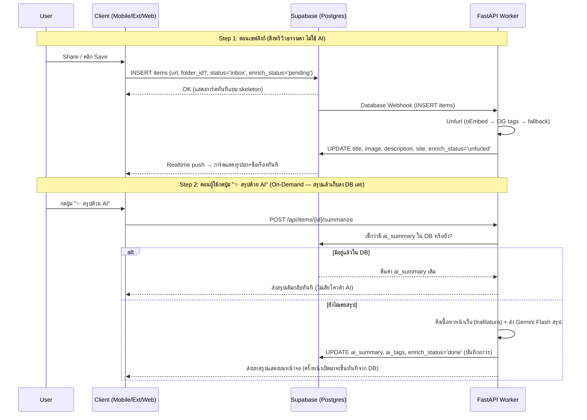
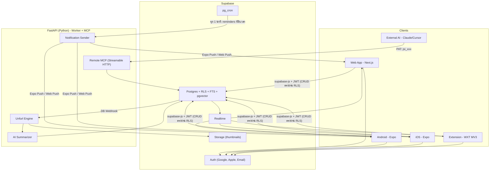

<!-- NOUS-SPEC: domain=save-for-later | purpose=product+engineering-spec | stack=nextjs-expo-wxt-supabase-fastapi | team=4 | timeline=4-weeks -->
# Just-Save-It — Product & Engineering Spec (v1.0)

> **One-liner:** เซฟอะไรก็ได้จากทุกแอปใน 2 แตะ → ระบบจัดให้ (AI สรุป + ติดแท็ก) → เตือนให้กลับมาดู → แชร์โฟลเดอร์ให้เพื่อนได้ → AI ภายนอกเข้ามาใช้คลังได้ผ่าน MCP
>
> **ทีม:** 4 คน | **กรอบเวลา MVP:** 4 สัปดาห์ | **แพลตฟอร์ม:** Web App · Android · iOS · Browser Extension
>
> เอกสารนี้ **แทนที่** ภาพรวมใน [TECH_STACK.md](./TECH_STACK.md) ในส่วนที่ขัดกัน (ดู §14)

---

## 1. ปัญหา (Pain Points)

| # | ปัญหา | สาเหตุย่อย | ฟีเจอร์ที่แก้ |
|---|---|---|---|
| P1 | เก็บของที่สนใจไว้ แต่ไม่กลับมาดู | **ลืม** | Reminder ตั้งเอง + Daily/Weekly Digest |
| | | **ขี้เกียจ** | AI สรุป 3 บรรทัด (ไม่ต้องเปิดอ่านเต็ม) + Focus Mode (ไล่ทีละอัน) + ติ๊กสถานะ |
| | | **ลำบาก — เก็บกระจายหลายแอป** | ที่เดียวรับจากทุกแอปผ่าน Share Sheet / Extension |
| | | **ลำบาก — เก็บในแชท (LINE Keep / ส่งหาตัวเอง) เสิร์ชไม่ได้ จัดไม่ได้** | Folder + Tag + Note + Full-text search |
| | | **ลำบาก — เปิดดูช้า** | Preview card (รูป/ชื่อ/สรุป) โหลดจาก cache, เปิดลิงก์ต้นทางใน 1 แตะ |
| P2 | หาข้อมูลกับเพื่อน (ทริป, ร้าน, งานกลุ่ม) แล้วเปิดดูกันลำบาก | ลิงก์จมในกลุ่มแชท | Shared Folder (เพิ่ม/ดู/ติ๊กได้ทุกคน, sync realtime) |

**ขอบเขตเนื้อหา:** ลิงก์ **โพสต์สาธารณะ** บนโซเชียลมีเดีย (TikTok, IG, FB, YouTube, X, Reddit, Pantip) + เว็บทั่วไป — **ไม่ดึงเนื้อหาที่ต้องล็อกอิน** (ToS/กฎหมาย)

**กลุ่มเป้าหมาย:** คนใช้อินเทอร์เน็ตทั่วไป — เริ่มเจาะ 3 persona:
1. **สายเซฟ (นักศึกษา/วัยทำงาน)** — เซฟคลิปสูตรอาหาร คาเฟ่ ทิปส์ แล้วไม่เคยกลับไปดู
2. **สายเที่ยวกับแก๊ง** — วางแผนทริปร่วมกัน ต้องรวมลิงก์ไว้ที่เดียว
3. **สาย AI/Power user** — อยากให้ Claude/Cursor/ChatGPT ค้นคลังของตัวเองได้

---

## 2. คู่แข่ง & จุดต่าง

| | **Sprink** | **Tuckii** | **Pocket** | **Just-Save-It** |
|---|---|---|---|---|
| แพลตฟอร์ม | iOS + Web (ไม่มี Android) | Android + iOS | ปิดบริการแล้ว (ก.ค. 2025) | **Web + Android + iOS + Extension** |
| Share Sheet | ✅ | ✅ | – | ✅ |
| AI จัดหมวด/แท็ก | ✅ | ❌ | – | ✅ + สรุปลง Note |
| Reminder | ✅ | ❌ (มี Focus Mode) | – | ✅ + Focus Mode |
| แชร์กับเพื่อน | แชร์รายชิ้น/กลุ่ม | ❌ | – | **Shared Folder แก้ไขร่วม realtime** |
| Sync หลายเครื่อง | ✅ | Pro (iCloud/Drive) | – | ✅ ฟรี |
| MCP / AI ภายนอก | ❌ | ❌ | – | **✅ (จุดขายเฉพาะ)** |
| ภาษาไทย | ❌ | ❌ | – | **✅ (UI + AI สรุปไทย)** |
| ราคา | $2.99/ด. หรือ $19.99/ปี | Free + Pro | – | Free + Pro (§9) |

**Positioning:** *"Sprink ที่ใช้ได้ทุกเครื่อง + แชร์กับแก๊งได้ + ให้ AI ใช้ได้ — ภาษาไทยตั้งแต่วันแรก"*

**ยืมไอเดียที่ดีจากคู่แข่ง:** Focus Mode (Tuckii), Import screenshot + "Turn saves into action" (Sprink), Export JSON (Tuckii — ข้อมูลเป็นของผู้ใช้)

---

## 3. Feature List (MoSCoW สำหรับ MVP 4 สัปดาห์)

### ✅ MUST (MVP — ต้องจบใน 4 สัปดาห์)
| ID | ฟีเจอร์ | รายละเอียด |
|---|---|---|
| F1 | **Quick Save** | วางลิงก์ / Share Sheet / Extension → บันทึกทันที (optimistic, < 1 วินาที) แล้วค่อย enrich เบื้องหลัง |
| F2 | **Link Preview (Unfurl — ไม่ใช้ AI)** | ดึงชื่อ รูป คำอธิบาย ชื่อเว็บ favicon ประเภท (video/article/post) ด้วย `oEmbed` / `OG tags` ล้วน (ฟรี 100%, ไม่เสียโควต้า AI) |
| F3 | **Folder** | สร้าง/ย้าย/ลบ, 1 item อยู่ 1 folder (หรือ Inbox) |
| F4 | **Tag** | หลายแท็กต่อ item, กรองตามแท็ก |
| F5 | **Note** | โน้ตส่วนตัวต่อ item (markdown ธรรมดา) |
| F6 | **Status** | `inbox` → `todo` → `done` / `archived` — ติ๊กได้จากทุกหน้าจอ |
| F7 | **Search** | Full-text (ชื่อ คำอธิบาย โน้ต สรุป URL แท็ก) — Postgres FTS + `pg_trgm` (รองรับไทยแบบ substring) |
| F8 | **Reminder** | ตั้งเวลาเองต่อ item (เช่น "คืนนี้ 2 ทุ่ม", "เสาร์นี้") → Push notification |
| F9 | **Shared Folder** | เชิญด้วยลิงก์/อีเมล, role `owner/editor/viewer`, ทุกคนเห็นของใหม่แบบ realtime |
| F10 | **On-Demand AI Summary (กดปุ่มสรุปแล้วเก็บถาวร)** | มีปุ่ม **"✨ สรุปด้วย AI"** บนการ์ด/หน้ารายละเอียด กดแล้ว AI สรุปเนื้อหาลง Database (`ai_summary` / `note`) + แนะนำแท็ก **สรุปครั้งเดียวเก็บตลอดไป** เปิดดูครั้งหน้าโหลดจาก DB ทันทีโดยไม่เรียก AI ซ้ำ |
| F11 | **Multi-device Sync** | บัญชีเดียว ข้อมูลเดียว ทุกแพลตฟอร์ม (Supabase Realtime) |
| F12 | **MCP Server (basic)** | `search_items`, `save_item`, `list_folders`, `get_item` ด้วย Personal Access Token |

### 🟡 SHOULD (ถ้าเหลือเวลา / สัปดาห์ 5–6)
- F13 Focus Mode — ไล่ inbox ทีละใบ (ปัดซ้าย=archive, ขวา=todo)
- F14 Daily Digest — "วันนี้มี 5 อันที่คุณเซฟไว้แต่ยังไม่ดู" (push/email)
- F15 Semantic Search (pgvector) — "ร้านกาแฟเปิดเช้าแถวอารีย์"
- F16 Export JSON / Import bookmarks HTML

### 🔵 COULD (Phase 2 — ต่อยอด)
- F17 **Pro tier / Payment** (จำกัดจำนวน Folder, AI credits)
- F18 **บันทึกรูปภาพ / Screenshot** (+ AI อ่านรูป OCR)
- F19 AI "Turn saves into action" — รวมโฟลเดอร์สูตรอาหาร → meal plan, ทริป → itinerary
- F20 Comment/Reaction ใน Shared Folder

### ❌ WON'T (ตอนนี้)
- ดึงเนื้อหาโพสต์ส่วนตัว/ต้องล็อกอิน, ดาวน์โหลดวิดีโอเก็บไว้ (ลิขสิทธิ์), Offline-first เต็มรูปแบบ

---

## 4. Platform Matrix — แต่ละแพลตฟอร์มทำอะไร

| ความสามารถ | Web App | Android | iOS | Extension |
|---|:-:|:-:|:-:|:-:|
| ช่องทางเซฟหลัก | วางลิงก์ / Bookmarklet / PWA Share Target | **Share Sheet** | **Share Sheet** | **1-click popup / คลิกขวา / Shortcut `Alt+S`** |
| ดู/ค้นหา/จัดการ Folder, Tag, Note | ✅ เต็ม | ✅ เต็ม | ✅ เต็ม | ดูรายการล่าสุด + ค้นหา |
| เปลี่ยน Status | ✅ | ✅ | ✅ | ✅ |
| ตั้ง Reminder | ✅ | ✅ | ✅ | ✅ (ตอนเซฟ) |
| รับแจ้งเตือน | Web Push | FCM (Expo Push) | APNs (Expo Push) | `chrome.notifications` |
| Shared Folder | ✅ จัดการสมาชิก | ✅ | ✅ | เลือกเป็นปลายทางตอนเซฟ |
| ตั้งค่า MCP Token | ✅ (หน้าเดียว) | – | – | – |
| บทบาทหลัก | **ศูนย์บัญชาการ** (จัดระเบียบ, ตั้งค่า, แชร์) | **เซฟไว + เตือน** | **เซฟไว + เตือน** | **เซฟไวตอนท่องเว็บบนคอม** |

**กฎ UX ร่วม:** เซฟต้องจบใน **≤ 2 แตะ** ทุกแพลตฟอร์ม — เลือก folder/tag เป็น *optional* (ค่า default = Inbox) ไม่บล็อกการเซฟ

---

## 5. User Flows หลัก

### 5.1 Save Flow (ดึงพรีวิวอัตโนมัติ — ไม่ใช้ AI) & On-Demand AI Summary Flow

- **Idempotent:** `UNIQUE (owner_id, url_hash)` → เซฟซ้ำ = ดึงอันเดิมขึ้นมาบน (update `saved_at`) ไม่สร้างซ้ำ
- **Retry:** worker ดึงพรีวิวล้มเหลว → `enrich_status='failed'` + `enrich_attempts`, cron retry สูงสุด 3 ครั้ง; การ์ดยังใช้งานได้ด้วย URL ล้วน
- **สรุปแล้วสรุปเลย (Summarize-Once Persistence):** ข้อมูลที่ AI สรุปจะถูกเซฟลงคอลัมน์ `ai_summary` (และ/หรือต่อท้ายลง `note`) ในฐานข้อมูลถาวร เมื่อผู้ใช้หรือเพื่อนใน Shared Folder เปิดดูในอนาคต แอปจะดึงข้อความสรุปจาก DB มาแสดงทันทีโดยไม่ต้องกดสรุปใหม่

### 5.2 กลับมาดู (แก้ "ลืม/ขี้เกียจ")
`เซฟ → (option) ตั้งเตือน → Push "ถึงเวลาดู: <ชื่อ>" → เปิดแอปที่การ์ด → กดปุ่มสรุป AI (หรืออ่านสรุปที่เคยกดไว้แล้ว) → ติ๊ก done / เลื่อนเตือน`

### 5.3 Shared Folder
`เจ้าของสร้าง folder → Share → ได้ invite link (token หมดอายุ 7 วัน) → เพื่อนเปิด → ล็อกอิน → เข้าเป็น editor → ใครเซฟลงก็เห็นทันที`

### 5.4 MCP
`Web → Settings → "Connect AI" → สร้าง token (โชว์ครั้งเดียว) → copy config ไปใส่ Claude Desktop/Cursor → AI ค้น/เซฟ/อ่านสรุปได้`

---

## 6. สถาปัตยกรรม



**หลักการ:**
1. **CRUD ทั้งหมดผ่าน `supabase-js` ตรง + RLS** — ไม่เขียน REST endpoint ซ้ำซ้อน (ลดงานทีม ~40%)
2. **FastAPI ทำเฉพาะงานที่ client ทำไม่ได้/ไม่ควรทำ:** unfurl (CORS + scraping), AI (ซ่อน API key), push, MCP
3. **FastAPI ใช้ `service_role` เสมอ ต้อง filter `owner_id`/สิทธิ์เองทุก query** — ห้ามรับ `user_id` จาก AI/MCP parameter (ดู §8)

### 6.1 Tech Stack (ล็อกแล้ว)
| ชั้น | เลือก | เหตุผล |
|---|---|---|
| Monorepo | **pnpm workspaces + Turborepo** | แชร์ types/zod/supabase client ทั้ง 3 client TS |
| Web | **Next.js 15 (App Router) + Tailwind + shadcn/ui + TanStack Query** | SSR หน้า invite/share preview, Vercel deploy ง่าย |
| Mobile | **Expo (SDK ล่าสุด) + Expo Router + NativeWind** | โค้ดเดียว Android+iOS; ต้องใช้ **Dev Build/EAS** (Share Extension ใช้ใน Expo Go ไม่ได้) |
| Share Sheet | **`expo-share-intent`** (MVP: เปิดแอปแล้วเซฟอัตโนมัติ) → อัปเกรดเป็น `expo-share-extension` (UI ในชีท) ทีหลัง | ลดความเสี่ยง iOS share-extension memory limit / App Group |
| Extension | **WXT + React** (MV3, build Chrome/Edge/Firefox จากโค้ดเดียว) | HMR, typed messaging |
| DB/Auth | **Supabase** (Postgres 15, RLS, Realtime, Storage, pg_cron, pgvector) | |
| Worker/AI/MCP | **FastAPI + Python 3.12 + `httpx` + `trafilatura` + `selectolax` + `mcp` SDK** | deploy: Railway / Fly.io / Cloud Run |
| AI | **Gemini Flash (stable ล่าสุด)** ผ่าน env `AI_MODEL`; fallback Groq | ถูก เร็ว ไทยดี; อย่า hardcode รุ่น (`gemini-1.5-flash` ใน TECH_STACK.md เลิกใช้แล้ว) |
| Embedding (SHOULD) | `gemini-embedding-001` (env `EMBED_MODEL`), `vector(768)` | |
| Push | **Expo Push Service** (FCM+APNs) + Web Push (VAPID) | |
| Monitoring | Sentry (ทุก client + FastAPI) | |

### 6.2 Auth ข้ามแพลตฟอร์ม
- **Providers:** Google + **Sign in with Apple (บังคับบน iOS ถ้ามี Google login — App Store Guideline 4.8)** + Email OTP
- **Web/Mobile:** Supabase session ปกติ (mobile เก็บใน `expo-secure-store`)
- **Extension:** ปุ่ม "Login" → เปิดแท็บ `web/extension/connect` → web ส่ง session ให้ extension ผ่าน `externally_connectable` + `chrome.runtime.sendMessage(EXT_ID, session)` → เก็บใน `chrome.storage.local`, refresh token เอง
- **MCP:** Personal Access Token (`jsi_live_xxx`) เก็บเป็น SHA-256 hash (pattern เดียวกับ `Nous/docs/plans/2026-11-12-unified-ai-platform-architecture.md` §4)

---

## 7. Database Schema (Supabase)

```sql
-- ===== Extensions =====
create extension if not exists pg_trgm;
create extension if not exists vector;   -- SHOULD: semantic search

-- ===== Enums =====
create type item_status   as enum ('inbox','todo','done','archived');
create type enrich_status as enum ('pending','unfurled','done','failed');
create type folder_role   as enum ('owner','editor','viewer');

-- ===== Profiles =====
create table public.profiles (
  id          uuid primary key references auth.users(id) on delete cascade,
  display_name text,
  avatar_url  text,
  tier        text not null default 'free' check (tier in ('free','pro')),
  locale      text not null default 'th',
  timezone    text not null default 'Asia/Bangkok',
  created_at  timestamptz not null default now()
);

-- ===== Folders & Members (Shared) =====
create table public.folders (
  id         uuid primary key default gen_random_uuid(),
  owner_id   uuid not null references public.profiles(id) on delete cascade,
  name       text not null check (char_length(name) between 1 and 80),
  emoji      text,
  is_shared  boolean not null default false,
  created_at timestamptz not null default now()
);

create table public.folder_members (
  folder_id  uuid references public.folders(id) on delete cascade,
  user_id    uuid references public.profiles(id) on delete cascade,
  role       folder_role not null default 'editor',
  joined_at  timestamptz not null default now(),
  primary key (folder_id, user_id)
);

create table public.folder_invites (
  token      text primary key default encode(gen_random_bytes(16),'hex'),
  folder_id  uuid not null references public.folders(id) on delete cascade,
  role       folder_role not null default 'editor' check (role <> 'owner'),
  created_by uuid not null references public.profiles(id),
  expires_at timestamptz not null default now() + interval '7 days'
);

-- ===== Items (ลิงก์ที่เซฟ) =====
create table public.items (
  id             uuid primary key default gen_random_uuid(),
  owner_id       uuid not null references public.profiles(id) on delete cascade,  -- คนเซฟ
  folder_id      uuid references public.folders(id) on delete set null,           -- null = Inbox
  url            text not null,
  url_hash       text generated always as (md5(lower(url))) stored,               -- ใช้ normalized url จาก client
  title          text,
  description    text,
  image_url      text,
  site_name      text,
  favicon_url    text,
  content_type   text,          -- 'video' | 'article' | 'post' | 'link'
  platform       text,          -- 'tiktok' | 'instagram' | 'youtube' | ...
  note           text,
  ai_summary     text,
  ai_tags        text[],        -- แท็กที่ AI แนะนำ (ยังไม่ยืนยัน)
  status         item_status   not null default 'inbox',
  enrich_status  enrich_status not null default 'pending',
  enrich_attempts int not null default 0,
  saved_at       timestamptz not null default now(),
  done_at        timestamptz,
  search_tsv     tsvector generated always as (
                   to_tsvector('simple',
                     coalesce(title,'')||' '||coalesce(description,'')||' '||
                     coalesce(note,'')||' '||coalesce(ai_summary,'')||' '||url)) stored,
  constraint uniq_owner_url unique (owner_id, url_hash)
);
create index items_owner_status_idx on public.items (owner_id, status, saved_at desc);
create index items_folder_idx       on public.items (folder_id, saved_at desc);
create index items_tsv_idx          on public.items using gin (search_tsv);
create index items_title_trgm_idx   on public.items using gin (title gin_trgm_ops);  -- ไทยไม่มีเว้นวรรค → ใช้ trigram

-- ===== Tags =====
create table public.tags (
  id       uuid primary key default gen_random_uuid(),
  owner_id uuid not null references public.profiles(id) on delete cascade,
  name     text not null,
  color    text,
  unique (owner_id, name)
);
create table public.item_tags (
  item_id uuid references public.items(id) on delete cascade,
  tag_id  uuid references public.tags(id)  on delete cascade,
  primary key (item_id, tag_id)
);

-- ===== Reminders =====
create table public.reminders (
  id         uuid primary key default gen_random_uuid(),
  item_id    uuid not null references public.items(id) on delete cascade,
  user_id    uuid not null references public.profiles(id) on delete cascade,
  remind_at  timestamptz not null,
  sent_at    timestamptz,
  created_at timestamptz not null default now()
);
create index reminders_due_idx on public.reminders (remind_at) where sent_at is null;

-- ===== Devices (push tokens) & API tokens =====
create table public.devices (
  id         uuid primary key default gen_random_uuid(),
  user_id    uuid not null references public.profiles(id) on delete cascade,
  platform   text not null check (platform in ('android','ios','web','extension')),
  push_token text not null unique,
  last_seen  timestamptz not null default now()
);
create table public.api_tokens (
  id           uuid primary key default gen_random_uuid(),
  user_id      uuid not null references public.profiles(id) on delete cascade,
  token_hash   text not null unique,
  token_prefix text not null,
  name         text not null,
  last_used_at timestamptz,
  revoked_at   timestamptz,
  created_at   timestamptz not null default now()
);
```

### 7.1 RLS (กันการ recursion ด้วย SECURITY DEFINER helper)
```sql
create or replace function public.can_access_folder(fid uuid, min_role folder_role default 'viewer')
returns boolean language sql security definer stable set search_path = public as $$
  select exists (
    select 1 from folders f where f.id = fid and f.owner_id = auth.uid()
  ) or exists (
    select 1 from folder_members m
    where m.folder_id = fid and m.user_id = auth.uid()
      and (min_role = 'viewer' or m.role in ('owner','editor'))
  );
$$;

alter table items enable row level security;
create policy items_select on items for select using (
  owner_id = auth.uid() or (folder_id is not null and can_access_folder(folder_id))
);
create policy items_insert on items for insert with check (
  owner_id = auth.uid() and (folder_id is null or can_access_folder(folder_id,'editor'))
);
create policy items_update on items for update using (
  owner_id = auth.uid() or (folder_id is not null and can_access_folder(folder_id,'editor'))
);
create policy items_delete on items for delete using (owner_id = auth.uid());
-- folders / folder_members / tags / reminders / devices / api_tokens: owner-only หรือผ่าน can_access_folder ในแบบเดียวกัน
-- การรับ invite ทำผ่าน RPC `accept_invite(token)` (security definer) เท่านั้น
```
> ⚠️ **ข้อตัดสินใจ:** `status` เป็นของ item ร่วม (ใน shared folder ใครติ๊ก done ทุกคนเห็น done) — เหมาะกับใช้วางแผนทริป ถ้าต้องการสถานะแยกรายคนค่อยเพิ่มตาราง `item_user_state` ใน Phase 2

---

## 8. Backend Services (FastAPI)

| Endpoint | เรียกโดย | หน้าที่ |
|---|---|---|
| `POST /hooks/item-created` | Supabase DB Webhook (มี shared secret header) | ดึงพรีวิว (Unfurl: ชื่อ, รูปปก, คำโปรย) อย่างเดียว **ไม่เรียก AI** |
| `POST /api/preview` | Client (ตอนพิมพ์ลิงก์ ก่อนกดเซฟ) | unfurl อย่างเดียว (rate-limit 30/นาที/user) |
| `POST /api/items/{id}/summarize` | Client (เมื่อผู้ใช้กดปุ่ม **"✨ สรุปด้วย AI"**) | เช็ก DB ก่อน ถ้ายังไม่มีสรุปจึงดึงเนื้อหา + เรียก Gemini สรุปแล้วบันทึกลง DB ถาวร (สรุปแล้วสรุปเลย) |
| `POST /cron/reminders` | pg_cron (ทุก 1 นาที) | ส่ง push ของ reminders ที่ `remind_at <= now() and sent_at is null` แล้ว mark `sent_at` (idempotent ด้วย `UPDATE ... RETURNING`) |
| `POST /cron/retry-enrich` | pg_cron (ทุก 10 นาที) | retry unfurl ที่ `failed` และ `enrich_attempts < 3` |
| `/mcp` | External AI | Remote MCP (Streamable HTTP transport) |

### 8.1 Unfurl Engine (ไม่ใช้ AI) — ลำดับความพยายาม
1. **oEmbed ทางการ:** YouTube, TikTok (`tiktok.com/oembed`), X (`publish.twitter.com/oembed`), Reddit, Vimeo, Spotify
2. **Instagram / Facebook:** Meta oEmbed ต้องมี **Meta App + access token** (สมัครสัปดาห์ 1!) → ถ้ายังไม่ได้ ใช้ OG tags ที่หน้า public ให้มา
3. **OG / Twitter Card meta** (`selectolax` เร็วกว่า bs4) ดึง `og:title`, `og:description`, `og:image`, `favicon`
4. **Fallback:** title = hostname, ให้ผู้ใช้แก้ชื่อ/ใส่โน้ตเอง
- ใส่ User-Agent ของแอป, timeout 8s, จำกัดขนาด response 3MB, **SSRF guard** (ห้าม resolve ไป private IP)
- Thumbnail: ดาวน์โหลดมาเก็บ Supabase Storage (ลิงก์รูปของ IG/TikTok หมดอายุเร็ว) → แก้ "เปิดดูช้า"

### 8.2 On-Demand AI Summarizer (`POST /api/items/{id}/summarize`)
- **ทำงานเฉพาะตอนผู้ใช้กดปุ่ม "✨ สรุปด้วย AI"** (ไม่รันอัตโนมัติตอนเซฟ ประหยัดโควต้า 70–80%)
- **ลำดับการทำงาน (Summarize-Once & Persist):**
  1. เช็กในตาราง `items` ก่อนว่ามีค่า `ai_summary` อยู่แล้วหรือไม่ (หรือมีลิงก์ `url_hash` เดียวกันที่เคยสรุปไว้แล้วหรือไม่ ถ้าไม่ส่ง `force=true`) → ถ้ามีแล้ว คืนค่าจาก DB ทันทีโดยไม่เสียโควต้า AI
  2. ถ้ายังไม่มี → ใช้ `trafilatura` ดึงเนื้อหาหลักของหน้าเว็บ (ตัดขยะ HTML ทิ้ง, จำกัด ≤ 6,000 ตัวอักษร) + รวมกับ `title` และ `description`
  3. ส่งให้ **Gemini Flash** (fallback: Groq) สรุปเป็น JSON `{summary_th: string (≤3 บรรทัด), tags: string[≤5], content_type}` ตรวจด้วย Pydantic
  4. แท็กที่แนะนำจะจับคู่กับแท็กเดิมของผู้ใช้ก่อน (ส่งรายชื่อแท็กเดิมแนบไปใน prompt) เพื่อไม่ให้แท็กเฟ้อ
  5. **`UPDATE` บันทึก `ai_summary` (และ/หรือบันทึกลงช่อง `note`) ลง Supabase ถาวร** → ครั้งต่อไปที่เปิดเข้ามาจะแสดงผลจาก DB ทันที
- โควต้า Free: กดสรุปได้ 50 ครั้ง/เดือน (นับเฉพาะครั้งที่เรียก AI จริง ไม่นับการเปิดอ่านซ้ำ)

### 8.3 MCP Tools (Full-Featured — ทำได้ครบทุกฟังก์ชันของแอป, tenant-isolated)
| หมวด | Tool | Params | หน้าที่ |
|---|---|---|---|
| **บันทึก (Items)** | `search_and_list_items` | `query?, folder_id?, tag_name?, status?, limit=20` | ดู/ค้นหาลิงก์จากคำค้น โฟลเดอร์ แท็ก หรือสถานะ |
| | `get_item_detail` | `item_id` | ดูรายละเอียดลิงก์ + โน้ต + บทสรุป AI + แท็ก + เวลาเตือน |
| | `create_item` | `url, title?, note?, folder_id?, tags?, status='inbox'` | เพิ่มบันทึก/ลิงก์ใหม่พร้อมโน้ต โฟลเดอร์ และแท็ก |
| | `update_item` | `item_id, title?, note?, folder_id?, status?` | แก้ไขชื่อ/โน้ต, ย้ายโฟลเดอร์, ติ๊กสถานะ (`inbox`/`todo`/`done`/`archived`) |
| | `delete_item` | `item_id` | ลบบันทึก |
| | `summarize_item_to_note` | `item_id, force_refresh=false` | สั่ง AI สรุปเนื้อหาลิงก์เก็บลง DB ถาวร |
| **แท็ก (Tags)** | `list_tags` | – | ดูแท็กทั้งหมดของผู้ใช้ |
| | `manage_item_tags` | `item_id, add_tags?, remove_tags?` | ติดแท็กเพิ่ม หรือเอาแท็กออกจากบันทึก |
| | `rename_or_delete_tag` | `tag_name, new_name?, delete=false` | เปลี่ยนชื่อหรือลบแท็ก |
| **โฟลเดอร์ & แชร์** | `list_folders` | – | ดูโฟลเดอร์ส่วนตัวและโฟลเดอร์ที่แชร์กับเพื่อน |
| | `manage_folder` | `action ('create'\|'rename'\|'delete'), name?, folder_id?, emoji?` | สร้าง/เปลี่ยนชื่อ/ลบโฟลเดอร์ |
| | `share_folder_link` | `folder_id, role ('viewer'\|'editor'), expires_in_days=7, revoke_all=false` | **กดสร้างลิงก์แชร์โฟลเดอร์ให้เพื่อนเข้ามาดูหรือร่วมเพิ่ม/แก้ไขบันทึกได้** |
| **แจ้งเตือน** | `set_or_cancel_reminder` | `item_id, remind_at_iso?, cancel=false` | ตั้งหรือยกเลิกเวลาแจ้งเตือน |

**Invariant:** `user_id` มาจาก token เท่านั้น ทุก query ผ่าน helper ที่ใส่เงื่อนไขสิทธิ์เดียวกับ RLS

---

## 9. Monetization (Phase 2 — ออกแบบ schema รองรับไว้แล้ว)

| | Free | Pro (~59–79 ฿/เดือน, ~590 ฿/ปี) |
|---|---|---|
| Items | ไม่จำกัด | ไม่จำกัด |
| Folders | 10 | ไม่จำกัด |
| Shared folders | 2 (สมาชิก ≤ 5) | ไม่จำกัด (สมาชิก ≤ 50) |
| AI สรุป | 50/เดือน | 1,000/เดือน + "Turn into action" |
| บันทึกรูป/Screenshot | – | ✅ (5 GB) |
| MCP | read-only | read + write |

> ⚠️ **กฎ Store:** ขาย subscription ดิจิทัลในแอป iOS/Android ต้องใช้ **IAP** (แนะนำ RevenueCat ดูแลทั้ง 2 store + web Stripe) — benchmark: Sprink $2.99/ด.

---

## 10. Non-Functional Requirements

| ด้าน | เป้า |
|---|---|
| ความเร็วเซฟ | แตะ Share → เห็นการ์ดใน **< 1s** (optimistic) |
| Enrich | unfurl p95 < 5s, AI สรุป p95 < 10s |
| เปิดแอป → เห็นรายการ | < 1.5s (cache TanStack Query + persist) |
| Offline | Mobile/Ext: queue การเซฟไว้ใน local storage แล้ว flush เมื่อออนไลน์ |
| ความปลอดภัย | RLS ทุกตาราง, service_role อยู่แค่ FastAPI, SSRF guard, rate-limit, token hash |
| Privacy | PDPA: Privacy Policy + ลบบัญชีได้ในแอป (**บังคับโดย App Store/Play**), Export JSON |
| Accessibility | ฟอนต์ไทย (IBM Plex Sans Thai / Noto Sans Thai), contrast AA, dark mode |

---

## 11. Repo Layout (Monorepo)

```text
Just-Save-It-/
├── apps/
│   ├── web/            # Next.js — คนที่ 2
│   ├── mobile/         # Expo (Android + iOS) — คนที่ 3
│   └── extension/      # WXT — คนที่ 4
├── packages/
│   ├── shared/         # types (gen จาก Supabase), zod schemas, url-normalize, constants
│   ├── supabase/       # typed client factory + query hooks (TanStack) ใช้ร่วม web/mobile/ext
│   └── ui-tokens/      # สี ฟอนต์ spacing (Tailwind/NativeWind preset)
├── services/
│   └── api/            # FastAPI: unfurl, ai, notify, mcp — คนที่ 1
├── supabase/
│   ├── migrations/     # SQL ทั้งหมดใน §7 (version control!)
│   └── seed.sql
├── design/             # wireframe เดิม (frontend/index.html ย้ายมา)
├── PRODUCT_SPEC.md     # เอกสารนี้
└── TECH_STACK.md
```

---

## 12. แผน 4 สัปดาห์ × 4 คน

| บทบาท | คนที่ 1 — **Backend/AI** | คนที่ 2 — **Web** | คนที่ 3 — **Mobile** | คนที่ 4 — **Extension + Shared + QA** |
|---|---|---|---|---|
| **W1 — Foundation** | Supabase project, migrations §7 + RLS, FastAPI skeleton + deploy, **สมัคร Meta App** | Next.js + Auth (Google/Email) + layout, หน้า Inbox (list) | Expo dev build บน Android + iOS, Auth (Google + **Apple**), **Apple Developer account** | Monorepo (pnpm/turbo), `packages/shared` + gen types, url-normalize, design tokens |
| **W2 — Save loop** | Webhook → unfurl (oEmbed/OG) → update; thumbnail → Storage | Paste-to-save, การ์ด preview, Folder CRUD, Tag, Note, Status | **Share intent → save**, list + การ์ด, status | WXT popup 1-click save, context menu, auth via web connect |
| **W3 — Retrieve & Share** | AI summary + auto-tag, reminders cron + Expo/Web push | Search (FTS+trgm), filter, Shared folder + invite page, Realtime | Folder/Tag/Note, search, reminder picker, push registration | Ext: เลือก folder/tag/reminder ตอนเซฟ, รายการล่าสุด; เขียน E2E (Playwright) web |
| **W4 — MCP, Polish, Ship** | MCP server + PAT UI API, rate-limit, Sentry | Settings (token MCP, ลบบัญชี, export), PWA share target, deploy Vercel | Polish, offline queue, **TestFlight + Play Internal Testing** | Publish Chrome Web Store (unlisted), QA matrix ทุกแพลตฟอร์ม, bug bash |

**Milestone demo ทุกวันศุกร์** — DoD ของแต่ละ ticket: ทำงานได้บนแพลตฟอร์มจริง + มี test (pytest สำหรับ API, vitest สำหรับ shared, Playwright 1 flow หลักบน web) + ไม่ทำ RLS พัง

### 12.1 Critical Path / สิ่งที่ต้องเริ่ม **วันแรก** (มี lead time)
1. **Apple Developer Program** ($99/ปี, อนุมัติ 1–2 วัน+) — ไม่มี = ไม่มี iOS build/TestFlight
2. **Google Play Console** ($25, ยืนยันตัวตน; บัญชีส่วนตัวใหม่ต้องมี closed testing ≥ 12 คน 14 วันก่อนขึ้น production)
3. **Chrome Web Store developer** ($5, review 1–3 วัน)
4. **Meta App** สำหรับ IG/FB oEmbed (review อาจนาน → มี OG fallback)
5. Gemini API key + Supabase project (region Singapore)

### 12.2 Definition of Done ของ MVP
- [ ] เซฟลิงก์ TikTok/IG/YouTube/เว็บ จาก **ทั้ง 4 แพลตฟอร์ม** แล้วเห็นในอีก 3 แพลตฟอร์มภายใน 2 วินาที
- [ ] การ์ดมีรูป + ชื่อ + สรุป AI ภาษาไทย
- [ ] สร้าง folder/tag/note/status/search ได้ทุก client หลัก
- [ ] ตั้งเตือนแล้วได้ push จริงบน Android + iOS
- [ ] เพื่อน 2 คนใช้ shared folder ร่วมกันได้ realtime
- [ ] Claude Desktop ค้น + เซฟผ่าน MCP ได้
- [ ] ผ่าน RLS test: user B อ่าน item ส่วนตัวของ user A ไม่ได้

---

## 13. ความเสี่ยง & ทางรับมือ

| ความเสี่ยง | โอกาส | ผลกระทบ | ทางรับมือ |
|---|---|---|---|
| 4 แพลตฟอร์มใน 4 สัปดาห์ = แน่นมาก | สูง | สูง | ตัด SHOULD ทิ้งก่อนเสมอ; shared package ลดงานซ้ำ; Extension ทำ scope เล็ก |
| iOS Share Extension ใน Expo ยุ่ง (App Group, memory) | กลาง | สูง | MVP ใช้ `expo-share-intent` (เปิดแอปหลัก) ก่อน |
| IG/FB ไม่ให้ preview | สูง | กลาง | OG fallback + ผู้ใช้แก้ชื่อ/โน้ต; รอ Meta App |
| RLS ผิด → ข้อมูลรั่ว | กลาง | วิกฤต | pgTAP/pytest RLS tests ใน CI, helper `can_access_folder` ที่เดียว |
| ค่า AI บาน | ต่ำ | กลาง | โควต้า, cache สรุปตาม `url_hash` ข้าม user (ลิงก์ public เดียวกัน) |
| Store review ช้า/โดน reject | กลาง | กลาง | ส่ง TestFlight/Internal testing ตั้งแต่ W3; มี Privacy Policy + ลบบัญชี + Sign in with Apple |
| ค้นหาภาษาไทยไม่แม่น (ไม่มีเว้นวรรค) | สูง | กลาง | `pg_trgm` + ILIKE; SHOULD: semantic search |

---

## 14. สิ่งที่เปลี่ยนจาก TECH_STACK.md เดิม

| เดิม | ใหม่ | เหตุผล |
|---|---|---|
| Mobile = PWA / APK | **Expo native Android + iOS** | ต้องมี Share Sheet จริง (หัวใจของการเซฟไว) |
| FastAPI ทำ CRUD ทั้งหมด (`/api/links/*`) | **Client → Supabase ตรง + RLS**, FastAPI เฉพาะ unfurl/AI/push/MCP | ทีม 4 คน 4 สัปดาห์ ลดงาน API |
| `folders.members` เป็น column | ตาราง **`folder_members` + `folder_invites`** + roles | รองรับ shared folder จริงและ RLS ได้ |
| `links.is_read` boolean | **`status` enum** (inbox/todo/done/archived) | ตรงกับ "ติดตามสถานะ / ติ๊กสถานะ" |
| Gemini 1.5 Flash / text-embedding-004 | **ตั้งผ่าน env, ใช้รุ่น stable ล่าสุด** | รุ่นเดิมเลิกให้บริการ |
| Extension vanilla JS | **WXT + React** | แชร์โค้ด/type กับ web |
| MCP stdio/SSE | **Remote MCP (Streamable HTTP) + PAT** | ใช้จาก Claude/Cursor ได้โดยไม่ต้องติดตั้งอะไร |

---

## 15. Open Decisions (ต้องตัดสินใน W1)
1. ชื่อแบรนด์ทางการ + โดเมน (Just-Save-It / อื่น) — กระทบ bundle ID (`com.justsaveit.app`) ซึ่งเปลี่ยนทีหลังยาก
2. Status ใน shared folder: ร่วม (default ในสเปกนี้) หรือรายคน
3. Hosting FastAPI: Railway (ง่าย) vs Cloud Run (scale-to-zero ถูก)
4. จะเปิด Pro/payment ตอนไหน (แนะนำ: หลังมีผู้ใช้จริง ≥ 200 คน)
