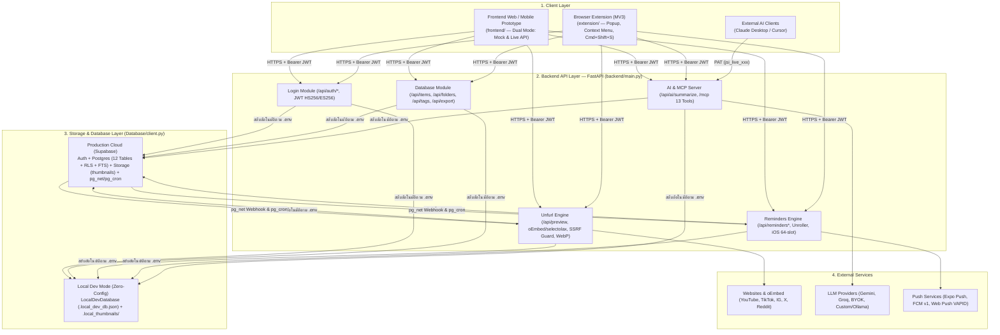

# Tech Stack & Architecture Overview — Link Saver (Just-Save-It-)

> **Project Concept:** ระบบเซฟลิงก์และข้อความอัจฉริยะ (Save for later) รองรับการใช้งานข้ามแพลตฟอร์ม (Web App, Browser Extension, Mobile PWA) ใช้ฐานข้อมูลร่วมกัน มีระบบดึงรูป/วิดีโอพรีวิว (Link Unfurling), AI สรุปเนื้อหาอัตโนมัติ และรองรับการเชื่อมต่อกับ AI ภายนอกผ่าน MCP (Model Context Protocol)

---

## 1. ภาพรวมสถาปัตยกรรมทั้งระบบ (System Architecture & Data Flow)



**Data Flow หลักของระบบ (ตามโค้ดปัจจุบัน):**
1. **Save & Unfurl Flow:** Client ส่งลิงก์เข้า `POST /api/items` → Canonicalize URL + สร้าง `url_hash` กันซ้ำ → รัน `Unfurl` ผ่าน BackgroundTask (Local) หรือ `pg_net` Webhook (Cloud) ดึง OG/oEmbed (≤5 รูป), บีบอัดปก #1 เป็น WebP, และตรวจสอบ `embed_url` ด้วย Allowlist
2. **Auth & RLS Flow:** ล็อกอินรับ Bearer JWT → `auth_dep.py` ตรวจสิทธิ์ (HS256 / Supabase `get_user`) → Postgres บังคับสิทธิ์ระดับแถวด้วย RLS (`owner_id` / `private.can_access_folder()`)
3. **Reminders Flow:** ตั้งเตือนผ่าน `PUT /api/reminders/{item_id}` → `pg_cron` เรียก `POST /cron/reminders` ทุก 1 นาทีส่ง Push (Expo/FCM/VAPID) หรือ iOS ซิงค์ผ่าน `GET /api/reminders/local-sync` (≤ 64 slots)
4. **AI & MCP Flow:** `POST /api/ai/summarize` ตรวจ DB cache ก่อน → สกัดข้อความด้วย `trafilatura` → สรุปผ่าน Gemini/Groq/BYOK/Custom + นับโควตา | ส่วน External AI เรียก `/mcp` ผ่าน PAT (`jsi_live_xxx`)

---

## 2. รายละเอียด Tech Stack แต่ละส่วน (Component Breakdown)

### 🎨 2.1 ฝั่งหน้าบ้าน (Frontend Web & Mobile)
- **Framework:** **Next.js (App Router)** หรือ **React (Vite)** + **TypeScript**
- **Styling:** **Tailwind CSS** (Mobile-first Responsive ออกแบบตามสเปก Android 390×844 px)
- **State Management & Data Fetching:** **TanStack Query (React Query)** (จัดการแคชข้อมูล API ไม่ต้อง fetch ซ้ำ)
- **Icons:** **Lucide Icons** / Inline SVG สะอาดตา
- **UI Wireframe Baseline:** ต้นแบบ Figma 1:1 อยู่ที่ `frontend/index.html` (ครอบคลุมทั้ง 6 หน้าจอหลัก)

### 🧩 2.2 ส่วนขยายเบราว์เซอร์ (Browser Extension)
- **Platform:** **Chrome / Edge Extension (Manifest V3)**
- **Popup UI:** หน้าต่างจิ๋วสำหรับกด 1-Click Save จากหน้าเว็บที่กำลังเปิดอยู่
- **Context Menu:** คลิกขวาที่ข้อความ -> เลือก *"Save Highlight to Just-Save-It"*
- **Authentication:** ดึง JWT Token จาก Web App หรือหน้า Login ครั้งเดียวแล้วบันทึกใน `chrome.storage.local`

### ⚙️ 2.3 ฝั่งหลังบ้าน (Backend API)
- **Framework:** **FastAPI (Python 3.11+)**
- **ASGI Server:** **Uvicorn**
- **Data Validation & Serialization:** **Pydantic v2**
- **API Documentation:** มี **Swagger UI (`/docs`)** และ **ReDoc (`/redoc`)** ในตัวอัตโนมัติ

### 🔍 2.4 ระบบดึงรูปภาพและเนื้อหาพรีวิว (Link Unfurling Engine)
- **General Web Articles / Blogs:**
  - `trafilatura` หรือ `newspaper3k`: สกัดเฉพาะเนื้อหาบทความหลัก ตัดแถบเมนู โฆษณา และขยะ HTML ทิ้ง
  - `beautifulsoup4` + `httpx`: ดึง Meta Tags มาตรฐานโลก:
    - `og:title`, `<title>`
    - `og:image`, `twitter:image`
    - `og:description`
    - `og:site_name`, `favicon.ico`
- **Social & Video Platforms (YouTube, TikTok, Twitter/X):**
  - **oEmbed API:** ดึงข้อมูลทางการผ่าน oEmbed ของผู้ให้บริการโดยตรง เช่น `https://www.youtube.com/oembed?url=...`
  - `yt-dlp` (Python): ใช้เป็น Fallback เมื่อต้องการดึงความยาวคลิป หรือ Thumbnail คุณภาพสูงสุด

### 🤖 2.5 ระบบ AI และ MCP (Model Context Protocol)
- **In-App AI Summarization:**
  - **Model:** **Google Gemini 1.5 Flash** (เร็ว ประหยัดโทเค็น และเข้าใจภาษาไทยได้ดีเยี่ยม)
  - **ฟังก์ชัน:** สรุปใจความสำคัญของลิงก์ใน 3 บรรทัด + แนะนำแท็กหมวดหมู่อัตโนมัติ (Auto-tagging)
- **Semantic Search (ค้นหาด้วยความหมาย):**
  - **Embedding Model:** `text-embedding-004` (Gemini)
  - เก็บ Vector ใน `pgvector` บน Supabase -> ผู้ใช้พิมพ์ค้นหาด้วยภาษาธรรมชาติ เช่น *"บทความร้านกาแฟแถวสะพานควายที่เปิดเช้า"* แล้ว AI จะค้นเจอแม้ไม่ได้พิมพ์ชื่อร้านตรงๆ
- **External AI Integration (MCP Server):**
  - พัฒนาด้วย **Anthropic Python MCP SDK (`mcp`)**
  - เปิด Tools ให้ AI ภายนอก (Claude Desktop, Antigravity, Cursor) สั่งงานได้:
    - `search_my_links(query: str)`: ค้นหาลิงก์ที่เคยเซฟไว้
    - `save_link(url: str, tags: list, folder: str)`: สั่งให้ AI เซฟลิงก์ให้ผ่านแชต
    - `get_link_summary(link_id: int)`: ดึงบทสรุปของลิงก์ที่เคยบันทึก

### 🗄️ 2.6 ระบบฐานข้อมูลและการยืนยันตัวตน (Database & Auth)
- **Provider:** **Supabase (Managed PostgreSQL)**
- **โครงสร้างตารางหลัก (Database Schema):**
  - `users`: ข้อมูลสมาชิก (`id`, `email`, `created_at`)
  - `folders`: โฟลเดอร์จัดหมวดหมู่ (`id`, `user_id`, `name`, `is_shared`, `members`)
  - `links`: ลิงก์ที่เซฟ (`id`, `user_id`, `folder_id`, `url`, `title`, `description`, `image_url`, `is_read`, `created_at`)
  - `tags`: แท็ก (`id`, `user_id`, `name`)
  - `link_tags`: ตารางความสัมพันธ์ N:M ระหว่างลิงก์กับแท็ก
  - `reminders`: กำหนดเวลาเตือน (`id`, `link_id`, `remind_at`, `status`)
  - `link_embeddings`: ตารางเก็บ Vector ของเนื้อหาสำหรับ AI Search

---

## 3. สรุปข้อตกลง API Contract ตัวอย่าง (Key REST Endpoints)

| Method | Endpoint | หน้าที่ | Payload ตัวอย่าง |
| :--- | :--- | :--- | :--- |
| `POST` | `/api/preview` | ดึงข้อมูลรูปภาพและชื่อเรื่องจาก URL | `{ "url": "https://..." }` |
| `GET` | `/api/links` | ดึงรายการลิงก์ทั้งหมด (มี Filter) | Query: `?folder_id=1&filter=unread` |
| `POST` | `/api/links` | บันทึกลิงก์ใหม่เข้าคลัง | `{ "url": "...", "title": "...", "folder_id": 1, "tags": ["คาเฟ่"] }` |
| `POST` | `/api/ai/summarize` | สั่งให้ AI อ่านและสรุปเนื้อหา | `{ "link_id": 101 }` |
| `POST` | `/api/reminders` | ตั้งเวลาแจ้งเตือน | `{ "link_id": 101, "remind_at": "2026-11-13T18:00:00Z" }` |
| `GET` | `/api/folders` | ดึงรายชื่อโฟลเดอร์ทั้งหมด | - |

---

## 4. โครงสร้างโฟลเดอร์ใน Git Repo (Monorepo Layout)

```text
Just-Save-It-/
├── .gitignore
├── README.md
├── TECH_STACK.md                  # เอกสารฉบับนี้
│
├── frontend/                      # [ทีม UI]
│   ├── index.html                 # หน้าจอ Figma 1:1 Prototype
│   ├── src/                       # โค้ด Next.js / React (เมื่อเริ่มขึ้นโปรเจกต์)
│   └── package.json
│
├── extension/                     # [ส่วนเสริม Browser]
│   ├── manifest.json              # Chrome Manifest V3
│   ├── popup.html / popup.js      # หน้าต่างกดบันทึกด่วน
│   └── background.js              # จัดการ Context Menu & Sync Token
│
└── backend/                       # [ทีมระบบ & AI]
    ├── main.py                    # FastAPI Entrypoint
    ├── requirements.txt           # fastapi, trafilatura, google-genai, mcp, supabase
    ├── Ai/                        # โค้ด Gemini API, Embeddings, และ MCP Server
    ├── Login/                     # โค้ด Auth & Middleware ตรวจสอบ JWT
    └── Database/                  # สคริปต์เชื่อมต่อ Supabase & Database Models
```
